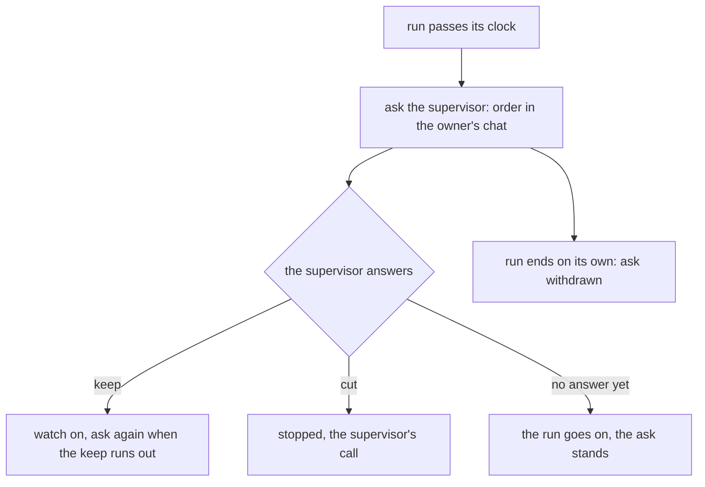
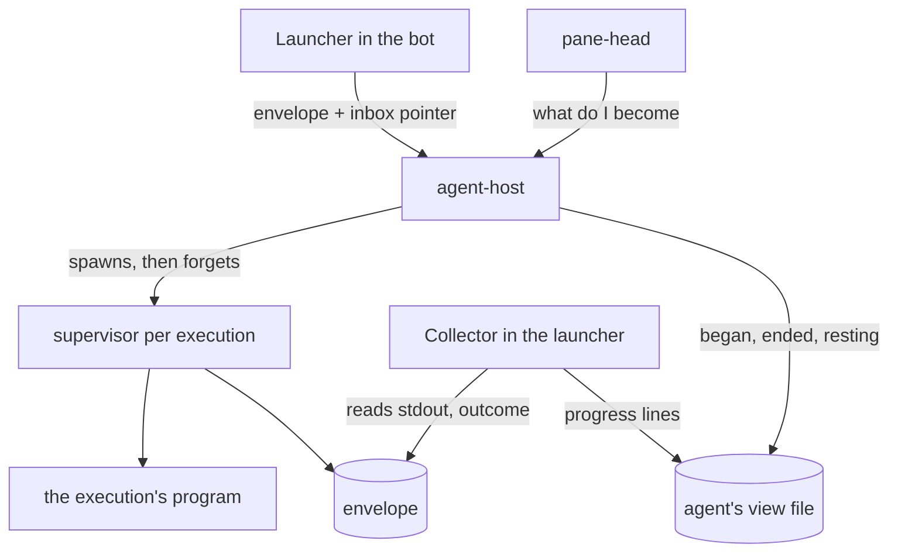

# Putting words into a running agent

Agency's agents run in panes under herdr. This document says what that channel is, and what works and
what does not. Everything here was actually run on the operations machine.


## Execution transport contract

The owner's words for the scope are:

> So from now on, no more starting agents from the command line or using agents over HTTP: everything goes through herdr, on the harnesses!

> Yes, literally everything. The harness is an adapter, so that can't be helped, but the path by which the bot controls an agent is herdr.

### Ownership and scope

- **Every model invocation runs through herdr, for every provider.** That is every supervisor's turns,
  its compaction and its keepalive, and every run of a role — a job's turn, a worker ask, a
  repository-managed co-work branch, a search and a browse — with their fallback attempts and
  their compaction.
- **There is one launch path, and nothing branches on the line.** No line, provider or caller
  keeps a process of its own beside it, and none calls a model over HTTP from the bot.
  - The harness adapters stay what they are: a harness is how a program is spoken to, and a
    bridge or a tap that a harness needs runs where the harness asks for it.
- **Ownership and placement are separate questions.**
  - A supervisor's turn stays the bot's own run: the bot waits for it, reads its answer, and a bot
    that stops has it stopped.
  - Where its process runs is the supervisor's pane, as a role's run stands in a pane of its own.
- **Not model invocations.** Utility commands, model discovery and service supervision need no
  agent pane of their own.
- **The `supervisors` and `roles` tables are authoritative** for names (`docs/agents.md`, 「Two
  axes」): a supervisor stands in a standing workspace under its name, and a run of a role in a
  workspace opened for the run. A name a run is launched under that has no row still gets a workspace
  of its own under that name. No roster is kept in the code: a row is written by whoever registers it —
  a supervisor from the seed its deployment hands in, a role the owner adds — and what each is called on
  a screen is the console's own wording.

### A pane carries the real execution

A resident agent's pane runs its provider's interactive program, and its turns are read from the
records that program writes — transcript, hooks, status line, rollout — never from the screen
(「What a resident turn reads」). A host agent's pane runs a supervisor which starts the actual
harness as its owned child, shows the execution on its terminal, and captures exact stdout/stderr
separately for the harness reader; its headless commands keep their argv, tools, permissions,
effort, prompt construction and session policy. A pane that only tails an unrelated systemd
process is not execution through herdr. Codex retains its thread ids; a dsh session stands inside
the pane program that keeps it. Do not parse terminal rendering as the answer or infer success from
the disappearance of a pane.

Use a private per-attempt directory (0700, files 0600) for the command envelope, input, raw
outputs and atomically published outcome. Only its opaque path travels to the agent's pane. Do not
put prompts, credentials or complete environments in labels or metadata.
Drain stdout and stderr concurrently; preserve byte boundaries through incremental decoding.
Display provider/model, lifecycle and readable progress without corrupting raw result data.
Existing harness readers remain responsible for reply, usage and session interpretation.

### One standing pane per supervisor

The owner's words:

> For example, if it is a Claude Code session, just show the screen with Claude Code running. Always make it possible to give it instructions directly there too; I asked for this so I can also see what it is doing and what it is thinking.

> Stand every agent provider up interactively. A request with no tools to a registered model can't be, so leave it as the exception. It is abstracted anyway, so it is the same interface.

- **Every supervisor has one pane that stays.** It is the head pane of the supervisor's standing
  workspace (「What goes where」). It does not come and go with the work, and the workspace holds
  nothing else of the supervisor's: no shell tab, no drawn status beside it, no pane opened for one turn.
- **Every run of a role has a pane of its own,** opened for the run in a workspace of its own and closed
  with it (`docs/agents.md`, 「A run in a pane of its own」). Nothing of a role stands between its runs —
  no head, no program, no place — so the heads, the places and the standing pass below are a
  supervisor's alone.
- **What stands in a supervisor's pane is one of two things.**
  - **A resident supervisor's pane is its program.** The provider's own interactive program — Claude
    Code's screen, Codex's screen — stands in the pane between turns and during them. A person
    attached to herdr reads the tool calls and the thinking as the program draws them, and can type
    into it at any time. Every turn of that supervisor, keepalive and fold included, goes into that one
    program.
  - **A host agent's pane shows its host's view** of the agent: each structured execution the agent
    host runs for it, as it begins, streams and ends (「The host」 below). No process of the agent's
    own stands in the pane.
- **The launcher says what the program is, the agent host decides, and the head becomes what it is
  told.** Only the line knows the agent's command — its model, its prompt file, its session — so the
  launcher writes the program into the agent's place before a turn: the command to start it on, the
  command to start it again on, which resumes the session the first one opened, the record whose
  existence says that session is open, its identity, and the files it needs — every word of either
  command that is the absolute path of a file standing as the program is written.
  - **The head is `pane-head`,** a Rust program of a few megabytes. Each time the pane's loop starts it,
    it asks the agent host of its data root what this pane is to become, handing the agent's name, its
    pane and its own process.
  - **The agent host answers from the place.** Where a program is written and no live head holds it,
    it records the start — the identity, the head's own process, which the program will be, and how
    many times that identity has been started — records the pane as holding the program, and answers
    the command, the environment, the directory and the wait the restart bound asks. That record is
    what the launcher reads to know the program is up.
  - **The head waits the wait, lays the pane's terminal variables over the environment, and replaces
    itself with the program** (`exec`). Nothing of ours stays in the pane beside the program: the
    program is the pane's process, and the loop is its parent.
  - **Where no program is written, or a live head already holds it,** the agent host answers the view:
    the head replaces itself with a follower of the agent's view file, which the host writes
    (「The host」).
  - **A program whose files are gone is not started.** The agent host starts a program only while every
    file it needs is there. With one gone — a configuration taken from under it, a file a node's link has
    not brought yet — every head is answered the view, the place does not read as unheld, so no view
    gives way to it, and nothing of the program starts: no loop, and no cost to the machine. Once the
    program has stood written for thirty seconds with a file still gone, the place records a failed start
    naming the file, which the turn waiting on it reads, once per program and reason. The program starts
    by itself once the file is back — a turn writing its configuration again, the link bringing it — as
    the view then gives way.
  - **A program could not be started** — the executable is not on the path — and the head tells the
    agent host why before it ends, which records it in the place as a failed start the turn waiting on
    it reads; the try counts as a start, so the restart bound holds a program that cannot come up.
  - **An agent host that does not answer** leaves the head saying so on the pane and ending; the loop
    asks again a second later.
  - **One program per place.** A second head in the same workspace that finds the program already held
    by a live head is answered the view instead of a second copy.
  - **A head opened for a host lets go.** A head started with the host-head variable — a pane a bun
    launcher opened for a host beside the program — never races the program's own loop: it is answered
    the program only once nothing has held it for ten seconds, the view while no program is written,
    and, where a live head holds the program, told to let go, so the leftover pane ends.
  - **A view gives way to the program.** When a program is written into a place no live head holds, the
    agent host ends the follower in the agent's head pane, and the loop starts the head again, which is
    answered the program. It waits three seconds of the program standing unheld first — longer than a
    program's own loop takes to start it again — and ten for a head opened for a host.
  - **Where the answers are recorded.** Each head pane's record stands under the host's `heads/`, one
    directory per agent, one file per pane: the process, the birth, and whether it holds the program or
    the view.
  - **The prompt goes to the pane holding the program.** The agent host records the pane beside the
    program it started, and a turn puts its words there rather than into whichever head the workspace
    lists first.
  - **A head record of a process that is gone stands for nothing.** Each record carries the process and
    its birth, which after `exec` are the program's, so a record whose program has ended is read as
    absent and dropped at the next answer; nothing has to remove it.
  - **The head installs no signal handler.** Before its `exec` a signal that ends it — while it asks
    or while it waits out the restart bound — is an end like any other: the loop asks again a second
    later, and the start the host recorded names the head's own process, now gone, so it reads as
    absent. After its `exec` the program is the pane's process, so a person's Ctrl-C and the
    launcher's SIGTERM reach the program itself, with nothing between. The loop ignores no signal, so
    the program inherits none ignored.
  - **A session is resumed only once it exists.** A program that opens a session under a name it chose
    writes nothing of it until its first prompt: Claude Code started on `--session-id` and given nothing
    leaves no transcript, `--resume` of that name then exits with `No conversation found with session
    ID`, and the same `--session-id` starts again cleanly (measured). So the agent host answers the
    resuming command only once the record the launcher named exists, and the opening command until
    then; a program written with no record named is started again on its resuming command.
  - **Written with nothing to do.** A supervisor whose own launcher has a program to stand while no
    turn has asked for one has it written by the standing pass below, into a place that holds none, and
    the head starts it with nothing put in. The pass offers each supervisor to its launcher and writes
    what that launcher answers; which answer, and with what, is each launcher's own. No role is offered:
    a role's program stands only in the pane its run opens (「Nothing of a role stands between runs」).
    The heads, the launchers and the pass are agency's server's, the chat receiver's, and a head stood
    before the offer takes the program as a view gives way (below).
  - **Handed back.** Where the supervisor's provider declares no program or its line keeps no session, the
    launcher takes the program out of the place and ends it, and the head, starting again, is answered
    the view. The chat does this on every round it runs on the host, so a program written while its
    provider still declared one never keeps the pane.
- **The pane runs a loop, and the program stands inside it.** The pane's command is a shell loop
  that starts `pane-head` with the supervisor's name, under the mark `bmo-head-<agent>` by which a head pane
  is told apart from everything else. Where what the head became ends — the program crashed, a person
  typed its exit, the bot ended it to start a different command, the agent host ended a view — the
  loop starts the head again in the same pane, waiting a second between tries so a head that cannot
  come up does not spin.
  - **One exit is not started again:** the code `HEAD_STOPPED`, which only the head gives, when the
    agent host tells it to let go of the pane. Any other end, a program ended by a signal included, is
    started again; a pane closed from herdr takes its loop down with it by the hangup.
  - **The loop keeps no count of its own.** A program the bot ends to stand another and a view giving
    way end the head as a crash does, so the loop stops on nothing but that exit; how soon a program
    starts again is the agent host's bound below. A loop that stopped would take with it the workspace
    whose one pane it is, under a session still taking turns.
  - **Starting again is bounded.** The agent host keeps the times of the recent starts of the program
    the place holds in the place. The first three within a minute start at once; each start after that
    waits twice as long as the one before, from two seconds up to thirty. The start is recorded before
    the wait, with the time it waits until, so the place reads as held meanwhile.
  - **Only the same program starting again counts.** A start on another program than the one that ran
    last — a command a turn or the standing pass wrote in its place — begins the place's start history
    afresh, so a place whose program is replaced from one turn to the next is neither held back nor taken
    for a loop.
  - **A program in a loop rests.** Six starts of its program within five minutes is a program in a
    loop, and the agent host starts it no more: the head that asks for the seventh start is answered the
    view, and the place records that its program rests, with the moment and the program's identity.
    While it rests every head is answered the view, the place does not read as unheld, so no view gives
    way to it, and nothing starts the program however long no turn comes. A program that can never come
    up — a file its command names gone, a login refused — so costs six starts and then nothing. Every
    start costs more than the pane: Claude Code inside WSL asks Windows for its managed settings through
    interop as it starts, and a few dozen places starting every few seconds starve the whole Windows
    machine, its screen and every command run there.
  - **A rest ends when the place changes:** a program of another identity written into it, or the
    rebuild below, which clears the rest with the start history.
  - **A place that keeps dying is stood up anew.** A program in a loop or at rest is not given the next
    turn's prompt: the place is rebuilt first (「Stopping, falling back and standing up again」).
- **Every supervisor's pane is stood up, not waited for.** The chat receiver stands them all up as it
  attaches to herdr, on every reattachment and every ten minutes (`chat-providers.md`, 「Where the
  receiver runs」), so a supervisor that has not run since the machine came up has its pane and its
  program all the same.
- **A head of another kind is replaced once nothing runs on it.** A head loop that starts anything
  but `pane-head` — a head a herdr kept standing from an earlier deployment — is closed by the
  standing pass once no open execution names its pane, and `pane-head` is stood in its place. A pane at work keeps its head
  until a later pass finds it idle: closing it would end the program standing in it.
  - **A name with no row is covered too.** Message sending, a voice briefing and a watch launch under
    a name the store keeps no supervisor or role for, and their workspaces carry that name as
    their agent's token. The pass reads every such name off herdr's workspaces of this data root and
    replaces their heads of another kind the same way, so no head of another kind outlives the pass.
  - **A workspace whose token herdr lost still counts.** A restarted herdr revives workspaces with
    their labels and panes but no tokens, so a workspace with no agent token counts under the name
    its head carries in its mark. The workspace is then found by the label this data root gives that
    name, so another root's revived workspace is left alone. A workspace of a person's own, with no
    head in it, counts under no name.
- **The leftovers go with it.** A pane of the agent's workspace with no run in it and no command of
  its own — a shell a rebuilt herdr left, a pane whose loop let go — is closed as the panes are
  stood up. A job's dev server runs its own command and is kept, and so is a standing pane — one
  whose command line carries the standing mark (`bmo-standing-*`), such as a supervisor's follow pane
  (`docs/supervisors.md`, 「What a turn shows」).
- **A workspace gone as it is stood is made again.** Standing a home reads herdr's picture once to find
  its workspace and again to find the head in it; a workspace gone between the two readings is looked for
  again, and made where none stands, once, before a turn goes in. A thrown-away session's workspace is
  closed with the session, in the herdr of the node its place stands on, and no turn's end closes it.
- **The whole of herdr is swept of what nothing stands for.** As agency's server starts, once the turns the
  last process left in flight are picked up, when a job ends, and on agency's own clock every ten minutes,
  agency reads every workspace and every pane in it, on this machine and on each ready work node whose
  link the node service reports up, with the folder herdr reads each pane's process standing in.
  - **What stands.** Every supervisor, every co-work place, every gate place, every thrown-away session's
    place, every agent a consumer claims a pane for (`docs/api.md`, 「hooks」, the pane claims) and every
    checkout a job has asked a dev server of stands.
    A workspace is counted under the agent its token names, or, where herdr lost the token, under the name
    its head carries in its mark. A standing agent's own workspace and a node's are left to the standing
    passes, whatever else is true of them: only a pane carrying nothing beside a head is closed there.
  - **A pane whose run is over is closed.** A pane carrying a run, a head (`bmo-head-*`, the head
    script), a node's pane (`bmo-node-*`), a dev server or a standing pane (`bmo-standing-*`) is kept,
    but for a run that is over: its execution this store holds has ended, or is open while its collector
    has published how it ended or is gone, the process that carried it ended with a server's restart or a
    verb's process stopped, and no pickup carried it on. Such a pane is closed, its workspace with it where
    nothing else is in it, whatever the workspace is marked with, and an execution its collector left open
    is closed with it, as interrupted, with what its run started (`docs/run-groups.md`). A run this store
    holds no execution of — another data root's, or a consumer's — is never over here. An open execution
    of a run in a pane of its own whose collector is gone and whose pane this machine's herdr no longer
    holds is closed the same way, since a run opens its pane on this machine's herdr alone.
  - **A workspace in a removed folder goes whole.** One with no run at work in it, every pane of which stands
    in a folder that has since been removed — a head an earlier release stood, a run whose folder went — is
    closed whole, marked or not.
  - **A checkout's workspace stands for its dev server.** A workspace counted under a checkout's name, a
    support worktree past its repository's present count among them, is closed whole once neither a dev
    server nor a run at work is in it (`docs/worker-bench.md`, 「It stands in that checkout's fixed
    workspace」); while one is, its other panes carrying nothing are closed.
  - **A gone agent's workspace.** In a workspace this system marked, one carrying an agent's or a node's
    token, a pane carrying nothing is closed, and a workspace of a name that no longer stands, left with
    nothing kept in it, is closed whole.
  - **Another root's workspace is judged by this store's runs alone.** A workspace whose data token names
    another root, and for a copy every workspace carrying none, has only its panes of runs over closed.
  - **What the sweep will not close is told, not closed.** A workspace of an agent that no longer
    stands but still carries something, and a workspace no token marks whose panes carry nothing, are
    published as one `herdr-leftovers` event — how many panes, in which workspaces, and whether each is
    marked (`docs/api.md`, 「Events」). An unmarked workspace may be a person's own terminal, so closing it
    is the call of whoever the consumer tells, after asking. The same picture is published once.

### Where a pane stands

- **Every pane agency stands starts in the data root,** never in the code tree: an agent's head, its room
  sessions' follow panes, a worker's dev server and a node's pane (`docs/work-nodes.md`, 「In herdr」). On a
  work node a head starts in the node's own data root. The program a head becomes starts in the folder its
  place names, and what a pane's loop starts inherits the loop's folder.
- **The reason is the deployment's prune.** A process enters a folder by its real path, so a loop started in
  the deploy tree's link stands in the release that was live at its start for as long as it runs, and the
  prune keeps every release a process stands in (the testbed's `docs/deploy.md`, 「Retention」). The data
  root moves with no deployment.
- **A pane standing elsewhere than its launch names is replaced:** a head as a head of the other kind is,
  once no open execution names its pane, and a follow pane as one of an older version is. Herdr reads the
  folder off the pane's process; a pane it reads none of stands where it stands.

### Which agents are resident

- **Every agent runs as an interactive program in a pane; none runs in print mode**
  (`docs/agents.md`, 「No print mode」).
- **A supervisor is resident when its current provider declares an interactive surface and its line
  keeps a session.** That is every supervisor (`docs/supervisors.md`, 「One runner」) and
  nothing else. Its turns follow one another on one program: the rounds of a supervisor of the `agent`
  scope come off one common queue, and the turns of one of the `room` scope in its rooms take the
  supervisor's own lock in turn.
  - A supervisor of the `room` scope keeps a session in each room it answers, and its one program goes on in the session of
    the room its turn is for: a turn for another room changes the command, which starts the program
    again on that room's session in the same pane (「The interactive surface a provider declares」).
- **Every run of a role stands apart:** a job's turn, a worker ask, a co-work branch, a search, a browse,
  a translation and the news page's writer each stand the interactive program in a
  pane of their own, opened for the run and closed with it, so two runs of one role at once are two
  panes; the session each opens on, a new one or the one its role keeps at that path, is its role's
  setting (`docs/agents.md`, 「A run in a pane of its own」; `docs/sessions.md`, 「A role's session」).
- **The registry's provider stands Claude Code on the gateway.** What stands in the pane of a run or a
  supervisor on a registered model is Claude Code's interactive program pointed at agency's gateway
  under the registration's name: a supervisor's turn goes on in its scope's session, and a role's run on
  the session its role's setting gives it at its path (`docs/own-llm.md`, 「Claude Code in the pane」).
  The registry's provider declares this, and nothing outside it names a registration.
- **A provider may declare no surface,** and a supervisor is then a host agent for as long as it runs on
  that provider: its calls run as structured executions of the agent host and its pane shows their
  view.
- **Resident or not is read off the declaration, never off a name.** The launcher asks the supervisor's
  current provider for its surface and the line for whether it keeps a session. The receiver, the
  conversation and the runners never read which provider they are talking to.

### A checkout's lock

- **A checkout's job lock guards the directory** — its files and its git index — and is taken by
  whatever does work there: a job's run, and a worker ask in a repository's checkout. It is held until
  the run is recorded, so one checkout carries one run at a time (`docs/role-slots.md`, 「The line」, a
  place key).
- **No lock guards a role's program.** Each run stands its program in a pane of its own, so no turn of
  the bot's waits on another run's pane; two runs that are let into one folder a caller named — a
  scratch folder, which no checkout lock covers — are two programs working there side by side.
- **A supervisor's program is guarded by its own turn order** (「Which agents are resident」): one turn at
  a time per supervisor, its keepalive and its fold skipping a round while a turn is at work in it.
- **A run reads working while its program carries its turn,** and a repository's checkout reads free only
  once no run holds its lock. The queue reads that state, so a second launch is never written into a
  checkout a run already holds.

### What an agent provider is made of

- **An `AgentProvider` is one road the owner chooses** — Claude Code, Codex, OpenRouter, the registry's — and it
  answers every question that differs between roads for itself. Nothing outside it keeps a list of
  those answers, and nothing branches on its name to find one.
- **The program it is carried on is its `AgentAdapter`:** how a run is put to that program and how
  its answer is read back. One adapter may carry several providers.
- **The adapter names the tools of its program whose calls wait long** — a shell command, a
  sub-agent, a fetch from the web — or none, which is the default. The list is the program's own:
  nothing outside the adapter holds a tool name. A road that serves the run's model on the node
  pool sends the list with every request, so an engine can hand its cards on while the run waits
  on such a tool (`docs/own-llm.md`, 「How requests go」).
  - Claude Code names `Bash`, `Agent`, `Task`, `WebFetch` and `WebSearch`, in its provider's
    policy file, which both sides read. Codex and dsh name none.
  - A tool the list does not name — a file read, a search, an MCP server's tool — is a short one.
- **It declares its logins, or that it holds none.** A provider whose runs agency puts on a login of
  its choosing says which logins it holds in walk order, which one it walks to now, and which one a
  reading with no login in hand is filed under. A run's login is an `AgentAccount`: the login's id,
  the name the owner gave it, and where its credential is reached. A provider that holds none has one road
  and nothing to name.
- **It picks its own two headline windows** — the session window and the weekly one — out of the
  windows filed under it, in its own vocabulary; a provider that publishes no window answers none.
- These are the pieces the usage path stands on (`docs/cache-fallback.md`): a reading is filed under
  an `AgentSlot`, the provider plus the login where it holds logins, and which slot is serving now
  has one answer, `activeAgent`.
- The chat providers — Telegram, the web console and the rest — are another thing:
  a chat provider supplies rooms, an agent provider supplies answers.

### The interactive surface a provider declares

A provider that can stand as a resident program declares its surface beside its harness; one that
cannot declares that it has none, and a supervisor on it is a host agent. A role's run stands the same
surface in the pane its run opens. The surface answers, in the provider's own terms:

- **How the resident program is started:** the line's command with the print-mode flags taken out, on the
  session the supervisor or the run resumes, with what lets agency read the program while it stays up — for
  Claude Code, a settings file naming agency's status-line command and its `Stop`, `StopFailure`,
  `UserPromptSubmit` and `SessionStart` hooks, and a `PreToolUse` hook on the shell that closes every
  command's standard input (`docs/live-claude-guard.md`, 「Agency's shell hook closes every command's
  standard input」) and, on a supervisor's program, refuses a command starting Claude Code
  (`docs/agents.md`, 「No print mode」); on a line that carries its background apart, its stop and submit hooks
  also write the place's background record (「Background work on a line that carries it apart」).
- **How one turn goes in:** `agent.prompt` for a program herdr recognises as an agent, the pane
  program's own inbox for one it does not.
- **Whether words go into a turn that is working.** A surface that takes them says so; one that
  does not keeps them until the turn has ended.
- **How a turn's end, its answer, its tokens, its money and the account's windows are read** while
  the program keeps running.
- **How a working turn is interrupted.**
- **How the session is folded, and how it is cleared.**
- **Which session a standing program is on,** read off its command where the command names one, so
  a ping that warms a session goes into the program only where the program stands on it.
- **Whether it carries its own turns.** Codex's surface and the inbox surface's run one of their
  turns from start to end themselves — the program stood up, the turn put in through the door, the
  record read until it ends — so whatever hands them a turn, the fallback walk above all, asks the
  surface for the turn rather than naming the program. Claude Code's lines run their own turns and
  its surface carries none.
  - Which door a provider's turns go through, and whether it takes words while a turn works, is its
    own file of agency's policy (`policy/providers/`), which agency's server's resident door and
    the TypeScript surfaces both read: the server puts a turn through the door the provider
    names there and never through one chosen by the provider's name.
- **Whether it stands with nothing put in.** A surface whose program can be stood from a supervisor's
  own line alone, before any turn has asked for it, says how: the command, with whatever a person's
  first turn at the program needs laid down beside it in the place. The inbox surface does — the terminal client
  takes a typed line into the same dsh session it keeps, so no run need be laid down — and Codex's
  surface stands only with a turn. The standing pass reads it for a supervisor alone; no role's program
  stands before its run (「Nothing of a role stands between runs」).
- **Whether a standing program is its own,** read off the command the program was started on: Claude
  Code's and Codex's by the executable, the terminal client's by the program's file name and the provider its
  model choice names, `[provider, model]`, so a program started from another tree, wherever that tree
  keeps the binary, is still its own. A supervisor's place holding a program no surface of its current
  provider owns is one the next turn stands again on its own provider's program.

- **The command is the program's identity.** Before every turn the launcher compares the command the
  surface would build now with the one the standing program was started on.
  - Any difference — provider, model, effort, login, the system-prompt file, the working directory
    — means the program is ended between turns and started again in the same pane on the new
    command. The pane stays.
  - **Between turns is read off the program's own record** where it keeps one, as the terminal client's
    `loop.jsonl` does: while its last turn — the bot's or one a person typed — has a start and no end,
    the program is not ended. The turn that found the command changed goes into it as it stands, waiting
    in its inbox behind the working one, and the next turn's stand, the working turn over, replaces it
    (`docs/sessions.md`, 「A restart hands the session over」).
  - The settings file the command hands the program counts by the status command it names now and
    every guard the place's own verb stands before a tool call, not by its path alone: a program
    keeps the status line and hooks it started with, so one whose settings came to call another
    command, or to guard its shell where it did not, is started again on it.
  - The hooks that only write the place's records are not part of the identity. A hook added beside
    them reaches each program the next time it is started for any other reason, and nothing is
    restarted for it.
  - This is also how the chat's check before every call (`unified-bmo.md`) lands on a resident
    program: a prefix that changed replaces the session and the program with it.
  - **A setting is never changed by typing a command into the program.** Claude Code's `/model`,
    typed through `agent.prompt`, stops on a confirmation of its own and then saves the model as the
    user's default for every new session, whatever setting sources the program was started with
    (measured). That is a write outside the agent.

| Provider | Resident program | A turn goes in by | Words mid-turn | Turn end, answer, tokens | Money and windows | Interrupt | Fold and clear |
|---|---|---|---|---|---|---|---|
| claude-code | Claude Code's interactive screen | `agent.prompt` | Taken, measured | Transcript, and the `Stop` or `StopFailure` hook | Status line | Escape, measured | `/compact` and `/clear`, measured |
| codex | Claude Code's interactive screen on the gateway under the member's name, its records under `claude-roads/codex/<member>` | `agent.prompt` | Taken | Transcript | None | Escape | `/compact` and `/clear`; a conversation is handed over by a turn asking for its note |
| openrouter | Claude Code's interactive screen on the gateway under the member's name, its records under `claude-roads/openrouter/<member>` | `agent.prompt` | Taken | Transcript | None | Escape | `/compact` and `/clear`; a conversation is handed over by a turn asking for its note |
| deepseek | Claude Code's interactive screen on the gateway under the member's name, its records under `claude-roads/deepseek/<member>` | `agent.prompt` | Taken | Transcript | None | Escape | `/compact` and `/clear`; a conversation is handed over by a turn asking for its note |
| registered | Claude Code's interactive screen on the gateway under the registration's name, its records under a home of the registration's own | `agent.prompt`; a supervisor's turn on its scope's session, a role's run on the session its role's setting gives it | Taken | Transcript | None | Escape | `/compact` and `/clear`; a conversation is handed over by a turn asking for its note rather than folded, the program folds itself before the registration's window, and a turn at the limit fails |

### What a resident turn reads

- **Claude Code.**
  - **The turn's end and answer** come from the transcript in the order 「The order for putting in
    one turn and waiting for it to end」 gives. The `Stop` hook fires once per turn with the session
    id and the last assistant message (measured), and it is the end signal the reader waits on
    beside the transcript's own end line.
  - **An interrupted turn** writes the interrupted marker, and neither the `Stop` hook nor the end
    line (measured). The reader ends the turn on that marker.
  - **A turn a failed request ended** fires `StopFailure` in place of `Stop`. Claude Code hands it the
    error's kind (`rate_limit`, `overloaded`, `server_error`, `authentication_failed`,
    `max_output_tokens` and the rest of its own list), the details and the error text it wrote in the
    answer's place, and ignores what the hook answers.
    - The place writes it as a failed end. It closes the run as a stop does, counts as a turn's end
      wherever the ends are counted, and is never held.
    - The reader ends the turn as errored on it, or on the error in the answer's place, whichever
      it reads first, with the error's kind beside the text. The record's own error line carries the
      same kind, so a program started before the hook was added still ends its turn the same way.
    - The hook ends the turn the moment it is read, whatever herdr reads the pane as: herdr can go on
      reading `working` for a look or two after the program gave the turn up, and words pushed into
      the program then would open a turn of the program's own that hides the failure. Nothing more is
      pushed into a turn its program reported failed.
  - **Tokens** are summed once per `message.id` over the turn's lines (「The session record and
    usage」).
  - **Money.** The status line's `cost.total_cost_usd` is the session's running total, and `/clear`
    starts it again from zero (measured). The program hands it over after each model response —
    once per tool step inside a turn — and about a second after the turn ends, and after an
    interrupted turn too; it does not call it at the moment a prompt is submitted, only with that
    turn's first response (measured, a four-tool turn: nine calls, the first 2.3 s after the
    submit). The last reading of a session equals the `totalCostUSD` its `cost-state` line settles,
    the title-making Haiku call included (measured).
    - A turn's money is the reading after its end minus the reading before its start: the whole
      turn, with no split by model.
    - The reader waits after the turn's end for the status-line call that follows it, until it
      comes, the program is no longer alive, a stop stands over the run, or the bound the resident
      turn's policy names has passed since the wait began (`policy/resident-turn.toml`,
      `status_after_ms`, ten seconds). Following it means stamped later than the end: a
      reading stamped in the same millisecond as the `Stop` hook may be the program's call at
      startup or one inside the turn, and such a reading, with no windows in it or an earlier
      total, is never the one after the turn. Where the program is gone before that call comes, where
      the bound passes without it, or where it and the `Stop` hook name different sessions, the
      transcript's tokens stand and the turn's money is left empty rather than guessed.
    - The bound cuts no turn: the record has already closed the turn and its answer is read from the
      transcript, so only the reading of its price is given up. A call can be made and never reach the
      place: a program on a node answers its status line through the home bridge, over the node's link
      (`docs/person-nodes.md`, 「Which node is a person's」), and a call made while that link is down or
      being made again is lost, since the bridge sends nothing again and the program makes its next call
      only with its next turn.
    - A stop standing over the run — the interrupt (`docs/api.md`, 「sessions」) or `bmo-agency run stop` —
      ends this wait as it ends every other wait of the turn: the turn ends `stopped` and its run is closed
      as cancelled, so the session takes its next turn.
    - The split by model is the `cost-state` line, which the program writes when its session
      changes or the program ends — at `/clear`, at `/exit`, on SIGTERM and as a pane closed — and
      never at `/cost`, at `/compact` or on an Escape that interrupts a turn (measured). It settles
      everything the session ran.
  - **Account windows.** The status line carries `rate_limits.five_hour` and `rate_limits.seven_day`,
    each a used percentage and a reset time. They are absent from the call at startup and present
    once a request has been made (measured), so a program that has made no request yet reports no
    windows, and the readers keep the last windows they had. They feed the rest and usage readers.
    - The place is the agent's, not the login's: every program that ever stands in it writes its
      readings into the same file. So the recorder stamps each reading with the login of the program
      that made it — the configuration home its own environment names, or a short fingerprint of the
      token it was handed, never the token — and the reader takes the reading after a turn only from
      that turn's own session.
    - The windows go to the registered account the stamp names, whichever login the turn was meant
      to go out on; a reading whose stamp names no registered account, or that carries none, gives
      the turn no windows at all. The login the turn's spend is written under is the stamped one too,
      and where there is none, the one the pane's own environment names.
  - **The model a turn ran on** is `message.model` on the turn's response lines. The downgrade check
    reads it there.
  - **Background work** is read as 「The session record and usage」 reads it: what a turn put in the
    background is followed to its finished notice. A `<task-notification>` that arrives after the
    turn ended starts a turn of its own, and the submit hook is handed the notice as that turn's prompt
    (measured). On a line that does not carry its background apart, that turn belongs to the round or job
    turn that launched the work, which waits for it before it ends. A line that carries it apart, the chat
    line, ends its turn at its stop with the work still running and carries the notice to the room the work
    was launched in (「Background work on a line that carries it apart」).
    - **A line can hold a turn's end while its own background work runs.** The `Stop` hook is handed
      `background_tasks`, every task of the session with its id, type, status and description, a
      shell command left going reading `running` (measured on the worker's own records). A line whose
      place settings ask for the hold has its stop hook answer a stop of a bot's run with a block
      while any task reads `running`, naming each task and the two ways out — wait for it on the file
      its output goes to, bounded, or stop it with `TaskStop` — so the program goes on in the same turn instead of
      ending it with the work cut off. A held stop is written into the place as a hold rather than a
      stop, so it neither closes the run nor counts as a turn's end.
    - **A line can also hold a turn's end while its final answer uses a banned word.** Where the
      place settings ask for it, a stop of a bot's run whose answer so far — the program's own
      `last_assistant_message` where the hook is handed one, the turn's text read off the session
      record otherwise — uses a term `WORDING.md` bans outside its quoted spans is answered with a
      block naming each term beside what to write, and the program writes the answer again in the
      same turn. For a job that answer is its report.
    - **A line can hold a turn's end while its final answer is a tool call written as text.** Where the
      place settings ask for it, a stop of a bot's run whose answer so far is a tool call written as text
      is answered with a block saying the call was never made and asking for a native tool call, then the
      report as ordinary text. The judgement is broad rather than one shape at a time, since each model
      and template breaks a call its own way:
      - The answer counts as a call written as text where, anywhere in it, it carries an opening or closing
        tag of tool-call markup (`tool_call`, `tool_calls`, `function_calls`, `invoke`, `function` or
        `parameter`, the tag's name ending at `>`, `/`, `=`, a space or the line's end, so a longer word such
        as `<functional>` is not one), or a model's control token written out, `<|…|>` with plain or
        full-width bars, whatever stands around it: a call with no tool named, or a control token where
        the name belongs, counts as much as a whole one.
      - It counts too where the whole answer is one JSON object shaped like a call: a `name` beside its
        `arguments` or `parameters`, or such an object under `function`.
      - What the answer quotes as code is passed over: its fenced code blocks and its inline code spans, as
        a markdown reader reads them, so a report that shows such markup in backticks or in a fence is a
        report. An indented block is not read as a quotation, since a call written as text can come
        indented.

      A job whose turn still ends on such text ends failed rather than leaving it as its report
      (docs/api.md, 「A job ends by itself as its turn ends」).
    - The hold is bounded: three holds in a row with no turn's end between them, whatever each was
      held for, and the next stop
      is let through as it stands, so a program that will not settle its work cannot be kept turning
      for ever; what it left running is then the runner's to judge, as below. A person's turn is
      never held.
    - **Which holds a line asks for is its own declaration's** (`policy/run-lines.toml`, the line's
      `holds_stops`): the worker line asks for all three; the chat line asks for none of them, its answer
      being held to the same words by the round (`answer-checks.md`, 「The banned words」).
    - **A line's holds go wherever its run's Claude Code program goes:** a standing place, a place on
      the gateway — a registration's or a member road's — and a pane of the run's own alike, so a job is
      held the same on every road. A run in a pane of its own has no standing place, so where its line
      asks for holds its hooks are given a place of the run's own: its settings written there, the run
      begun there before the prompt goes in, and the place taken down with the run. A server that starts
      keeps such a place while its run is a turn it picks up, so the holds stand for the rest of that turn,
      and takes it down once that turn's end is handed back; one whose run is no turn in flight is taken
      down by the sweep of thrown-away places.
  - **Outage retries.** A request that fails is written as the program's own words in the answer's
    place (「The session record and usage」), and the `StopFailure` hook follows it. That ends a
    resident turn as failed and starts the fallback walk. The retries the program makes before it gives up are not read while they happen;
    whether they can be is not measured.
  - **Context.** The status line's `context_window` carries the tokens in use and the window's size.
  - **The status-line command is agency's:** the deploy tree's `bmo-agency agent-status`, which the hooks call
    too. It writes what the program hands it into the agent's place under the data root, where the
    readers take the figures from, and it prints the one line the program shows at the foot of its
    screen (「Runs and sessions in one pane」). On a work node it runs on the operations machine, where
    the place stands; the shell guard reads only the command it is handed and runs where it is called.
  - **A record holds no secret.** A hook hands the call whole — a prompt, a background task's command, the
    agent's last answer, a shell command an agent ran with a token in it — and the records are read by more
    than the agent they belong to. So before a line is appended to one of the place's records, its status,
    hooks or background record, every string the line holds, its keys aside, is read for secrets, and each
    one found is written as `[redacted]`. The line stays JSON and nothing but a secret's run changes, so
    every field a reader takes — the session, the transcript's path, a task's id, status and description —
    stands as the program handed it. Three readings run, in this order:
    - **A saved secret's value,** wherever it stands in the words. The values are those of the files
      under the data root's `env/`, its folders included at any depth, a folder's files before its
      folders and each in the order of their names. A folder that is a provider's login home is passed
      over: its files are the program's own, thousands of them, and the login's token is reached through
      the files agency saves beside it. Each provider names the entry its login home holds (Claude Code's
      is its `.claude.json`), and a folder holding one of them is such a home. Links are not followed. In
      each file blank lines and lines opening on `#` are passed over, and:
      - a file of one line is that line as one value, unless the line is a `NAME=VALUE` field as below;
      - a `.toml` or `.json` file holds the strings under its keys at any depth, and a `.json` file that
        is one string holds that string; one that does not read as its format is read as lines;
      - a line `NAME=VALUE` of any other file, also as `export NAME=VALUE`, holds its value verbatim after
        the first `=`, and also without the one pair of quotes it may be wrapped in; a value of `=` alone
        is the padding a base64 value ends on, and such a line is a value, not a field.

      A value counts where a file of one line or one string holds it, or where its key's last part, split
      at `_`, `.` and `-` and where a lowercase letter meets an uppercase one, and read in any case, is a
      word a secret is named by, alone or after `api`. It counts only at twelve or more characters and
      where it is no path, since a shorter run is an ordinary word and a path is what a reader takes. The
      walk is bounded, since a process reads it before the first line it writes and a hook's call is a
      process of its own: a file over 64 KiB is passed over, as no saved secret's, and the walk stops at
      1,000 files and says so on the error stream. The words, the length and both bounds stand in
      `policy/record-secrets.toml`.
    - **The secret shapes** of the base library `bmo-secret-shapes` (bmo-chat's `docs/secret-shapes.md`), the
      ones the receiver reads a message's words for: each shape in the order the library lists it, over
      what the shapes before it left, its `secret` part alone replaced where it names one, and a run lying
      wholly inside a run one of its spared patterns finds left as it stands. Agency keeps no shape of its
      own among them; the records follow the library's list as agency is built on it.
    - **Agency's own token shapes,** a little wider than the library's: sixty-four hexadecimal digits
      standing alone, a key beginning `sk-` with sixteen or more characters after it, and the word after
      `Bearer`, sixteen or more characters, which keeps its `Bearer`.

    The processes that append, the hook command and the server (which writes a stopped task's mark), are
    each told the data root as they start, and read the saved values once, on the first line they write; a
    process never told, a test's own, reads the secret shapes and agency's token shapes alone. The records
    written before are read the same way by `bmo-agency redact-records`, which reads the saved values as it
    starts and goes through every place under the data root. It rewrites a
    record only where one of its lines changed, a line at a time, keeps every line that did not change
    byte for byte along with the record's permissions, and prints how many records and lines it changed
    and how many runs each source took out, so a false find can be judged without the words: a saved
    value by the file under `env/` it stands in, a secret shape by its name, and agency's token shapes
    as one. It prints nothing of what it took out. A line the program appends while its record is rewritten is carried
    into the rewritten record, read through the same readings.
  - **The place's records are read from their end.** Each call is one line appended to the place's
    status record or its hooks record, and neither is cut while what they hold stands, but for a secret's
    run written as `[redacted]` (「A record holds no secret」), so an agent's records
    grow to hundreds of megabytes. A supervisor's are cut where its conversation is taken: its reset empties both,
    and a turn the reset overtook takes its session's lines out of them (`docs/supervisors.md`, 「Starting it
    afresh」). Every reader wants only the lines since a moment — a turn's start, its end,
    the program's own start — and reads back from the end of the file only as far as that moment, one
    line at a time, never the whole file into memory.
    - A line is stamped as its call arrives, so the lines stand in their stamps' order but for two
      calls landing together; a reader goes on a minute past its moment before it stops.
    - The reading before a turn is the one exception: it is the session's last reading at or before
      the turn's start, however far back that lies, and a session's first turn has none, so that one
      reading goes back to the file's head, still one line at a time. Waiting for the reading after
      the turn reads back no further than a minute before the turn's end.
- **Codex.**
  - The rollout file the program writes under its sessions directory carries `task_started`,
    `task_complete` — with the error, when a turn failed — and `token_count` with the turn's usage
    and the `rate_limits` windows, written by the running process (measured on this machine's
    rollouts).
  - **The rollout is the turn's record as it goes.** Its response items carry the model's messages,
    its reasoning, each tool call — `function_call` and `custom_tool_call` — and what each handed
    back, matched to its call by `call_id`, and a `token_count` follows each request with that
    request's input, the cached share of it, output and reasoning (measured). The door hands every
    whole line the rollout gains after the prompt to whoever follows the turn, and the turn's log
    and its picture read those lines as they read Claude Code's record.
  - herdr recognises the program as an agent, and the program resumes a thread by its id (measured).
  - The interactive program has no `--ignore-user-config`; it refuses the flag as an unexpected
    argument (measured), so it reads a Codex home's `config.toml`. It runs under a Codex home of
    agency's own under the data root, named by `CODEX_HOME` on its command. The home's `config.toml` is
    agency's alone, so the user's configuration never rides along and nothing the program writes into
    its configuration lands in the user's. The login file and the sessions directory are links into
    the user's own Codex home: the program goes out on the login `exec` goes out on, resumes the
    threads `exec` opened, and writes its rollouts where every reader of a rollout looks.
  - Of the screens it raises before its input box, two are switched off by configuration:
    `check_for_update_on_startup=false` takes the update offer away and `features.hooks=false` the
    hooks review (measured). The folder trust stands even with a trust entry given as a `--config`
    override, and answering it writes a trust entry into the Codex home's `config.toml` (measured),
    so the launcher writes that same entry into agency's home for the directory before the program
    starts there, and the screen does not come up, with the sandbox and with the sandbox bypassed
    alike (measured). A prompt put in while a screen stands lands in that screen (measured), so a
    program still showing one when its turn is due is a turn left for a person, never a prompt
    typed into it. herdr reads the trust question as `idle` (measured), so its status does not
    say the question stands: the turn reads the screen for the question before the prompt goes in.
  - The program is spawned as itself rather than through a shell, so the shell function this
    machine defines under the same name, which adds sandbox and approval flags of its own, never
    stands in front of it.
  - A thread the program opens for itself has no id until its rollout names one. The program is
    started with no thread, and once the first turn's rollout names the thread, the program standing
    is relabelled as the program on that thread rather than started again. A program that falls
    over afterwards comes back resuming it, and the next turn resuming it finds it standing.
  - The account's windows a turn's last `token_count` carries are the same windows the account
    reading returns, named the same way. The bot's minute-by-minute reading of them takes them from
    the newest rollout where a turn wrote them within that minute, and asks the account otherwise,
    since an idle machine's rollouts say what the windows were rather than what they are.
  - A supervisor's turn that goes out on Codex is a turn of this program in the supervisor's pane, on
    the thread the walk resumes, and a role's run on Codex is this program in the run's own pane. An
    ephemeral turn's stays in the host.
  - Words put in with `agent.prompt` while a turn works are held on the screen and taken inside
    the same task: after the turn's next tool call, or, where the response ends with no tool call,
    as the task's next request (measured). Nothing is lost and no task of their own is opened, so
    the rollout carries them as a user message before the one `task_complete`, and that task's last
    message is the answer. The rollout records nothing of a word while it is held, and a task never
    completes with one still held, so an ended task has nothing left queued.
  - Escape interrupts a working turn (measured). The rollout writes `turn_aborted` with the reason
    `interrupted`, herdr reads the pane as `done`, the program stays up on the same thread, and the
    next prompt is answered on it. A command the turn started is not stopped: it runs on to its own
    end in one of the program's background terminals, and adds nothing to the thread when it does.
    Escape pressed while words are held aborts the task and opens a new one on those words at once
    (measured), so an interrupt ends the work only where nothing is held.
- **The registered models through Claude Code on the gateway.**
  - The program is Claude Code's own, pointed at agency's gateway under the registration's name — with
    its node, where the registration has several — with the gateway's key read by the program from
    its file on each request and its records under a configuration home of the registration's own
    that holds no login (`docs/own-llm.md`, 「How requests go」). So a program standing in a pane is
    the registration's where its records home is that registration's or it is pointed at agency's
    gateway, and the Claude Code road's otherwise — a program on an endpoint account, pointed at
    another provider's endpoint under that account's own home, included (`docs/cache-fallback.md`,
    「The Claude Code road is a list of accounts」). An endpoint of its own does not take a program off
    the Claude Code road: it is closed when Claude Code is off, like any of that road's.
  - It is read the way Claude Code's program is: the turn goes in with `agent.prompt` and its answer
    is read out of the transcript. A supervisor's turn goes on in its scope's session, and a role's run
    on the session its role's setting gives it at its path (`docs/sessions.md`, 「A role's session」),
    under the registration's window as its last answered turn left it. A person's lines typed after a
    turn go on in its session.
  - The home's first-run questions — the colour theme a home with no login asks for, and the folder
    trust — are answered in its configuration file before the program comes up, and the warning the
    worker line's bypass mode stands on is passed over by the settings it is handed, as every login's own
    settings pass it.
  - A run of the worker line on a registered model is the worker line a Claude run takes, the model
    and endpoint aside (`docs/own-llm.md`, 「A run on the worker line is composed as on Claude」).
- **dsh's providers are kept for a rollback; no provider of this build names dsh.** The statements below
  hold for the dsh harness a deployment may return to.
  - Both providers' programs were dsh, and everything below holds for either; they differed in dsh's one
    route alone — OpenRouter's gateway, or DeepSeek's own OpenAI-compatible API.
  - dsh has no terminal conversation of its own. Its `headless` profile answers one task and exits,
    its `web` profile serves a browser, and its `acp` profile speaks the Agent Client Protocol. The
    `tui` profile its help names in an example ships in no release: booting it ends with
    `dsh: profile "tui" does not exist` on the pinned version and on the newest (measured).
  - **The resident program is the terminal client.** It stands in the pane, starts the harness the provider
    declares at `--profile acp` with an overlay agency composed, opens one persistent session and
    keeps its screen open for the session's life. dsh owns the agent loop, the tools, the model
    calls, compaction and the session; the terminal client sends prompts and shows what comes back, and keeps no
    agent loop of its own.
  - **One session across turns.** A turn the bot puts in and a line a person types go into the same
    ACP session, so the conversation carries across them. The model and effort are chosen on the
    session as it opens, from the command's model choice `[provider, model]` and its `--effort` where
    the run names one. A program started again on the same place and folder takes up the session it
    stood in before and then sets the model and effort the new command names, so a changed model
    carries the conversation over rather than opening an empty session beside it.
  - **dsh's own prompt is the harness, and agency's follows it.** The overlay sets dsh's `system-prompt`
    persona suffix to the run's role and persona — the chat's the one the Claude Code line is handed,
    but for the chat's tools paragraph, which names dsh's own tools in place of Claude Code's
    (`docs/agent-documents.md`, 「A supervisor of the window shape」); a worker's its rules — so dsh's identity line, its
    profile's opening line and its guidance stand whole before it. Each `{{` in agency's text is broken
    by a word joiner, since dsh refuses a prompt naming a variable it does not hold. The overlay switches
    off dsh's instruction-file reader and its title call; a worker keeps the instruction-file reader,
    since the checkout's documents are its work's.
  - **The web is agency's, and the rest of the tools are dsh's.** A line that grants tools keeps the
    rows dsh ships — the shell, the files, the search, jobs, sub-agents, workflows, todo, the editor, the
    working-directory tool, plan mode and the user question — and switches off the web row, since the web
    the model reaches is the deployment's own, handed in through its MCP configuration. A standing session goes without the
    goal row too: it keeps a session working past the turn that was put in, and a chat's
    turn ends with its answer. A line shown no tools has every tool row off. A
    worker takes the whole working set but the web, as a job always has.
  - **The MCP servers are agency's.** They are read from the same configuration file the Claude Code
    line is handed and mounted in the overlay as dsh's own MCP clients. The profile holds no row of
    those ids, so the clients stand in one `insert` entry of the overlay: an entry naming an id the
    profile does not hold is read by dsh as a change to a row that is not there, and mounts nothing. A
    standing session's client that cannot open fails its own activation, which dsh writes to its error
    stream with the cause and goes on without it; a headless run's is let go in silence. Either way the
    session stands: dsh ends a session whole on a server handed to it over the protocol that does not
    open, and a tool host namespace with nothing placed for the session answers not found. The terminal client hands
    the session none of its own, so no server stands twice. A server's bearer and every variable it is
    given are read from dsh's own environment as the overlay loads, never written into the overlay's
    file: under the variable's own name where the program's environment holds the same value, and
    otherwise — the job plugin started on the chat's own caller token, beside the deployment's shared one
    the program carries — under a name of the server's own, `BMO_MCP_<SERVER>_<NAME>`, which the
    program's environment is given with the value the configuration names.
  - **The shell guard stands in dsh's shell start-up.** dsh offers no hook before its shell runs a
    command, and runs each as `bash -c` with the start-up file the program names. On a conversational
    agent's program that file hands the command about to run, bash's own execution string, to the deploy
    tree's `bmo-agency guard-shell`, the same guard the Claude Code hook asks; a command it refuses never
    runs, and its refusal stands as the command's error with the exit code 126. A worker's dsh program names
    no guard.
  - **The shell keeps the variables dsh drops.** dsh starts every child, its shell among them, on an
    environment scrubbed of each variable whose name holds `KEY`, `PASSWORD`, `SECRET` or `TOKEN`, and
    names no exception to that rule. So the program's command opts into carrying: as its program is
    written into the place, every `BMO_` variable of its environment — the tool session token `bmo use`
    reads among them, issued after the command is composed — gains a copy under a carrier name the rule
    keeps, `BMO_CARRIED_` and the variable's name in upper-case hexadecimal, and the command names the
    shell start-up file agency writes under the data root's `shell` in `BASH_ENV`, which puts each carried
    variable the shell lacks back under its own name in every shell dsh starts.
  - **What dsh says on its error stream is kept.** The program's command names a file in its place,
    `stderr.log`, in the variable the pane head reads, and the head points the program's error stream
    there as it starts it, so neither the terminal client's own last words nor what dsh says of a client that did not
    activate draws over the screen or is lost. After each turn the lines the file gained since the last
    look are written into that turn's run log, a few hundred at most (`policy/resident-turn.toml`).
  - **A chat session hears which of its servers is absent.** After the first turn a chat program stands
    on, agency reads which of the line's servers did not attach: a tool host namespace of the line
    (`policy/run-lines.toml`) the tool host saw no client of this session's token reach, where it saw some
    other one reach it (the host's `connected` on `GET /tool-sessions/{token}`; a host that saw none since
    it started says nothing), and every server whose client dsh's error stream says did not activate. Each
    absent server is one fact owed in agency's outbox (「An item's change is told to its orderer」), keyed by
    its kind, the agent and the room, and queued for the session in the turn's room through the receiver's
    `POST /instructions`, of the kind `session-tools:<server>`, saying the server is absent from this
    session and why, with no instruction; the tools paragraph says how a hosted tool is reached, and the
    session's own rules say nothing of it is spoken in a room. The fact costs one line of the turn's run
    log. The session goes on; nothing fails for it. One look is taken per program started.
  - **The overlay is the route.** Before the program is stood, agency composes the same dsh overlay a
    headless run on the road takes: the prompt, the tool rows and sandbox above, and the provider's API
    as dsh's one route with the model and, where the agent chose one, its reasoning level. The key is
    named in the overlay as the environment variable it is read from and travels in the program's
    environment — OpenRouter's from the process's own, DeepSeek's read from the road's key file as the
    program is stood; the overlay holds no secret. The permission mode the overlay's sandbox row states
    travels in the program's environment as well, the one name dsh resolves both its sandbox and its
    asking from: a session given the row alone would compose a pair dsh names no preset for, and its
    permission service would not stand. It is written under dsh's home — the data
    root's `dsh`, which a deployment lays nothing over — and named by its own text, so the program's
    command — and its identity — stays the same while nothing it reads has changed.
  - **What the bot puts in.** A turn in the inbox is one file: the turn's id, the run's name and what
    it is, the turn's own wait, and the run with its prompt and only the variables that belong to that
    turn. No key, no token and none of the rest of the bot's environment go into it. The program's own
    command carries none of those turn variables, so its identity is the same from one turn to the
    next and it is started again only when the agent's command really changes.
  - **What a person types.** A line typed at the terminal client's screen and ended with Enter is a prompt into
    the same session. The record marks it as typed, under the name the terminal client gives a typed line.
  - **The record.** The terminal client appends to `loop.jsonl` in the agent's place as a turn starts and ends:
    the start with the turn's id, name and title, its moment and whether a person typed it, then the
    answer with its model, or an interruption, or a failure with its sentence, and the end. The bot
    reads its turn out of the record by the id it put it in under, from its start line to the next
    turn's. The record carries no tokens, and nothing on this road reports them into it.
  - **One turn at a time.** One prompt stands in the session at a time, and a line typed while a turn
    works is not taken into that turn; the bot's next turn waits in the inbox until the working turn
    ends.
  - **The interrupt.** Escape at the terminal client's screen cancels the session's working turn; the turn is
    recorded as interrupted. A key's own escape sequence — an arrow, a function key — is no
    interrupt.
  - **On the screen** a turn opens with a line naming it and when it started, dsh's words and
    thoughts follow as it streams them, then the answer.
  - A supervisor's turn that goes out on OpenRouter or DeepSeek is a turn of this program in the
    supervisor's pane, and a role's run on either is this program in the run's own pane; an ephemeral
    turn's stays in the host, on dsh's headless profile.

### Runs and sessions in one pane

- **A run** in a supervisor's resident pane is one turn the bot put in — a round, a keepalive, a
  fold — and a run of a role is the turn its own pane carries. **A session** is the program's own
  conversation, which runs across many of them.
- **Where a run starts.** The first line of every prompt the bot puts in names the run: its run
  name, what it is — the room, the job and its item, a keepalive — and the time it went in. On a
  Claude Code program that line is typed with `pane.send_text`, and the turn's words are pasted after
  it (「The order for putting in one turn and waiting for it to end」). A job's, an upkeep turn's and a
  run apart's words are pasted behind a typed lead that vouches for them; a room's round is pasted
  behind the head line alone, with no lead. The transcript holds it at the head of that turn, and the
  screen draws the whole prompt, first line included, rather than a paste marker (measured, a 42-line
  prompt).
- **Where a run ends** is the program's own end of the turn on its screen, and the status line
  turning to rest. A run that spans more than one turn of the program — a word handed over after
  the model's last tool call opens a turn of its own — ends with the last of them: the end of a turn
  leaves the bot's run open while a word is still queued or a later turn is owed, counted by the ends
  the program reported, so the status line goes on naming the run through the turn that follows.
- **The status line is the state that is always shown.**
  - While a run is going it names the run and the time it started.
  - At rest it says the agent is resting and since when — the end of the last run — with that run
    named.
  - A person's turn is named as a person's.
  - The program calls it at startup, after each model response and after each turn, and never while
    idle or at the moment a prompt is submitted (measured). The line shows what the agent's place
    said at the program's last call, so it names a new run from that run's first response and turns
    to rest with the call after the turn.
- **A turn a person types** is a turn of the program like any other, since the pane is the
  program. A prompt submitted while the agent's place names no run of the bot's, and no word the bot
  handed its last run is still to arrive (「Words that arrive while a turn is working」), is a person's
  turn:
  - it is recorded under the agent as a turn of its own — the place's run names it a person's, the
    place's hook records hold its submit and its end, and the session's own record holds its words and
    its answer — and belongs to no round and no job;
  - its answer goes to no room;
  - on a line that declares it — the supervisor's line alone — the submit hook hands the line the composition a
    round of the owner's private chat would carry, as context beside it (`bmo-window.md`, 「A
    line typed into the supervisor's program」);
  - the bot's own turn does not touch the program while it works: while the place names a person's
    turn still open and the pane reads working or waiting on a question, the turn that arrives — a
    round, a keepalive — neither stands, replaces nor resets the program nor puts words
    in, and waits for that turn to end. A person's turn whose end was never recorded — an Escape
    fires no hook — is over once the pane reads neither working nor waiting on a question, so the
    wait ends on what the pane shows as well as on the place's record.
  - A person typing into a turn the bot put in is a word into that turn, and the program takes it as
    it takes a pushed word; the round or job turn that is working reads the answer as it stands.
- **Where a session starts and ends** is drawn by the program itself: a program's opening screen,
  `/clear`'s empty screen, `/compact`'s compacted marker. A session the fresh-start path replaces
  is opened under a new name the round chose, which is a new command, so the program is started
  again in the same pane on it and its first turn carries the handover prompt; the program's opening
  screen is where the new session begins.
- **A host pane** follows the agent's view file, which shows each execution's readable progress as it
  streams — the thinking, the tool calls, the answer — headed by the run's name and closed by how it
  ended, and between executions a resting line saying since when the last one ended; a keepalive is an
  execution like any other. A view with no execution in it yet says only that the agent is resting.
  Raw output is the harness's data and stays in the envelope (「The host」).
  - The collector reads the running execution's output as it streams and writes what it has not
    written yet, each piece once, through its provider's own reader. It reads the output once more
    after the supervisor has closed it, and writes the end line only after that, so whatever that read
    finds — the unended last line included — stands above the end line.
  - So a program that prints its whole answer at once and ends inside a second — a request with no tools on
    a registration — still shows that answer. The registry's reader reads a typed event as Claude Code's and
    shows every other line as it stands.
  - Every line goes through the same flattening and width as a streamed one, whether the answer
    came as one line or many.

### Nothing of a role stands between runs

- **No role's program stands with nothing put in.** A run's pane is opened when its slot is let in
  (`docs/role-slots.md`, 「Who takes a slot」) and closed when the run ends, so between runs no pane, no
  program and no session of a role stands to be shown or typed into.
- **A person speaks to a run while its pane stands.** A line typed into a run's program is a person's turn
  of that program (「Runs and sessions in one pane」), answered in the run's folder under its line and
  tools, recorded in the session's own record, and sent to no room. Between runs a word said to the
  worker stands a turn of its own on the session the worker role keeps there (`docs/repositories.md`, 「The
  words said to a repository」; 「Words said to a worker」).
- **A run's folder is trusted before its program comes up,** on the login the run goes out on
  (「A first interactive run stops at the trust-this-folder check」).
- **What a later run reads of an earlier one is the session its role keeps,** resumed at the same path on
  the same provider and model while it is valid (`docs/sessions.md`, 「A role's session」); nothing keeps
  it warm in between (`docs/keepalive-schedule.md`).

### A pane nobody uses

- **No automatic close stands.** A pane with no turn or job is left as it stands: no criteria for
  judging a pane idle were ever settled, so the closing pass and its `GET /panes` listing were removed
  rather than corrected. A pane is closed only by a person's own action.

### The chat line's main tools

- **The artifact and explorer services are servers of the chat line itself,** started beside the job
  and agency plugins as `bmo-artifact mcp` and `bmo-explorer mcp`. They are not reached through the tool
  host's pocket entries; where the tool host carries an entry of the same tool name, the main server's
  tool is the one the chat sees and calls, and the pocket copy is reached with `bmo use` alone.
- **The agency plugin is named through the deploy link.** Its command is the deploy tree's `bin/bmo-agency`
  under the link wherever the link holds code, and the binary beside the server only where it holds none,
  never a release by its real path: the configuration outlives a deployment, and a session started on it
  would otherwise run, and stand in, the release that was live when it was written, which the deployment's
  prune then keeps (「Where a pane stands」).
- **A newly named server becomes reachable when the chat program is stood again.** A console session
  reset closes the conversation but the running dsh program keeps its MCP list; the program must be
  replaced for the new server to appear. Where the deployment names no artifact address or token, or no
  explorer program or data root, that server is left out.
- **A supervisor whose program stands on a node is handed neither,** nor the job and agency plugins: the tool
  host's `artifact`, `web` and `agency` namespaces carry their work there (`docs/person-nodes.md`, 「A supervisor's
  tools on a node」).

### A pane that dies

- **A run whose program dies in its turn ends failed.** The turn ends as a lost transport (「Stopping,
  falling back and standing up again」): a job's run ends failed with what the pane said as it went in
  its report, its slot is freed and the ordinary end releases the lease and leaves the report on the
  item.
- **A job is not silently reborn.** Nothing starts a run again in a pane that died; the job it was
  running stays failed and its item stays open.
- **A supervisor's program that dies is started again by its head pane's loop** (「One standing pane per
  supervisor」), bounded as that section says, and the turn it was carrying ends as a lost transport.

### Asking a worker directly

- **A supervisor may hand a small coding task to a run of the `worker` role, with no item.**
  `worker_ask` names the words and an optional folder (`docs/tools.md`, 「The worker ask」); agency runs
  one `worker` run on the words in that folder, the ask waits for the run's end however long it takes,
  and it answers with the run's answer and the files it changed in the folder.
- **The run goes out on the worker role's active provider** (`docs/provider-order.md`, 「Whether a road can answer」), on the session kept for the worker role at that folder on that provider and model where
  one is valid (`docs/sessions.md`, 「A role's session」).
- **The folder** is the asking supervisor's scratch workspace under the data root where none is named,
  made on first use. A repository's checkout may be named only in the owner's turn, and the run is then
  handed that repository's own (`docs/repositories.md`, 「What a run in a repository is handed」).
- **A busy role or checkout is waited for.** The ask takes a slot of the worker role, as the source `ask`,
  and a repository's checkout where it names one, and waits for both however long it takes; it is never
  refused for either being taken (`docs/role-slots.md`, 「The line」).
- **A folder on no machine the worker role can run on** is refused, as is a checkout named outside the
  owner's turn.
- **The exchange is a run of the worker role,** written to its run log like any other, so the console
  shows it. No item, lease or report is written. A task worth keeping and reviewing is filed as an item.

### Words that arrive while a turn is working

The owner's words:

> After five seconds, just send it without waiting. It's per provider anyway: if it is Claude Code, doesn't Claude Code take the message at its next tool call and stack it in its own queue?

- **The room queue does not wait for the round.** When `roomQueueMs` fires for the room whose round
  is working, and the surface takes words mid-turn, the batch goes into the running turn at the
  turn's next look, a second at most, rather than waiting for the round to end. A quiet instruction
  for that chat goes the same road.
- **Words go in only while the turn is working.** A word put into a program at rest opens a turn of
  its own, and herdr's word that the pane is working can trail the turn's real end by a look, while
  making the push — selecting for it, composing it — takes seconds more. So the push is decided twice:
  - on the look, only while herdr reads the pane working;
  - again just before the words are typed, off the place and the record: a run the place says has
    ended, or a record whose round has nothing queued and every owed turn ended, refuses the push,
    and its words go back to the buffer for the next round.
- **The consumer pushes; agency puts the words in.** The consumer holding the room decides what goes
  and when, and hands the paragraph to the session's push (`docs/api.md`, 「sessions」). Agency offers
  it to the run the session's turn is carrying; the door takes it at its next look at the working
  program, only where the turn's provider declares that it takes words mid-turn, and answers what
  became of it. An offer stands until a look takes it or the turn ends, and a turn that ends answers
  every offer it did not take refused, since its words belong to the next turn.
- **A word that lands after the end anyway is still the round's.** The end can come between that
  last reading and the keys reaching the program, which then submits the word as a prompt of its
  own. The bot marks the run in the place as handed a word just before typing it, and takes the mark
  back where it does not type it:
  - the submit that follows a mark is the bot's word, never a person's line: the submit hook leaves
    it uncomposed, and where a turn's end had closed the run it opens the run again, so the turn the
    word opens carries the run's own variables and its end closes the run as any of the run's turns
    does;
  - any submit takes the mark away, so the next prompt is judged afresh;
  - the round reads that turn as one it owes (below), and its answer goes to the round's room as the
    paragraph pushed with the word says;
  - a push that went in is waited on until the record holds it — queued, or submitted as a prompt —
    or the round reads as no longer working, before the round reads its end again, so the program
    writing it down a moment late does not end the round without it.
- **A later run of the round reads the push too.** Every paragraph a push put in is carried behind
  the round's own prompt by any run of that round after the one that took it — a login moved to, a
  lost session opened again — so a run that starts the answer again answers the pushed words as
  well.
- **One paragraph wraps it:** these are new messages from the same room — or a quiet instruction
  from the bot — that arrived while the answer was being made, and this same answer takes them in;
  its lines are the chat round policy's `push` table.
  It also says that what is written after it replaces the answer written before it: the reply is
  written whole, the new words taken in, however much of it was already written.
- **A push brings only its words.** No gate picks for it: the round's agent reads the brain's index for
  what the pushed words call for, as for any words in its draft step (`reference-selection.md`, 「Words
  pushed into a working round」).
- **The round's answer is judged once.** The output gates read the one answer
  the round sends, at its end; nothing a turn wrote before a push is judged on its own.
- **A push never widens what the turn was told.** A round's prompt declares its standing —
  privileged when every carried message is the owner's, restricted otherwise — and whether tools are
  enabled in the room, and the turn acts under that declaration from its first step. A batch goes in
  only when it keeps both: into a privileged round, only a batch whose every message is the owner's.
  Any other batch stays in the buffer for the next round, which declares its own standing.
- **Only the round's own room.** A batch for another room waits for that room's own round. A round's
  prompt carries its room's switch block and its answer goes to that room alone
  (`unified-bmo.md`), so another room's words pushed into it would be answered in the wrong
  room.
- **What Claude Code does with them, measured.** A word put into a working turn is queued at once and
  handed to the model at the next tool result, inside the same turn, as a queued command. Two pushes
  a second apart stay two and neither is lost, and the prompt hook fires once for each.
- **Counted exactly once.**
  - A batch joins the round when the push is accepted, and not before: its messages move from the
    conversation's buffer into the round's carried set and into its seen set. A push that is refused
    — a program that is blocked, a turn that has ended — leaves them in the buffer, unmarked, for the
    next round.
  - Everything the round decides from its carried set is decided at its end over the grown set: the
    read position and the last consumed message, whether every carried message is the owner's, the
    output gates' judgement of the answer, and the reply target.
  - The reply target is the room's newest carried message, with the exceptions it has on every
    round: none where that message came through the reader, and none on a road that cannot pin an
    answer to a message.
  - The answer owed in the owner's private chat is derived again at the round's end from the grown
    set, since a pushed message of the owner's is one the round owes an answer to.
  - A quiet instruction that went in joins the round's instruction ids and is settled with the round.
  - The live picture and the run-started screen count the round's messages and instructions again
    each time a push is accepted, so they show what the round carries, not what it froze.
- **A round that does not end in an answer keeps what it carried.** Pushed messages are the round's
  as much as the ones it froze.
  - A retry, a lost session opened again and a move to another provider all carry the whole grown
    set, pushed messages included.
  - A round that ends without an answer — failed or stopped — ends with what it carried the way any
    round does: the read position is left at the newest message it carried, pushed or frozen alike,
    and the instructions it took are settled however it ended. So a pushed word is counted once
    whichever way the round ends: the next round starts after it, as it starts after the frozen
    ones, and a retry inside the round is what carries it again.
- **A word that lands after the model's last tool call** is not lost and not taken into that turn:
  it is queued, and once the turn has ended it is taken off the queue and becomes a user line that
  opens a turn of its own, with its own `Stop` hook and its own end line (measured). The prompt hook
  fires when the word is pushed, not when its turn starts.
- **The round's answer.** Each turn the round spanned is read for its answer, the last response of
  that turn, and what the turn was opened by decides what its answer does to the round's:
  - A turn opened by words handed over — the round's own prompt, a push taken after the last tool
    call — replaces it. The model sees its own finished answer followed by the paragraph that says
    this same answer takes the new words in, and writes the reply again whole, so keeping the earlier
    answer beside it would send it twice. The paragraph tells the model that what it writes after
    it replaces the answer before it.
  - A turn the program opened on its own — a background task's notice — adds to it, joined after a
    blank line. Such a turn answers the notice, and the answer it came after stands. A round read with
    notices apart, as a line that carries its background apart reads every round (「Background work on a
    line that carries it apart」), takes nothing from such a turn: it is no round's.
  - A turn that wrote no answer leaves it as it was.
  - Each turn's answer is handed on beside the one built from them, in order and with what opened the turn
    (`docs/api.md`, a turn's end, `answers`). Agency reads no words of an answer, so whether a later answer
    that says nothing a consumer counts as an answer leaves an earlier one standing is the consumer's to
    judge, and it judges from these.
- **What a round owes, read off the record.** A round ends only when the program is at rest with
  nothing it was handed still queued, and the transcript holds one end line for every turn the round
  owes.
  - What is still queued is every entry enqueued less every one removed inside a turn and every one
    taken off the queue. A person pulling the queued words back into the input empties the queue at
    once, and the record says so in one line.
  - The round owes the turn it opened, and one more for every stretch between two end lines in which
    anything was taken off the queue, or, where nothing was, whose first words handed over came
    straight in as a prompt: a push that landed after the turn had ended. Words that waited together are taken off together, before the
    end line of the turn they follow, and go into one turn as several user lines (measured: two pushes
    taken off in one stretch, one end line after them). No stretch can open more than one turn, since
    every turn that is not interrupted writes its end line; so the end lines are counted rather than
    matched to what was taken.
  - A background task's notice queued twice under one task id is kept once: the later notice
    replaces the earlier, and the record has two entries enqueued, one taken off and no removal
    (measured). The count then says one word is still queued when none is.
  - Read with notices apart, a queued notice is no word handed over and one taken off the queue owes the
    round nothing, so the round is over once every word it handed over is taken and the turn the last of
    them went into has written its end; the turns the program opens on notices are not counted.
  - So the wait for the owed end lines has a floor under it: where the program reads at rest on two
    looks in a row, its record unchanged between them and its last line of the conversation the end
    line of a turn, the round is read as over, and the run log says what the count still expected. A
    program with words still queued takes them the moment a turn ends, so a record ending on a turn's
    end beside a program at rest has nothing still to come. A turn a failed request ended writes no
    end line: the failure hook the program reported since the words went in stands in that line's place,
    both here and where a turn come back to rest is waited on for its end line, so neither wait outlasts
    it.
- **A surface that takes no words mid-turn** keeps the buffer: the batch waits there and the next
  round carries it.
- **A run's turn takes them by the same door.** A job's run, a co-work branch and every other role's run
  stand as a session, and words said to one go through the session push the room's do
  (`POST /sessions/{sessionId}/words`, `docs/api.md`, 「sessions」). The owner, and the supervisor that asked
  for the run, may say them; nobody else. A role's turn hears them unless its caller said otherwise. A
  subagent a job's own program opens stands inside that program and is no session of agency's, so no word reaches it: the job's turn it stands in takes one.
- **A job's run is the one run whose words are kept** (「Words for a running job」 below): every other rule here
  is for a run that is no job's.
- **A run that has ended takes none.** Its session goes with its run, so a word said to it is answered
  refused as ended and nothing stands to receive it. A run whose session still stands but carries no turn
  refuses them as no turn: its next turn is its caller's to send, and agency holds nothing for it.
- **A provider that takes no words mid-turn refuses them.** Agency keeps no buffer of a run's beyond its
  answer, so the words belong to whoever said them, which may say them again as a turn of the run's own. An
  offer the turn ends before taking is answered refused the same way.
- **What was said and what became of it stand in the run's record:** a `prompt` line named `word` under the
  run holding the words as said, and a `note` line under it saying whether the turn took them, whether it
  waited on a person, or why they did not go in. A job's report ends with the same, read off its log, so a
  person reading what the job came to also reads what it was told while it ran.

### Background work on a line that carries it apart

A line declares in `policy/run-lines.toml` whether its program's own background work is carried apart
(`background_apart`). The chat line does, so a supervisor's background work is read as this section says
(`docs/supervisors.md`, 「A supervisor's long work」); every other line's turns read it as 「What a resident
turn reads」 says, the job's turn among them, unchanged.

- **The turn ends at its stop, the work still running.** A turn's foreground is over once the place's last
  hook that bounds a turn — a stop, a failure or a submit — is a stop or a failure stamped after the turn's
  prompt went in, and the record's last line of the conversation is a turn's end, a notice queued or taken up
  inside a turn passed over, with no word handed over still queued. While Claude Code runs a shell command or
  a subagent in its own background, herdr can read its pane as working with nothing in the foreground; where
  the foreground is over, that reading is the background's, and the door reads the pane as at rest. So the
  round takes the turn's answer as its draft at once, and the receiver's draft process runs on it as on any
  draft (the receiver's `docs/drafting.md`).
- **What is read as the answer written** is that stop. The `Stop` hook is handed `background_tasks`, every task
  of the session with its id, type, status and description (measured), and a stop naming tasks still running
  ends the turn as any stop does: no line that carries its background apart holds a stop on it.
- **The draft process's later turns go into the same session while the work runs.** Before a turn goes in,
  the door waits for the foreground to rest as above rather than for the pane's working to clear: a turn the
  program opened on a notice is waited out, since its stop comes in moments, and a background task is never
  waited on. With the main conversation selected, Claude Code takes a prompt typed while its background
  subagent works and answers it in the main conversation (measured).
- **The screen addresses the main conversation before anything is typed.** Claude Code lists its background
  agents under its input, and an agent opened from that list takes the input: the box reads
  `Message @<agent>…`, and a prompt typed there goes to the agent as the user's message resuming it, never to
  the conversation (measured, and seen live). An Escape there stops the agent rather than leaving it
  (measured). So before a turn's prompt and before words pushed into a turn, the door reads the screen; where
  the input addresses an agent it opens the list and takes its main row, reading the screen after each key —
  `Down` from an agent's view lands the list's cursor on the main row (measured), `Up` moves it there from
  lower, and `Enter` takes it. Where the screen still addresses an agent after its steps, the turn ends
  blocked with the screen kept, and nothing is typed. The screen's words and the keys are Claude Code's, kept
  in `policy/door-words.toml`.
- **A turn of the process and a notice landing in it are kept apart.** A background task's finished notice
  opens a turn of the program's own once the turn going has ended (measured), or is taken up inside a turn
  still working. Every round of such a line is read with notices apart (「Words that arrive while a turn is
  working」): a turn the program opened on a notice is no round's — the round owes it nothing, waits for none
  and takes no answer from it — and a notice still queued is no word the round handed over. A notice taken up
  inside a round's turn is read by the model there; the chat manual tells the supervisor to answer in a round
  only what that round asks, since the notice reaches its own room as below.
- **A notice's submit is no person's line.** A submit whose prompt opens on `<task-notification>` opens no
  person's turn in the place, and on a line that composes typed lines it is handed no composition.
- **The launch is written down with its room.** On a line that carries its background apart, the stop hook
  appends to the place's background record, `background.jsonl`, each task its stop names running that the
  record does not hold yet, under the run standing in the place: the task's id, kind and description, its
  command where it is a shell, the room and agent of the run (`BMO_TURN_CHAT`, `BMO_TURN_AGENT`), the run, the
  session and its record, and when. A task first named at the stop of a person's turn, or of a run that names
  no room, is written with no room. The submit hook appends each notice it is handed beside them: the task,
  the status, the summary, the result and the output file.
- **A notice the program takes up without a submit is read off its session record.** Claude Code queues a
  finished task's notice and may take it off the queue into a turn still working, so no submit hands it over
  and the background record never holds it (measured: the queue's enqueue and remove stand in the session record
  within a moment of each other, and no submit follows). So the watch also reads each running task's session
  record, the one its launch names, as it grows, and a notice there naming the task with the status it ended on
  ends the task as one the submit hook wrote.
- **Work its program drops without any notice ends all the same.** A task the program kills on its own word ends
  with no notice anywhere (measured). Every stop names the session's tasks still running, so a task a later stop
  of its own session leaves out has ended; a notice can still come a moment after that stop, so the task is
  taken as ended only once `gone_seconds` (`policy/background-work.toml`) passed since the first stop that left it
  out and no notice came. Such work wakes no room: the program ended it itself, and the turn that did so is where
  it was said.
- **The notice is carried to its room as a wake.** Agency's server reads every supervisor's background record
  every `look_seconds` (`policy/background-work.toml`). A task launched under a room whose notice ended it —
  `completed`, `failed`, `killed` or `stopped` — is told once to that room: the receiver's `POST /instructions`
  is handed, through agency's outbox, an order for the supervisor in the room under the sort `background` and
  the kind `background-ended:<task>`, with cause `reply`, carrying the work's kind, description and launch
  time, the status, the result cut to `result_chars` and the output file. The receiver opens the supervisor's
  turn in that room on it (the receiver's `docs/api.md`, 「Instructions」), and what the supervisor answers goes
  out there through the draft process. A notice that ends nothing, such as one saying a task was resumed,
  tells nothing, and a task told is told once whatever later notice comes for it. A task with no room keeps
  the rule every notice had: it opens a turn no round carries.
- **While it runs, it is read as room state.** `GET /background-work` answers every task with its room that no
  notice, stop, loss or drop has ended and the watch has not settled, and each look that first reads a task
  running, or finds it over, publishes
  `background-work.created` or `background-work.ended` (`docs/api.md`, 「background-work」), so a screen of the
  room stands the work from the turn's end until its wake.
- **Work lost with its program is told once.** The work lives only inside the program. A task with a room
  whose notice never came while its program is gone — the place names no program alive, or one started after
  the task was launched, which is a program ended, stood afresh or stood again on another command — is told
  to its room once as lost, under the kind `background-lost:<task>`, and never told again.
- **A stop ends it.** A stop of a turn on such a line (「Stopping, falling back and standing up again」) ends
  the turn as a chat round's stop does, and then, within `stop_bound_seconds`, the background work its
  program still runs, as the last stop the place recorded names it. Where a subagent is among it, the program
  itself is ended, which ends its subagents and its shells with it (measured for shells), and the next turn
  stands it again on the same session; where it is shells alone, their processes are ended and the program
  stays. Either way every process of the program's tree that began with a task and still stands is signalled,
  SIGTERM and then SIGKILL past `stop_grace_ms`. The stop's note names each task it ended, and each with a
  room is told to its room once as lost, a stop's reason given. On a place standing on a node, the program's
  end through the node's link is what reaches the work.
- **Its calls are held to the call clock.** A background shell of the program, and a shell call or a
  background shell of a background subagent, read off the subagent's own record beside the session's, is a
  call as 「A run's tool calls are held to a clock」 reads one: its processes are those of the program's tree
  that began with it and that its command names. Agency's server reads them every look and, as a supervisor's
  call opens no ask, cuts one by signalling its processes where it is past the clock's minimum and for the
  stall its processes have burned no processor time, begun no process and written no output, or where it has
  written no output and stood idle across the silent window, under the idle share: a wait that only polls.
  The task's notice then ends it, and the wake carried to its room names each cut and why. A call that keeps
  burning processor time, a long search among them, or whose output keeps growing, a check that says once a
  minute that a step placed on another machine still runs, is never cut. On a place standing on a node no
  process is read here, and the clock reaches nothing there.
- **The session is free for the next round.** A round ends at its own turn's stop and a notice's turn is no
  round's, so a supervisor takes its next round as soon as its answer is handed over, whatever its program's
  background still runs.

### Words for a running job

A job is the owner's work in progress, and what he or its orderer says of it while it runs, by a word or by a
note on its item, belongs to that work until the job ends. So a job's words are kept until a turn of the job
takes them, however the job stands when they arrive.

- **A job is addressed by itself or by any of its turns' sessions.** Its turns each start and end a session of
  their own, and a turn may be picked up by the next server across agency's restart, so a session id names the
  job it ran a turn of rather than a session this process must hold: words to it while the job is `starting`,
  `running` or `reviewing` take the job's road, and only a job that has ended refuses them as ended
  (`docs/api.md`, 「assignments and jobs」, 「Words and notes for a running job」). Each session a turn of the job
  starts is recorded against the job as it starts, and a session id names one session across agency's restarts
  (`docs/sessions.md`, 「A restart hands the session over」), so a word reaches the job it was said to; where an
  id was given twice by processes before that, a job that runs is the one it names.
- **A note added to the job's item is a word of its orderer's.** The minute pass that reads the job service's
  events (「An item's change is told to its orderer」 below) reads `note.created` too, and a note on the item of a
  job that runs is handed to that job behind a paragraph naming it a note of the item, with who added it
  (`policy/worker-words.toml`, `[job]`). A note the job's own turn wrote — its worker's or its agent's name as
  the note's actor — and the job service's own record are not handed back to it, nor is a note its prompt
  already carried: the job keeps the newest note its launch composed its prompt with; and nor is a handoff note,
  which the turn that goes on opens with already (`docs/sessions.md`, 「The handoff a job's session leaves」). The note is kept before
  the pass moves its cursor past the event, so a restart between the two hands it again, and it is kept once.
- **Kept first, offered after.** Every word for a job, said or noted, is written to the store's `job_words`
  before anything is tried, and marked handed only once a turn of the job took it; a turn that did not take it
  leaves it unmarked. So no word is lost to a turn ending, a review between stages, a seat or a road waited
  for, or a restart.
- **The turn working now takes them at its next look,** in the order they were kept, by the same door a room's
  batch goes through (「Words that arrive while a turn is working」 above), where its provider takes words
  mid-turn. A turn picked up across a restart listens too: while its program reads working, each word offered
  is typed into it as the live door would type it. A word kept while the working turn could not take it — a
  program waiting on a person, a look that did not read it working — is offered to that turn again on the
  minute pass, so it reaches the turn rather than waiting for the next.
- **Any later turn of the job carries what is still kept,** behind its own prompt and one paragraph saying these
  are the job's words that arrived while no turn of it took them: its first turn after a wait, the next stage
  handed over, a question of its review or a rework (`docs/job-review.md`, 「The turns the review asks for」). A
  turn that goes out again on another road because its own stopped answering carries them again; a turn that
  went out and ended marks them handed.
- **A word goes into the turn in English.** It is kept as said, and translated into the worker's language
  each time it is offered or carried, or goes in as said under a mark where no translation came back in time
  (`docs/worker-language.md`, 「What agency translates on the way in」).
- **The record and the report.** Each word stands in the job's log as said, a `prompt` line named `word`, with a
  `note` line saying whether a turn took it or it was kept, and a line as a later turn takes what was kept; the
  job's report ends with them (「Words that arrive while a turn is working」 above).

### Words said to a worker

- **A word to a worker is said by its repository,** `POST /repositories/{repositoryName}/words`
  (`docs/api.md`, 「repositories, prefix-checks and room-holdings」). It is the owner's alone.
- **Where a job runs in one of the repository's checkouts,** the word is the job's (「Words for a running
  job」 above): into its turn at its next look, as a room's batch does, or kept for its next turn, and the
  job's log and report keep it.
- **Where no job runs there, the word is carried in a turn of its own** on the session the worker role
  keeps at the checkout: the worker line's program, on the model the worker role's order names on Claude Code
  (the repository's pin where it pins one), on a session its role keeps there resumed while valid and opened
  afresh otherwise, one turn at a time with a job's, under the checkout's agent lock. Its clock is
  `policy/worker-words.toml`'s, and a turn that passes it is cut.
- **The words are written into the worker's log the moment they are said,** under a run of their own, so they
  stand on the screen whether or not a turn has reached them yet. The answer, or what ended the turn, stands
  under them, and what held them is written once for each reason the policy names. The route answers
  `started` before that turn ends.
- **A worker pinned to another provider keeps them unsaid:** no turn on that pin carries words from this
  machine, and the line written under them says the pin. A worker whose checkout is on a work node is refused,
  since no turn of its own stands here.
- **Words said while the word's own turn works go into it** at its next look, as any working turn's do.
- **The command:** `bmo-agency run say <target> --words <text> [--file <path>]…`, its target
  `session:<sessionId>`, `job:<jobId>`, `repository:<name>` or `worker:<checkout>` (`docs/api.md`, the same
  section).

### Stopping, falling back and standing up again

- **Stop.** The one stop verb (「Stopping」) keeps its targets. A resident run is named by its
  execution id, and the reach is the surface's interrupt.
  - Claude Code's is Escape: the turn stops within seconds and the session stays usable (measured),
    and the reader closes the row as a stop.
  - A job's stop asks and waits: the words to commit, write the handoff and exit go in, and the turn is
    left to end on them; its answer to them is the job's handoff (`docs/sessions.md`, 「The handoff a job's
    session leaves」). A tool call that has stopped making progress is stopped on the stop, so the words are
    read at the next boundary; a turn that has not ended within its stop bound is interrupted and ends
    stopped. A chat round has no work of its own to wind down and is interrupted at once.
  - A surface with no measured interrupt ends the program, and the loop starts it again on the same
    session.
  - A stop never closes a supervisor's resident pane; a run's own pane closes once its run has ended.
- **A turn that ends its program** — the interrupt of a surface with none measured, a reset, words
  left unsent in the box — sends its process a SIGTERM, here or through its node's link, and waits
  until the process is gone. Until then the place still names it and reads it
  alive, so whatever reads the place next — the next turn, a reset watching for the program its loop
  starts after it — would take the program on its way out for the one standing.
- **Fallback.** A supervisor's turn that moves to another provider moves the pane's program with it.
  The command changes, so the program is ended between turns and the next provider's program starts in
  the same pane, on that provider's session for the supervisor's scope (`docs/supervisors.md`, 「Where a
  supervisor's turn runs」). While the supervisor runs on a provider with no surface, the pane stands as a
  host; coming back stands the resident program again. A role's run that moves goes out again on the next
  provider of its order, in a pane of its own (`docs/provider-order.md`, 「A road that fails」).
- **A supervisor's keepalive** is a turn put into its resident program, and it is skipped while a turn is
  working.
- **Fold** is the surface's fold typed into the program — `/compact` in Claude Code, which keeps the
  session id (measured), so its fold and its turns stand on one prefix.
- **A login change** is a command change: the program is started again on the new login between
  turns.
- **Standing up again.**
  - A supervisor's program that ends is started again by its loop in the same pane, resuming its
    session. A turn it was running ends as a lost transport, never as an answer.
  - A pane that is gone — closed by a person, or taken by a herdr that died — is stood up again by the
    bot's standing pass on attach and every ten minutes, and a turn that finds it missing waits for
    that rather than opening a pane of its own.
  - **A place that will not stand is rebuilt, once per turn.** A turn waits for its program to come up
    however long that takes, and ends early only on what the place says. A program in a start loop or
    at rest has its pane closed and its start history and its rest cleared, and the workspace is stood
    again and waited on once more. A place is rebuilt at most once a minute, a loop met inside that minute waited out until it
    may be; a turn whose program loops again after the rebuild ends as a transport failure naming why.
  - **A program that cannot be started at all is not waited for.** Where the head cannot start the
    program — its executable is not on the `PATH` it was handed, or is not runnable — the agent host
    writes into the place which program failed, when and why, naming the executable and that `PATH`,
    and counts the try as a start so the loop does not spin. A turn waiting on that program reads the failure as soon
    as it is written for the program it asked for, and ends at once as `program_not_started` with that
    reason, rather than waiting on a program that will not come and a rebuild that would fail the same
    way.
- **A deployment** does not end a resident program by itself, since the program is not agency's code.
  Where a deployment changed the program's command — a prompt file composed into the chat's system
  prompt, a flag — the comparison before the next turn finds it.

### A clock asks, it never cuts



- **No run is cut on a clock.** A run ends when it finishes, when it fails on its own or when somebody
  stops it. A clock on a run only says when to ask about it. A job's turn is the one run with a hard
  bound of its own, below: it holds an item and the queue behind it, and a turn the tool clock cannot
  reach must still not hold them for ever.
- **Which runs carry a clock.** A role's run, a chat round, a keepalive ping and a fold carry none. A
  voice run carries ten minutes for the speaking of its line, on this machine's card or a node; past it
  the clock asks. A job's tool call that has gone silent and idle is asked about the same way, its clock
  the call clock's silent window (「A run's tool calls are held to a clock」, below). A role's run and a
  chat round carry no clock of their own, but their tool calls are held to the call clock as a job's are, so
  a call that makes no progress is cut and the run goes on.
- **The mechanism is the run's, the policy its caller's.** A pane turn, and a run that is one
  process or one call, may each be handed an overtime policy, asked each time the clock passes with
  the facts the run can say of itself — when it started, the clock, and its last sign of work: when
  it was and what it was. The policy answers either cut or the next moment to ask again, and the run
  goes on in between, so a run that ends on its own ends as it always does. A run handed no policy
  carries no clock. A policy that cannot answer leaves the run going, asked again once the clock's
  own length has passed.
- **The ask goes to the supervisor:**
  1. The ask is an order queued for the supervisor's session in the owner's private chat, carrying the facts:
     which agent and run it is and what it is doing, how long it has run, when it last did anything
     and what that was, and the clock with its length. The order names the procedure `overtime`. Agency
     opens the ask on a run it carries and publishes it as `overtime-request.created` (`docs/api.md`,
     「Events」); the
     consumer holding the owner's chat queues the order, since agency sends nothing to a room.
  2. The supervisor decides alone — keep or cut — and never asks the owner. It answers an ask of agency's
     with `bmo-agency overtime`, which the event names, or `PATCH /overtime-requests/{requestId}`; a keep names how long,
     the clock's own length where it names none and two hours at most, and the run is asked about again
     when that runs out. A cut is the supervisor stopping the run. The run's door looks for the verdict
     every five seconds while the ask stands.
  3. A fault the supervisor sees in the run is filed as a TODO item and fixed by a job, as every change to the
     system is.
  4. Nothing is cut without a verdict. An ask with no answer — the supervisor resting, its session down,
     the order never delivered — stands for as long as the run goes, and the run goes on under it.
  5. A run that ends on its own while asked closes its ask as ended, published as
     `overtime-request.changed` so an order not yet delivered is withdrawn; a verdict given afterwards is
     refused as too late.
- **Every ask is a record.** A clocked run of agency's is a row of the store's `run_clocks` — its name,
  the name it runs under, its clock and when it started and ended — and each ask on it a row of
  `clock_asks`: the facts the order carried, the verdict, who gave it, why, and when (`docs/store.md`).
  A consumer reads a run's clock through `GET /runs/{runId}`: when its clock passes, and until when a
  keep on it stands. A run cut on one gives the clock and the supervisor's call as its failure's cause,
  which is what its room or the owner hears.
- **What waits behind a clocked run waits for its end.** A run is never cut for its clock, so whatever
  waits behind one — a voice node's asker — waits until the run ends, however long that is.

### A run's tool calls are held to a clock

A job's turn, a turn of every role's run the door carries on Claude Code's record — a worker ask, a co-work
branch and every other role session's turn — and a supervisor's turn run a program whose tool calls the
turn's collector reads off the record. A tool that blocks on a read or a write nothing will answer would
otherwise hold the turn for ever, and with it the slot and the line behind a role's run, or every room a
supervisor answers, and no stop reaches a turn held inside a call, so the call is held to a clock of its own
(`policy/tool-clock.toml`). It is one clock for all three: what follows holds for each alike, except where
it names a job.

- **What a role's run and a supervisor's turn are held to.** The first rule below, the cut of a call with
  no process of its own and the stop's cut hold for them as they do for a job's turn, and a role's run's
  program is given the same MCP idle window. The second rule's ask is a job's alone: its facts are the
  worker, the job and the item, and the supervisor judges it as a job's call. A role's run and a
  supervisor's turn hold no job, so no ask is opened on their calls and nobody judges one: a call that
  goes silent and idle while it still begins processes runs on until it ends, or until whoever asked for
  the run, or the owner, stops it. The hard bound below is a job's alone too (`docs/supervisors.md`, 「A
  supervisor's long work」).
- **Which roads it reads.** The clock reads the record of a Claude Code program the door carries. A run that
  goes out on another provider's road, in a place of its own, carries no call clock.

- **What a call owns.** A call's own processes are the part of the turn program's process tree that began
  with the call, less the processes that stood before it: a shell the program started for the call and
  everything under it. A call's output is what its own processes write to the files their standard output
  and standard error stand on: the file the program hands a shell call, and a log a command sends its own
  output to. A call's progress is the processor time its tree has burned since it was last read, a process
  newly begun under it, and its output grown since it was last read.
- **Two rules hold a call that owns processes, read in this order:**
  1. **A call that has stopped making progress is stopped.** Past the call's minimum, a tree that burns no
     processor time, begins no process and writes no output for its stall is signalled: its processes get
     a polite end and then the kill. The program's tool then answers the model with a failed result, and
     the turn goes on — the call is cut, not the turn. A call that keeps burning processor time, a build or
     a test among them, is never touched by this rule however long it runs; neither is a call whose output
     keeps growing, such as a check that waits on a step run on another machine or on a line for a seat and
     says so in a waiting line every so often while its own processes here burn next to nothing; and
     neither is a call while the job's own work it waits on still moves (below): a wait on the job's own
     question sits in a read its answer ends, burning nothing until it comes.
  2. **A call that has gone silent and idle is asked about, not cut.** A wait that polls — a loop that
     sleeps and then runs a search or a process listing — begins a process on every pass, so the first
     rule reads it as work. Past the call's minimum, a call whose output has not grown for the silent
     window, and whose tree burned under the idle share of one processor across that window, the time of
     the processes it has already reaped counted, has an overtime ask opened on it (「A clock asks, it
     never cuts」, above). The call runs on under the ask, and nothing cuts it but the supervisor's verdict.
     A call whose output keeps growing, or that keeps burning processor time, is never asked about, and
     neither is a call that waits on the job's own work while that work still moves (below).
- **A call that waits on the job's own work is neither asked about nor stopped while that work moves.** The
  work a job started stands outside the call that waits on it: a check or a close put in the background by
  an earlier call, polled by a loop that reads its log, or the job's own question to its supervisor. The
  silent window and the stall are then counted from the last moment the awaited work was seen moving, never
  from earlier, so the ask comes as it does for any silent call once that work has itself stood still for
  the window:
  - **Its own work in the background.** On every read of the tree, a call waits on such work where its
    command names, by its whole path, a regular file that a living process of the turn program's tree, not
    one of the call's own, holds open for writing. Such work moves while that process lives, however
    quiet it is: a check whose steps run on another machine writes its log only as each step ends, and
    burns next to no processor time here meanwhile.
  - **Its own question.** A call that has gone silent and idle is not asked about while the job's item holds
    a question still waiting for its answer, `open` or `paused` in the job service: the job's ask wakes the
    supervisor on that question itself, and the supervisor is never asked whether to wait on its own
    answer. Once a call is found waiting on it, the question is read again on every read of the tree until
    the call has stood silent for the window since the question was last seen waiting; the call is then
    asked about as any silent call. A question that cannot be read holds nothing: the call is asked about
    as it would be with none.
  - **The question is read before any stall cut.** A wait on an answer burns nothing from its first
    moment, so its stall can fall due before it has been silent for the window, and a call under a keep is
    not handed over until the keep runs out. So before the first rule stops a call that owns processes,
    the turn's caller is asked whether the job's item holds such a question; where it does, the call is
    found waiting on it then, as a silent call handed over would be, and is not stopped. The cut would end
    the job's `bmo job ask`, which reads any signal that ends it as the run told to stop and withdraws its
    question unanswered. A question's wait therefore ends only by its answer or by a real stop of the job:
    a stop, which cuts a blocked call as below, the supervisor's cut on an ask about the call, and the
    turn's bound.
  - **What it leaves to the ask.** A wait whose command names its log only through a variable built in
    pieces, a relative path or a script file, and a wait on work outside the program's tree, are asked
    about as any silent call. A process that never ends holds a call that names its file until the turn's
    hard bound (below).
- **The ask on a silent call.** It is a clocked run of its own, named for the call and standing under the
  turn's run, so the turn's run reads the clock and the keep on it; its clock is the silent window. The
  facts it carries are those the supervisor judges it by:
  - the worker, the job and the item the job works;
  - the call's tool and its command, flattened and cut to the ask's length, which says what it waits on;
  - when the call began, so how long it has run;
  - how long it has stood silent and idle, counted from the same moment the clock opened the ask by: its
    output's last growth, the call's start where it never did, or the last moment the job's own work it
    waited on was seen moving, whichever is later;
  - its last sign of work at that moment: where the job's own work it waited on is the later, what that
    work was — the file the job's own process wrote, or the item's question by its number — and when it
    was last seen moving or waiting; else the last line it wrote, or that it has written nothing;
  - the processor share its tree burned across the window.
- **What a verdict does to the call.** A keep holds it until the keep runs out; it is asked about again
  then only if it is still silent and idle, its window counted from its output's last growth or from the
  last moment the work it waits on was seen moving, whichever is later. A cut
  stops its processes as a stalled call's are, the program hands the model a failed result, and words
  are put into the working turn saying the supervisor cut the call and why, so the model does not start
  the same wait again. An ask with no verdict stands while the call goes. A call that ends, and a turn
  that ends, close the asks on its calls as ended. The first rule still holds a kept call: one that then
  burns no processor time and begins no process for its stall is stopped.
- **How the supervisor judges a silent call.** A wait the work genuinely hangs on — a testbed line, a
  deployment the run must wait on — is kept, with a length that names when to look again. A wait on
  another job's work, such as its close or its commit, or on an outside call that has stopped answering,
  is cut: what it waits on does not come while the call holds the turn.
- **A call with no process of its own is cut too.** A call that waits inside the program — an HTTP call
  to an MCP server, a read or a write on a pipe — leaves nothing in the program's tree to read, so
  nothing says whether it works. A job's turn and a role's run give the program the call clock's own bound
  as its MCP idle window (`CLAUDE_CODE_MCP_TOOL_IDLE_TIMEOUT`, named by the provider's policy): a call
  that sends no response and no progress notification for it is aborted inside the program, which hands
  the model a failed result and goes on. A call the program's own idle window does not cover is cut by
  the door past the same bound: words are put into the working turn saying the call did not complete and
  to go on without its result, and the program ends the waiting call and hands the model a failed result.
  A program that does not take the words within the cut's grace is ended at a bound of its own: a job is
  marked stopped there as it is at its turn's bound, so its item is released for a rerun, and a role's run
  ends stopped.
- **The lines are kept.** Each call's start is written with its pid and a one-line summary, a
  still-running line past its threshold and every interval after it, and its end with its duration and
  outcome. A cut is written as it happens, and so are an ask on a silent call and its verdict. The lines
  go to the run's log and the unit's own log, so a hang is readable while it is happening and after it.
- **A clock line carries its facts as fields.** In the run's log each such line is a `note` whose words
  are the sentence the unit's log keeps, and whose metadata holds `toolClock`, the facts the sentence was
  made of, so a reader draws the call rather than reading the sentence (`docs/api.md`, 「log-lines」):
  - `event`: `started`, `running` (a still-running line), `asked` (an ask opened on a silent call),
    `kept` (the supervisor kept it), `ask-failed` (the ask could not be put), `awaiting` (due for its stall
    but not stopped, since the job's own question still waits), `cut` or `ended`;
  - `call`, the call's id in the record, the same id its `tool` line carries as its `ref`; `tool`, the
    tool's name; `command`, the one-line summary; `pid`, the call's first process, null before it has one;
  - `elapsedMs`, how long the call had run when the line was written;
  - by event: `silentMs`, how long an asked call had been silent and idle, counted as its ask was; `keptMs`, how much longer a
    kept call is kept; `why`, why an ask failed or why the supervisor cut; `cut`, what cut the call —
    `no-progress`, `no-process`, `supervisor` or `stop`; `outcome`, how an ended call ended — `completed`,
    `failed` or `ended-with-turn`.
- **A clock line written before the fields were kept is read into them.** The sentence is the unit's
  own, so the log's reads hand such a line the same `toolClock` read back out of its words, with no
  `call`, and with `pid` and `elapsedMs` null where its sentence never said them.
- **A stop cuts a blocked call.** A call that has burned no processor time for the stop's stall is
  stopped when the stop is read, so the stop words — commit, write the handoff, exit — are read at the next
  boundary. A turn that has not ended within the stop's bound is ended by the surface's interrupt as a
  stop, so the item and the queue behind it are not held by a turn that will not end.
- **A job's turn has a hard bound.** A job's turn past its bound is cut and its item released: the door
  writes the job's stop mark with the bound's reason and interrupts the turn, the turn ends stopped, and
  the job's end reads the mark — written `stopped` with outcome `stopped`, its lease given back so the
  item is open for a rerun. The bound is generous, since the call clock is what catches a hang; it is a
  backstop for a turn the call clock cannot see.
- **A job's turn that makes no progress is told to its orderer.** The call clock's rules judge one call at a
  time, and a call that waits on the job's own work in the background is held for as long as the writing
  process lives, however still it stands. So the same reads also keep one moment for the whole turn, its last
  progress, and a job's turn that has stood past it for the stall span (`policy/tool-clock.toml`, `[stall]`)
  while it still works is told to its item's orderer once, as `job-stalled` (「An item's change is told to its
  orderer」). It is a notice, never a cut: the turn runs on as it would.
  - **What counts as progress.** Each read takes the record's new lines and the turn's running calls as the
    clock reads them. Any of these moves the moment to the read: a line of the record the model wrote, a text,
    a tool call or a tool's result, unlike every one of the last few the turn wrote; a subagent's own record
    grown; a running call's output grown with a last line unlike every one of the last few it wrote; a running
    call's tree burning more than the idle share of one processor (the silent window's `idle_cpu_percent`)
    since the read before; and, for a call that waits on the job's own work in the background, the file that
    work writes grown with a last line unlike the last few, or the writing process's tree burning more than
    that share. Two lines are alike where they read the same once every run of digits is taken as one, so a
    wait that says it still waits every minute with a new count, and a poll the model makes again and again
    with the same answer, are no progress. A process that merely lives, and one newly begun, are no progress:
    a poll begins one on every pass.
  - **When nothing is told.** While a call of the turn stands under an overtime ask, a keep, or a wait on the
    job's own question, the supervisor already holds that wait, so no stall is told; one that outlasts them is
    told at the next read. A turn picked up across a restart counts its last progress from the time of the
    record's last such line.
  - **What it carries.** The job, the item, the worker, how long the turn has made no progress and since
    when, and what it waits on: each running call's tool and command, with the last lines (`[stall]`
    `lines`) of the file the job's own work writes where it waits on one, else of its own output; where no
    call runs, that the model's own turn is what stands.
  - **Told once a stall.** The notice is kept while the stall lasts and withdrawn once the turn makes progress
    again or ends; a turn that then stalls again is told again. A notice already owed for the item when a
    stall begins, as after a restart in the middle of one, is not told twice.
  - **Where it holds.** The turns the call clock reads, a live one and one picked up across a restart. A job
    whose turn goes out on another provider's road is not watched for it.
- **A turn picked up across a restart is held to the same clock.** The turn `turn_pickup` attaches to
  reads its calls from the record its program writes and holds them to the same call clock, stop and
  bound. A blocked call is cut there as it is in the door, a silent and idle call is asked about and
  its verdict carried out the same way, a call with no process of its own is cut by the same words put
  into the turn, and a turn past its bound is marked stopped and cut, so its item and
  assignment are released and the queue behind it moves. A role session's turn and a supervisor's turn
  picked up are held to the call clock and the stop the same way, with no ask and no bound, as their live
  turns are.

### What standing costs

Measured on this machine: one resident chat program and one resident worker program stood up in
throwaway workspaces, both on Sonnet 5 at low effort, with the machine read before they stood and while
both did.

- **What stands.** One resident program per supervisor stands for good; every run of a role adds one
  pane and one workspace while it goes, and takes them away as it ends.
- **Panes.** One pane and one workspace per resident program, and nothing more: standing the two added
  two workspaces and two panes to the machine (29 → 31 workspaces, 33 → 35 panes), and the job turns,
  the keepalives, the fold and the stop that followed opened no pane and closed none. There is no
  shell tab. Taking the two away brought the machine back to 29 and 33.
- **Processes.** A supervisor's pane holds two processes: the pane's loop and the program, which
  the head became. Its tools are served by the one tool host (`mcp-host.md`) and its head's
  decisions made by the one agent host, so neither adds a process per pane.
- **Memory, per program, measured as each pane's process tree:**

  | Process | Chat (after one round) | Worker (after five turns) |
  |---|---|---|
  | The pane's loop | 1,896 kB | 1,892 kB |
  | The Claude Code program | 273,620 kB | 343,388 kB |

  - An idle Claude Code program held 377,224 kB when measured alone, and the eight standing on the
    machine at the time held 319–387 MB each. An idle Codex program holds 116–200 MB.
  - What the agent host and the tool host hold together for every pane is read by
    `bmo-agency machine memory` (「What each program holds」, `rust-migration.md`
    「The target」).
  - So each resident supervisor on Claude Code holds about 270 MB at the chat's footprint, and each
    run of the worker line about 340 MB while it goes, against 33 GB available of 49 GB; how many runs
    go at once is bounded by the roles' caps (`docs/role-slots.md`, 「The cap」) and the machine's room
    (「Room on the machine」).
- **Standing up again, measured.**
  - A program killed outright was started again by its pane's loop in 1.5 seconds, in the same pane, on
    `--resume` of the session it had, and it answered its next turn.
  - A pane closed from herdr takes its workspace with it when it is the only pane, and the hangup
    ends the program and its loop. The standing workspace was stood up again and the program was
    back in under a second, on `--resume` of the same session. Its next keepalive read 31,675 of its
    35,721 prompt tokens from cache.
- **Cache.** Moving a line to the interactive program moves its prefix once (「The cache prefix」): the
  chat's session is written again in full on its first resident turn. After that the turns read it:
  a keepalive into the measured worker program, two turns after its first, read 34,476 tokens from
  cache and wrote 60.

### The host

The agent host, `agent-host`, is one Rust process per data root that runs every structured execution
of every agent — a runner's coordinator, a stand-in's run on Codex or OpenRouter, a call on a provider
with no surface — and answers every head pane (「One standing pane per supervisor」).



- **Where it runs.** The bot's own data root has its agent host under a user unit of its own,
  `bmo-agent-host.service`, restarted always, killing only its main process when it stops
  (`KillMode=process`), and leaving the unit standing when one of its processes is killed for memory
  (`OOMPolicy=continue`).
  - **The code it runs** is the deploy tree's binary. A script a room's session runs out of the
    source checkout reaches the same host through its socket rather than starting a second one.
  - **The claim.** The host takes its data root by creating a claim file exclusively, holding its
    process identity and the code revision it started on. A second host that finds a live claim ends
    at once. Launchers read the claim to know the host is up.
  - **Its socket** is under the data root's executions directory, and a head and a launcher speak to
    it there. The host binds it only once the claim is its own, and it is the last thing a starting
    host writes: a host that answers on it writes nothing more under the root until something is
    put in or asked.
- **A copy's host.** A run against a copy of the data root finds no live claim there, and its
  launcher starts that copy's agent host as a transient user unit with the same properties. Nothing
  stands a copy's agents up again and no pass tidies them (「What goes where」). A copy's host stands
  until its root is taken away (below), its claim is taken from it or its unit is stopped; how long it
  has had nothing to do ends nothing. The next run on a root whose host has ended starts a fresh one.
  The bot's own host stands for good.
- **Where it keeps its own.** Everything the host writes for itself stands in one directory,
  `agent-host/` under the data root's executions directory: the claim, the inbox, its record of what
  it took, and the agents' view files. The envelopes stand beside that directory, never inside it.
- **A data root taken away.** The host makes the executions directory and its own as it starts and
  never again: a view line or a head's record written later is made only below the executions
  directory still standing, so a root taken away while the host runs stays away. Every few seconds the host
  looks for the executions directory and its claim, and ends once either is gone.
- **The inbox.** A launcher puts an execution in by writing a pointer into the host's inbox, after the
  envelope is complete. The pointer is a small JSON object naming the agent the execution belongs
  to and the envelope's directory, written beside its final name and renamed into place. The host
  takes each pointer and removes it, and it accepts only:
  - a pointer that names an agent and an envelope;
  - an envelope standing directly in the data root's executions directory, under a plain name of
    letters, digits, `-` and `_`, that is not the host's own directory;
  - a name it is not already running. Any other pointer is dropped and nothing starts.
- **What it took is written down.** Before starting an envelope's supervisor the host records the
  envelope, its agent, its title and since when, and then the supervisor's identity. A host that
  starts on a data root reads that record first:
  - an envelope whose supervisor is still alive is watched as if this host had started it;
  - one taken but never handed to a supervisor is handed to one now, unless a supervisor already
    holds the envelope — one started by a host gone before it could write the supervisor down — which
    is then watched as above;
  - one whose outcome is published, whose envelope is gone or whose supervisor died is let go;
  - anything else in the record, such as a record left half written, is removed.
- **One supervisor per execution.** For each envelope the host starts a supervisor — the same binary
  under its `supervise` verb, a few megabytes — in a process group of its own, and forgets it. The
  supervisor does what one execution needs and nothing else:
  1. holds the envelope by creating its `supervisor` file exclusively, with its own identity, and ends
     at once, touching nothing, where another supervisor already holds it, so an envelope is never
     run twice;
  2. waits for the grant until it is written, and ends with no child where the cancel file, a signal
     to the supervisor or its collector's disappearance says not to start first;
  3. reads the store at the PostgreSQL address the envelope's policy names, read-only, for the
     provider order and the cancellation markers over the execution's ids, the same reading the
     launcher made, and refuses the child where either forbids it — a provider the stored order does
     not name counts as switched on;
     - the envelope's policy may carry the providers the bot's build knows, and the supervisor then
       reads the stored order exactly as the bot does: an order naming a provider outside them,
       naming one twice or leaving none on reads as every provider on;
  4. starts the child in a process group of its own and its guardian beside it, then writes its
     acknowledgement with the child and its own identity, and copies the child's output byte for byte into the envelope's output files;
  5. asks the child's group to stop — a SIGTERM, once — on the cancel file, a signal to the supervisor
     or its collector's disappearance, and waits for the leader to end however long its own ending
     takes; nothing forces it. Once the leader has ended the run is over, so whatever of its group is
     still standing is an orphan of it and is killed at once, and no descendant outlives it;
  6. publishes the outcome atomically once the output files are closed and no member of the child's
     group is left running: a kill lands when the kernel next runs its target, which on a busy machine
     is later than the signal, so the supervisor waits for the group to be gone rather than taking the
     signal for the death.
  - A guardian process holding a pipe from the supervisor kills the child's group if the supervisor
    itself is killed outright. It stands before the acknowledgement does, so a child anyone has been
    told of never outlives its supervisor.
- **A deployment kills no execution.** The unit restarts the host alone; every running supervisor and
  its child stand where they are and publish their own outcomes, and the new host reads the envelopes
  still running from its record of what it took. A host gone between a placement and its
  acknowledgement is noticed by the collector through the claim, and the launcher places the pointer
  again for the host now standing.
- **The view.** Each agent has a view file the head pane follows.
  - The host writes the lines it knows from the envelopes: an execution beginning, headed by the run's
    name, and between executions a resting line saying since when.
  - The collector, which reads the execution's output as it streams with the provider's own reader,
    writes the readable progress — the thinking, the tool calls, the answer — and, after its last read
    of the closed output, the end line. So a program that printed its whole answer and ended inside a
    second still shows it above its end, and the host never reads a provider's output format.
  - A detached execution has no collector, and its pane shows its beginning and its end, written by
    the host from the outcome; the model runs it starts are executions of their own and show their
    progress.
  - A detached execution that ends badly has the last few lines of its error stream written under its
    end line, each cut to a line's length. Its execution directory, where that stream is kept, is
    taken away once its row is closed, so the view is where the reason it gave stays readable.
  - The host keeps each view file to its last few hundred kilobytes, replacing it whole with its
    newest part so a follower reading it by name carries on.
  - An agent's view file is named for the agent under the host's `views/`, a name that is not a
    plain word hashed rather than trusted as a path.
- **Starting a host never touches herdr.** A launcher that finds no live claim on the bot's own root
  waits for the unit's host to come up and take the claim, however long the unit's restart takes; on a
  copy's root it starts the copy's host first, and fails the launch as a transport failure naming the
  agent host where that copy's unit could not be started or has ended without taking the claim. A
  launch whose run is cancelled while it waits stops waiting. Structured
  executions run with herdr down: only the panes that show them, and the resident programs, need it.
- **Liveness.** A collector asks whether the supervisor named by the start acknowledgement is alive,
  and before that whether the claim holder is. A supervisor gone before the outcome is published is a
  transport failure, never an answer.
- **Detached executions.** A runner's coordinator — a search, a browse, a briefing — is
  launched and left, and reports on its own. It is an execution with no owner: the launcher grants
  it before putting it in, nothing collects it, and a bot restart does not stop it. It carries an
  execution record whose root is the run's name, which is how the run reads as alive and how a
  stop reaches it; asked to stop, it is given whatever time its own salvage of what it has takes, and
  nothing forces it.
- **Herdr down costs the supervisors' programs and the roles' runs, not the host's executions.** With
  herdr unreachable no pane can be stood and no resident turn put in, so a supervisor's turn on a
  resident program and every role's run fail as transport failures; structured executions go on
  through the agent host. herdr runs as a `Restart=always` unit for
  the rest.
- **One process out of memory costs its own execution or pane.** The kernel's OOM killer takes one
  process at a time, and when the machine as a whole runs out it takes the largest. herdr's unit and
  the agent host's are both `OOMPolicy=continue`, so systemd leaves the rest of the unit standing
  where one of its processes was killed: the execution or the pane that process ran in loses it, and
  every other one goes on. The suite, the heaviest thing a pane starts, leaves herdr's unit for a
  scope of its own with a memory ceiling before it runs a file (`test-suite.md`, 「A fence of
  its own」).
- **herdr's unit holds what its panes start under a ceiling of the machine's memory.** Every program a
  pane runs, and every development server, browser or tool its run stands up, stays in herdr's unit, and
  the unit is held to 65% of the machine's memory, past which the kernel takes the largest process inside
  it at once, with at most 12 GB of swap. So however many servers the panes leave standing, they cost the
  largest of them, never the machine and the services beside them: a unit swapping without bound fills
  the machine's swap and stalls it whole, a unit with too little swap evicts its own running code near its
  ceiling until every pane stalls, and a unit held at a soft ceiling with its swap spent is throttled
  likewise, so it carries no soft ceiling.
- **Tests.** The agent host's own tests start its binary on a scratch data root and keep what the bun
  host's tests held: exact output bytes, executions side by side, a duplicate refused, a descendant
  left standing after its leader ended on a stop still killed, a leader that takes its time over a stop
  waited for, a collector gone before the grant starting nothing, cancellation and eligibility refusals, the
  policy re-read at the child's start, a collector that dies, the detached lifecycle, a supervisor
  killed outright and inbox pointer validation. Beside them, **a running
  execution survives a restart of the host:** the host is killed while a supervised child streams,
  the child's output and outcome arrive whole, and the new host adopts the envelope.

### Identity and launch handshake

Allocate a durable execution row before launch: unique execution ID, parent/root ID, attempt, the supervisor
or role it runs for, purpose, provider/model, optional session ID, timestamps, pane ID and terminal outcome.
Existing job/run rows remain business records; executions link to them rather than pretending each retry is
a separate job. Use a unique run token per physical execution; root identity and parent identity are
separate metadata, not duplicate run tokens. Running views join children to roots and show the current
attempt; stopping a root addresses its owned execution tree. Claim the launch identity atomically so
concurrent launches cannot create two executions for the same claim.

The row also names the supervisor it is for, among the keys that never change once written: the
supervisor whose program a resident turn goes into, the supervisor whose host a run is left in, or,
where a host carries a run on a supervisor's behalf, that supervisor. A native child's row carries its
parent's. A role's run in a pane of its own names none. This is what a supervisor's removal finds its rows
by (`docs/supervisors.md`, 「Adding and removing a supervisor」); neither a root nor a place's
path says it.

The supervisor waits for the start grant until it is written. The launcher puts the execution into
its agent's host, records the host's pane as the execution's pane and then grants execution. A failed
placement, a cancellation before the grant or lost ownership — the collector's process gone — means no
model starts. The interactive path keeps
the equivalent handshake — the pane's metadata before the prompt — without altering Claude's
launch specification. Recheck #378 provider
eligibility at the actual child launch and prompt-delivery boundary after asynchronous waits
and lock acquisition. A denied launch records its reason and cleans private resources.

### Nested work

Repository-managed branches receive their own execution records, linked to the co-work task and
parent execution, take a slot of the task's role before launch, and run as runs of that role in a
pane of their own at the place they work in (`docs/role-slots.md`, 「A co-work branch」). New
search/browse side work enters through the same agency-owned dispatcher with the role it names;
it is not a native provider child and never inherits the parent model. Native Claude Code subagents
remain descendants of their actual herdr-hosted parent. On the worker line a native `Agent` call
starts its child inside the run's own program and takes no slot (`docs/agent-roles.md`, 「Subagents」);
on every other line a native creation request is refused. Represent each reported native child as
a child execution with its provider-native ID, parent, shared owning pane, purpose and lifecycle,
and render it in that pane's activity display and running state. A shared pane must be explicitly
identified as shared; do not claim a separate pane or session when the provider supplies neither.

Use provider lifecycle events/transcripts, not guessed process names. Capacity is granted before a
child starts — to the agency-owned dispatcher, or to the worker line's pre-call hook — and a native
request anywhere else is refused rather than counted. Parent completion cannot silently declare reported live
children successful: wait for terminal child evidence or end the parent as incomplete and
clean its owned descendants. If a provider lacks child observability, record that limitation
explicitly in the implementation verification matrix; missing evidence is not a passing
claim. Any native path found to escape the owning process tree must be repaired before
this work order can claim complete coverage.

### Web acquisition owned by a run

The run's session record in the tool host is the lifetime boundary for one run's direct cookie
jar and its isolated standard-Chrome fallback (`mcp-host.md`, 「What a record's tools keep」). The
Chrome process is not a model child and holds no role's slot. It is nevertheless owned
work: the web tools start it only after a classified direct refusal or JavaScript shell, keep its
temporary profile inside that run, and terminate and reap it when the record is revoked as its run
ends, on cancellation, signal, startup failure, and the host's own exit. An
execution is not cleanly finished while its owned Chrome or temporary profile remains.

The browser fallback uses a loopback DevTools endpoint and a fresh agency-owned profile. It never
attaches to a person's browser, transfers direct-request credentials, patches automation
fingerprints, solves a CAPTCHA, or treats a challenge screen as a result. Host admission happens
before both direct requests and browser navigation and refuses work only where the run's record has
been revoked. The detailed transport, refusal, and privacy contract is in
`web-access.md`.

### Completion, cancellation and loss

The supervisor publishes exit code, cancellation cause and output locations atomically before it exits. A
successful transport result still requires successful harness parsing. Collect a resident Claude turn's
money from the status line and the session's `cost-state` when the session changes, a host child's from its
own output, and deduplicate usage once. Keep business completion and transport completion separate and
idempotent. An execution record that ended more than seven days ago is removed: every supervisor's turn and
every role's run leaves one, and the job, run, usage and road rows are the business record that stays.
Reconciliation reads the open records and the envelopes still on disk, never the whole table. Fallback
creates a new attempt only after the prior execution has terminated and released its resources. Herdr
transport failure is infrastructure failure, not a provider quota failure; never route around it by
launching an invisible process.

Cancellation uses the interactive adapter only where conversational stop is supported.
Structured children receive a termination signal and are waited on until their leader ends; what
of their owned process group is still standing then is killed at once. Pane closure, parent cancellation and supervisor
loss must not leave descendants or loopback bridges alive. A run in a pane of its own meets that through its run
group: whatever it started, in the group or escaped from it, is taken down the moment its program ends, by
the run's reaper, by the door at the run's end, and by the sweep (`docs/run-groups.md`). Retain output/outcome until the
collector acknowledges it; clean private envelopes afterwards and reconcile abandoned
attempts on startup. Do not delete completed business records.

### What a cancellation reaches, and how long it stands

A cancellation is one settings row per name it covers: the name it was asked for and every
execution that name owns. While a row stands, every launch under that name is refused.

- **A cancellation stands until it is taken back.** A stop of several runs at once takes its own back
  once the runs are gone; any other is taken back by whoever asked for the stop, through the control
  port, before a run of that name starts again (`docs/api.md`, 「executions」). An execution reads as
  cancelled while a row stands over its own name or over the name of an execution owning it.

- **A stop belongs to the run it was asked of, never to the place that run stands in.** A root is
  shared by every run of the same place — a work task's retries, which differ only in their closing
  number, and a task's own turn — so it is never one of the names a
  cancellation covers. Every launch asks under its own execution id, its unit and the execution
  that owns it, which is what a cancellation does cover, and the next run of the same place
  launches as if no stop had been asked.

- **Each kind of run is reached by what can reach it.** A supervised child reads the cancel file
  its supervisor watches for. A turn that is its own pane's process reads no such file at all, so
  it is asked over the channel like any run in a pane — by the execution's own id, which is the
  name that pane carries, and never by the unit whoever asked for the stop named.
- **A run already under way ends itself on meeting the marker.** The marker alone only refuses the
  next launch, so a turn that kept working would be alive and unable to take any step that needs
  one. A supervised child is ended by its supervisor, which signals the child's group and publishes
  the ending into the envelope; the collector reads that ending, closes the row as a stop and
  raises the stop to whoever was waiting on the run, while the host the child stood in keeps its
  own pane standing and lists the run among the ones it has finished, said to have been stopped. A
  resident turn is ended by the surface's interrupt, and the program and its pane stay standing
  for the next turn (「Stopping, falling back and standing up again」). Either way the ending is a
  stop, which is not a failure and is not carried to another provider.
- **The marker is taken back.** It is the signal that ends one run, never a verdict about a name,
  and a marker left standing refuses its name for ever. Whoever asked for the stop drops every
  marker it wrote once the run it stopped is confirmed gone; every name it covers is its own, so no other
  run's row keeps one of them standing. A session's interrupt is such an asker too, the one an
  owner's release of a slot puts to the turn of the role session bound to it among them: the backend
  takes back the stop it put to a turn once that turn's end has been handed back, so a later turn
  sent under the same name is never refused for it. The queue's reconciliation, each minute, sweeps
  what is left: a marker raised more than an hour before goes whether or not anybody was there to drop
  it.
- **A row under a standing marker is not evidence of life.** The marker is the statement that the
  run must not be running; a row still open beneath one is reconciliation not having caught up, and
  a row whose process died without closing it would otherwise hold its marker for good. So neither
  the take-back nor the sweep waits on such a row.
- **A launch clears the names only it can be refused under.** A work task's next attempt runs under
  a unit name no run has carried before, so a marker standing on that name, or on the root its
  retries share, is left over from a stop nothing took back. The work order drops those before it
  launches the attempt, and a marker raised over a run still being wound down is never among them.

Herdr unreachability is unknown liveness, not an empty successful snapshot. Do not finish jobs
or release their checkout locks merely because a probe failed. A confirmed herdr restart or
missing execution after authoritative reconciliation records interruption; it does not
silently resume a model or replay side effects. Existing recovery policy decides subsequent
work from that terminal record. Running views expose unavailable/unknown status distinctly.

A resident turn is one turn of a program that outlives it, so neither the pane nor the program
going on says the turn is going on. The turn has ended when the program's own record says so — its
end line, the `Stop` or `StopFailure` hook, the interrupted marker, the program's error in the answer's place — and
its collector closes the row on that ending and leaves the pane and the program standing. The
program going away in the middle of a turn ends the turn as a lost transport: once herdr answers
that the pane is no longer there, or the program is gone from its place, the turn has ended with no
answer. Herdr not answering at all is no evidence of anything, and the row stays open on that. The
three are kept apart wherever the question is asked: a record that ended the turn, a program that
is gone, and a question nobody could answer.

- **A pane is gone only on herdr's own word, said several times.** A look that finds the pane
  missing from an agent list herdr answered asks again, a short gap apart, and the pane is gone
  only when three looks in a row are herdr answering a pane list without it. One answered look that
  still lists it, or one look herdr does not answer, is not gone.
- **Herdr not answering is waited out.** A call to herdr waits for its answer however long herdr
  takes; its end is the answer, a refused connection or one that closes. Herdr can stall for seconds
  under a burst of calls — dozens of workspaces moving at once — and every turn on the machine asks it
  at the same moment, so a stall read as a gone pane would end them all together. A turn whose look
  meets a socket that refuses or closes goes on reading its record and looks again.
- **A silence is written down where it begins and where it ends.** The turn notes in the run's log
  the first look herdr does not answer, with why, and notes again at the first look it answers after
  that, with how long it was silent and what it answered about the pane. The newest line of a job
  therefore never stands on a silence that has already ended: the console's log and the quiet
  job's tell both read the newest line, and a recovered herdr is that line until the job writes
  another.
- **A silence ends nothing.** However long herdr answers none of a turn's looks, the turn waits:
  it ends when herdr answers again — the pane gone, the turn's own end — or when it is stopped. A
  silence is never recorded as a pane gone, and the pane is left to the reconciliation's own three
  answers below. A turn still waiting for its program to come to rest waits the same way, rather
  than resetting a program nobody has seen.
- **Every place that asks whether a pane is there asks it this way**: the turn in a pane, the wait
  for a program to come to rest, the wait on a person's turn, and the Codex resident turn. The
  inbox turn asks the process itself rather than herdr, so a stall of herdr never
  reaches it.

The collector cannot write anything at the moment it is killed, so what a killed collector leaves
must have been written in advance. A pane-path turn therefore keeps an envelope of its own beside
the supervised path's, holding the identity — process id and start time — of the collector that
owns it, and publishes its outcome into that envelope when the turn ends. This is what makes an
abnormal death legible afterwards: an envelope whose owner is gone with no outcome published is a
collector that died holding the row, and nothing inside that run will ever close it.

Reconciliation is what closes a row whose own collector did not. It closes one on evidence and
never on absence alone, and the evidence differs by what kind of run the row belongs to, which the
row itself says rather than being guessed from what happens to be on disk. A published outcome
closes the row whose envelope it was published into, on either of the two paths that keep one. A
supervised row closes as interrupted when its supervisor and its acknowledged process group are
both gone. A resident row whose envelope names an owner that is gone — a turn whose collector
went down with agency's server restarting, among them — closes on the program's own word: as ended
where the program's hooks wrote a turn's end in its place since the turn began, a stop or the
failure a failed request ended it with, or as interrupted where the program the row names is gone
and its hooks wrote no end; while the program stands and has written no end, the turn may still be
going and the row stays open. A row whose collector is gone closes as well when it never recorded a
pane at all: a collector killed in its launch window. A native child shares its parent's pane and has no pane, no
unit and no envelope of its own — it runs inside its parent's CLI and cannot outlive it — so what
ends it is its parent ending: once the parent row has closed, a child still open has ended too,
with its state left unknown because how it went is exactly what was never observed. A row that
a day after it began still has no start acknowledged in an envelope, no pane and no resident record
was never placed anywhere a run could stand: every launch has one of them within its launch window,
so such a row closes as interrupted. Where herdr does not answer, none of these fire and every row
stays open, since an unanswered question is not an absent pane.

### No invisible fallback and compatibility

Agent launchRunUnit calls fail visibly when no host can take them, including thrown launch
errors. They close the run record and remove scratch files without consulting systemd.
Non-model utility callers (message delivery, audio conversion, briefing coordination and
watches) explicitly opt into legacy unit fallback; this permission is not inferred from an
agent name. The task launcher supervises only its coordinator; model work enters a host.
Failure settles the opened job/run and scratch files;
co-work launch failure also releases only the branch resources it actually acquired.
Pure coordinators may retain service supervision, but they may not invoke included models
outside herdr. Preserve legacy unit reads/stops for old executions during transition and
legitimate non-agent services. Do not remove systemd infrastructure indiscriminately.

### Structured transport implementation boundary

`packages/agent/pane-process.ts` supplies `runPaneProcess`, the detached launch, and the collector's
side of every envelope. The `agent-host` crate is the host and the supervisor it starts for each
execution, and the `pane-head` crate is the head; `packages/agent/root-host.ts` is the launcher's
side that reads the claim and places a pointer in the inbox.
The caller provides the private storage root, unique execution name, the agent it
belongs to and the `beforeGrant` eligibility check. Directory creation claims the name
exclusively. Placement in the host precedes the grant. Raw output files and an atomic outcome
carry results; an AbortSignal or timeout terminates the child process group. Uncollected attempts
retain private evidence for reconciliation rather than discarding it.

`packages/agent/agent-process.ts` is the one launch for every harness command — a supervisor's turns, every
role's run, search and browse, including fallback, warming and compaction. Each caller names the agent whose
host runs it. Incremental raw-file collection feeds the existing stream readers while the command is
running. The adapter checks eligibility before placement and before granting execution. A request to a
registered model with no tools is run through the same launch as a small command that makes the request and
prints the reply; the catalogue check that names the model stays in the bot, since it is model discovery.
Transport tests start the real agent host binary on a scratch data root; they do not contact a live model
provider.

Each side of the boundary carries the same run and the same turn, so a check holds the two to one
outcome: the server binary's `bmo-agency host-run <request.json>` carries one run in its agent's host
and prints how its program ended, what it wrote and its row as it was left, and `bmo-agency
resident-turn <request.json>` puts one turn into an agent's standing program through the door its
provider declares and prints what it came to and what was said into it. Each reads the store and the
data root as the server does; the TypeScript tests put the same request through `packages/agent/` and
compare.

Structured and interactive attempts save archive execution records. Interactive records precede
CLI placement; metadata acknowledgement and the existing provider guard precede prompt delivery.
The CLI argv and environment remain unchanged. Reported native Claude tasks have child records
with `sharedPane: true`; these refer to their actual parent's pane, not fabricated new panes.
Unfinished native tasks retain unknown outcomes when their parent ends.

The structured supervisor independently reads the store's provider switch before
spawning, and the cancellation markers standing over the execution's own id and the names it runs
under, so a stop that lands before the execution's envelope exists still refuses the child as a stop. A launch handed no store address carries no policy, so only the launcher's check runs for it; the
independent check has a regression of its own against a scratch store. A private child-start acknowledgement tells a started child from
an empty wrapper that never started one. The supervisor stops its process group when its collecting process disappears, and a
pipe-owned guardian kills that group if the supervisor is abruptly killed. Root stop writes
cancellation markers for recorded descendants. Herdr attachment reconciles durable outcomes and
keeps missing terminal evidence unknown. Transport errors stop provider recovery; they are not
provider outages.

Task/co-work systemd units remain pure coordinators. Their included model invocations use the
pane adapters; the unit itself is not a model invocation. Utility fallback remains restricted to
explicit non-model callers. These are supervision choices, not exemptions for worker models.

### Provider and execution-family verification matrix

`fixture` means controlled commands or harness stand-ins, not a live provider call. The adapter's
four-provider byte test does not establish provider support for an otherwise unsupported line.

| Execution family | Claude Code | Codex | OpenRouter | Registry, no tools |
| --- | --- | --- | --- | --- |
| Supervisor turns: chat, keepalive, fold | Transcript, hook and status-line fixture | Rollout fixture; words mid-turn and interrupt unmeasured | Terminal client fixture over a dsh ACP session; the session stands, no tokens recorded | Claude Code's transcript on a registered model, on the supervisor's scope's session |
| A role's run and co-work task | Pane fixture | Pane fixture; thread semantics retained | Pane fixture; the session stands in the terminal client's pane | Pane fixture; stateless |
| Search/browse | Pane fixture | Unsupported by harness | Unsupported by harness | Unsupported by harness |
| A role's session compaction | Pane fixture | Existing provider-specific compaction only | Existing provider-specific compaction only | Existing provider-specific compaction only |
| Native children | Request/start/notification reducer fixtures; external format and Claude Workflow branch coverage incomplete | Receiver-state reducer fixtures; installed CLI format coverage incomplete | Native tools disabled by the supervisor overlay; inapplicable | Native tools disabled by the supervisor overlay; inapplicable |

Original Stage 7 suite evidence was 3,899 passes and 13 skips. Stage 10's corrected suite
reported 3,904 passes and 13 skips, followed by additional targeted checks recorded under
the worker workbench's `379-repair-*` files. Each result supports its tested revision and
does not establish the broader native-child or coordinator lifecycle claims. Live publication checks have not run.
Native records represent emitted lifecycle evidence; they do not invent states for unreported provider work. A cancellation holds for the names it covers while it stands and prevents the stopped run's later fallback launches; 「What a cancellation reaches, and how long it stands」 above is what ends it. A stopped coordinator is waited on until it has collected what it can and ended; complete shutdown/resource-retention coverage remains unverified (build-4).

### Repairs and acceptance evidence

The implementation stages must cover the start-before-metadata race, duplicate run identity,
worker compaction and provider warming bypasses, included fallback transport, truthful
liveness on failed probes, owned descendant cleanup and final result collection. Tests use
controlled commands/fake sockets for short exits, large simultaneous stdout/stderr, metadata
failure, concurrent claims, cancellation, timeout, restart and fallback. Verify sessions,
usage and provider switches independently of transport success. Browser checks use the
standing isolated dev console; live publication checks verify actual panes and run records.

The search and browse runners put their runs in their agent's host first; a role's session compaction is the
fold typed into a run's program between its turns. Stateless dsh and the lack of automatic relaunch after
herdr restart are intentional semantics, not defects to repair by invention. The native Claude Workflow
gate-bypass claim is not established by fixture notifications alone.


## Why this channel exists

- **The old shape:** an agent's run took the prompt as one block, and input closed at that moment.
  So there was nothing to put into a running run from outside, and there was one means of control —
  stopping the unit, that is, killing it.
  - The unit is collected and gone, the job row it opened is closed by nobody, and the work is cut
    where it stood.
- **The trigger:** a running job that "stop and report on what you have so far" could not reach, so
  the unit had to be force-stopped — that is what made this channel.
- **The receiving side was always live.** The runner reads a run's output as it comes and streams it
  into the execution log and events, so the console follows what a running run does. The only thing
  missing was the putting-in side.

## herdr

herdr is a JSON-RPC server over a Unix domain socket. One request is one line, and a response is one
line too.

- **The socket** is `$XDG_CONFIG_HOME/herdr/herdr.sock`, defaulting to `~/.config/herdr/herdr.sock`.
  - A client socket (`herdr-client.sock`) stands beside it.
  - The only way to move the socket is `XDG_CONFIG_HOME` — there is no flag for the socket path alone,
    and `HERDR_CONFIG_PATH` moves the config file only, not the socket.
- **An agent on a work node stands in that node's herdr,** its session `bmo` forwarded here by the
  node's link to `nodes/<node>/herdr.sock` under the data root. The agent's home names that socket, so
  every call about the home and every turn in it goes there, and pane and agent ids are always that
  herdr's (`docs/work-nodes.md`, 「The bot's side of a remote agent」). A node's herdr that does not
  answer is its link, never written down as this machine short of room, and a turn there waits for it
  as a turn here waits for its own herdr.
- **One request per connection.** Writing a second request on the same connection is cut with EPIPE.
  The exception is the one connection that sent `events.subscribe`, which the server keeps open and
  streams events on.
- **A request that never reached herdr is sent again**, three times at most over about two seconds.
  That is a connection refused or failing, or closed before the request line was written
  whole. herdr waits a few seconds for the line and drops a connection whose line never came, so a
  caller whose thread was held for that long finds its connection gone though herdr is well; one
  held moment does not fail a turn. A request written whole is never sent twice, since herdr may
  have acted on it, and opening a pane twice opens two. Nor is one whose socket is not there at all:
  no herdr is there to take it, and a caller that falls back on a missing herdr does so at once.
- **A request line is at most 1 MiB** (1,048,576 bytes, measured on herdr 0.9.3 on 2026-10-13 on
  the operations machine): herdr drops a connection whose line runs past that, with nothing answered. The client
  refuses such a request itself as `too_large`, naming its size, and never sends it, since sending
  it again could not change the answer.
  - A turn whose words are refused so ends at once as unsubmitted, the refusal its reason, rather than
    standing its program up again to be refused the same way.
  - Keeping a prompt under the cap is its writer's concern: a writer that hands a run documents
    bounds them by its own ceiling.
- **The server lives** even after the shell that started it ends.
- **Not every workspace is an agent's.** Each node of the node list has a workspace of its own, carrying
  the `node` token rather than the `agent` one and standing after every agent's; the bot stands those
  after every node check (`docs/work-nodes.md`, 「In herdr」).

### When herdr dies, what ran in front in that pane dies too

- A task writing a display every second was launched in a pane, and killing the server ran it about 7
  more seconds, then it stopped and the process was gone.
- So herdr itself is in a `Restart=always` unit. A revived herdr cannot revive a dead job, so this is
  a choice to bet a job's life on herdr, one the owner made knowing its price.

### herdr's own log is a file, and the unit carries it into the journal

- The server writes its log — every API request, every pane spawned, exited and closed — to
  `herdr-server.log` beside its socket, and nothing to its standard output or error. A unit that only
  ran the server would leave the journal with systemd's own lines.
- So the unit starts a follower of that file beside the server, in the same unit: the server's lines
  land in `journalctl --user -u herdr`, and the follower goes with the unit when it stops.
- Which request closed a pane, and which pane a launcher opened just before, are read there.

### A revived herdr revives the place but not the work

- **A first-starting server** answers with an empty `session.snapshot`, but restarting a standing
  service brings **workspaces, tabs and panes back with their ids and labels** — because the layout is
  recorded and rebuilt.
- **But inside that pane** there is only a freshly started shell and an empty screen; the original
  running process is gone (measured: the pre-restart pid was gone).
- **What does not come back is the token reported to the pane** — the `tokens` attached with
  `pane.report_metadata` were empty in the snapshot after a restart (measured). So the snapshot's label
  is trusted only as a human-readable name, and a run's name is not put in the label.

- **What tells the two apart is what herdr launched that pane with.**
  - `layout.export` returns the `command` for a pane launched by command, and answers with an empty
    `command` slot for a shell-only pane.
  - A rebuilt pane has its label back but no `command` — measured so.
  - Unlike guessing from the process, this is what the structure answers, so this is used.
  - Looking at the process actually gets it wrong: a pane launched by command has that command as its
    first process, so `pane.process_info`'s `foreground_process_group_id` **equals** `shell_pid` — no
    different from a shell-only pane.

## The channel

Three things are used.

- **Putting words in.** `agent.prompt` takes a target and text.
  - A `wait` object (`until`, `timeout_ms`) makes the RPC response itself block until it reaches that
    state — measured once at 2.1 seconds — so **it is not attached on the launch road**.
  - Launching and returning at once is this repository's principle, and the result is reported by the
    run itself.
- **Stopping.** A stop instruction is put in as words. The job takes it, commits, reports and reaches
  its own end. That is what differs from killing the unit. Only when words do not end it does
  `pane.close` stand behind them.
- **Watching.** The order to attach without missing an event is fixed.
  - Open `events.subscribe` on a separate connection, read the ack, buffer that stream while calling
    `session.snapshot` to install it, then apply the buffered events in order.
  - Measured: an event that slipped between the subscribe ack and the snapshot is not in the snapshot
    and comes into the buffered stream **exactly once**. Reversing the order loses what appeared in that
    window.

### Launching

Two calls do it. What launches into which workspace is set by "What goes where" below.

1. **`workspace.create`** — takes `cwd`, `env`, `label`, `focus`. There is no place to take a command
   here. Calling it makes one workspace, one tab and one pane running a shell together, and returns the
   workspace and tab ids.
2. **`layout.apply`** — giving `root` a `{type:"pane", command, cwd, env}` launches that argv **directly
   without a shell**.
   - Giving `tab_id` replaces that tab's content with it, so the shell pane from step 1 disappears and
     the workspace is left with one pane running the command.
   - Giving both `tab_id` and `workspace_id` is refused with `use either tab_id or workspace_id, not
     both`, and giving only `workspace_id` makes one more tab instead of replacing — then a shell pane
     remains and the workspace does not disappear even when the run ends.

- **Why giving argv directly beats typing into a shell** is more than no quoting needed.
  - When the command ends, that pane ends, and a workspace with only that pane **disappears with it** —
    measured: after the command ended, the `session.snapshot` workspace list was empty.
  - With another pane beside it, only the ended pane drops and the remaining pane fills the space.
  - Either way, the run's end is reflected in the picture with nothing to announce separately.
- `env` really reaches that process (measured: two `BMO_*` were in that process's environment), and
  `cwd` too. Measured: one `layout.apply` was 9.0ms.
- **A run in a pane of its own is launched through agency's run-group launcher:** the argv is the
  launcher, the run's name and record, and the program's own argv after it. The launcher puts itself into
  a control group of the run's own, records the run and starts its reaper, then replaces itself with the
  program, which keeps the pid and runs the line's argv and environment unchanged
  (`docs/run-groups.md`). A standing program's pane is launched with no launcher.

### A run's name is the pane's token

- Giving `pane.report_metadata` a `source` and `tokens` (`run` being the run's name) puts it in that
  pane's `PaneInfo.tokens`, and the `pane_updated` event carries the token too.
- **The label is for the human-readable name** — the workspace label in the sidebar, the pane label on
  the pane border in a tab with more than one pane, the tab label in the tab row (confirmed on screen by
  attaching the herdr TUI). With no pane label, the border shows `report_metadata`'s `title` instead.
- **Why the name is taken off the label into the token, three reasons:**
  1. A human-readable name cannot be the same as a systemd unit name.
  2. A revived herdr returns the label but not the token.
  3. **`pane.rename` and `workspace.report_metadata` emit no event** (measured — reflected in the
     snapshot but nothing comes to the subscription).
- The token is attached right after the `layout.apply` that puts the command in, so a run in those few
  milliseconds has no name. A pane that could not get its token is a run running nameless, so it is
  closed, and the launch returns as a failure.

### A label is not a mutex

- Making a workspace twice with the same label makes both. systemd refused a unit of the same name, so
  the name was the mutex, but a pane has none.
- So whatever must run only one per name asks first, before launching, whether something is already
  holding that name.

- **The name pointing at a pane is `pane_id`** (not `target`), and if missing or wrong is refused with
  `invalid request: missing field 'pane_id'`.

### Stopping

- **The bot stops one run at a time by naming it, never by finding its process.** Its one stop verb takes
  a stop target: a kind, and the id that kind is named by. The kind is what decides the reach, there is
  exactly one reach per kind, and nothing in the bot kills a pane's process or stops a unit with
  `systemctl` in its place.
  - **A chat turn** is the bot's own run. It stands in no unit of its own, so the id is the
    execution's own, and the reach is the cancellation walked from that record. It stands in its
    supervisor's resident program and is interrupted by the surface's interrupt, and its collector
    closes the row as a stop on the interrupted marker.
  - **A runner and a job** each stand in a unit of their own, and the id is that unit's name. A
    run in a host is ended through the cancellation markers its execution records lead to, and its host
    signals its group and waits for its leader to end; a unit whose run is a turn of a resident program
    is asked over the channel to stop and left to end its turn on the stop words, the program and its
    pane staying; a run in a pane of its own is asked the same way and waited on until it has ended,
    its pane never closed under it; a unit still standing once its run has ended is stopped as its own
    unit.
  - **A resident turn is wound down by its own collector.** The collector reads the cancellation,
    puts the stop words in where a job gets them and waits for the turn to end on them, or interrupts
    a chat turn's program at once, so the unit whose coordinator holds that collector is not stopped
    under it: the coordinator ends on its own once the turn has. Behind the collector the stop keeps a
    reach of its own for one event: where the collector is gone while the turn's row is still open, the
    stop interrupts a chat turn's program itself by its surface's interrupt, and leaves a job's turn to
    end on the stop words already in — its blocked call cut, and the turn ended by the interrupt at the
    stop's bound — the reconciliation closing its row on the program's record. The row a resident turn
    opens says it is one, and names the program's record and the process the program was, which
    is what its collector and the reconciliation both close it on.
  - **A job stopped through agency's routes** — `PATCH /jobs/{jobId}`, and the supervisor's `stop_job`
    on the owner's word (`docs/api.md`, 「assignments and jobs」) — is the same cancellation of the job's
    run, read by the door carrying its turn or by the pass that picked the turn up across a restart, each
    of which puts the stop words in and waits for the turn to end on them, a blocked call cut and the
    turn ended by the interrupt at the stop's bound. The route answers once the turn has ended, so the
    job's checkout reads free, and takes the next launch, only when its run's program no longer carries
    the turn.
  - **A work order** is named by its item, and the item's stop is its stop (the job unit's
    `work-orders.md`, 「The owner stops an item now」): it reaches every run the order holds, each by the reach that run's own kind
    has. A skipped or folded branch is stopped the same way.
  - **A subagent has no reach of its own.** It shares its parent's pane and has no unit, no envelope and
    no cancel file of its own, and it cannot outlive the parent — so a stop aimed at one is refused, and
    the refusal names the parent as the target to aim at instead.
- **Every row of the picture names its own stop.** The bot says per row what a stop on it is aimed at — a
  runner and a job by their unit, a chat turn by the execution it opened, a subagent tile by the run it
  works inside — so no screen and no script works a target out of a row's shape, and the one place that
  decides which kind is reached by what stays the verb's. A row with nothing to aim at says so, and wears no
  stop.
- **Everything running stops on one call.** The owner's "stop every agent's running work" is the same verb asked
  of every target the picture names at that moment, walked in the order the picture stands them in — what
  stands apart first, the bot's own runs last, so the turn that may be doing the asking is asked last of
  all. A subagent is never among them, since the run it lives in is, and a job's item is not either, since
  the job's own unit is. One target that cannot be stopped does not keep the rest going: a run that ended
  between the reading and the asking is the ordinary way that happens, so each refusal comes back beside
  what was stopped rather than ending the walk.
- **A refusal says what was refused.** A subagent's names the run to aim at instead and hands that target
  back, so a screen can offer it rather than only printing a sentence; a row already ended says so; a target
  naming nothing says that. No refusal is written in terms of which screen asked — what may be stopped is
  the run's own business, not the screen's.
- **A stop is asked before it is confirmed, and the answer says which of the two it got to.** Asking is the
  cancellation written and the pane told; confirming is the rows closed and the units gone, which happens
  after the asker has already answered. So a stop answers that it was asked, never that the run is already
  gone, and everything reading that answer says stopping until the run has ended.
- **Taking the marker back is the stop verb's own work, on every road.** 「What a cancellation reaches, and
  how long it stands」 above puts the take-back on whoever asked for the stop, and the asker is the verb —
  whichever kind it reached, and whether the word came from the console, from the shell or from the bot
  itself. It drops the markers it wrote once the run it stopped is confirmed gone. The reconciliation's sweep is the floor under
  that, not the road.
- **What a stopped run leaves.** Nothing a stop ends is a failure: the row closes as a stop, the road
  records a stop, the ending is not carried to another provider, and nothing is announced afterwards as a
  breakdown. A job holds its item, and a stopped work order's interrupted task returns to waiting
  (the job unit's `work-orders.md`, 「The owner stops an item now」). A runner salvages what its run wrote and returns that
  to the room it was working for; with nothing to salvage, the room gets one line saying the work was cut
  off with no result. A chat turn stopped while it is answering leaves that same one line in the room it
  was answering, in the supervisor's own voice — the room watched it typing, so the room is what is told, and the
  owner hears nothing about a breakdown, because there was none. A watch is a promise as well as a run,
  so stopping its runner ends the watch itself: the record is ended before the unit goes, since a
  standing watch nobody holds is what the sweeper puts back in a run, and the chat that set it hears
  that the watch was stopped with nothing more coming.
- **A job reached by its unit is marked stopped before its unit is asked.** The mark carries the stop's
  reason — the `--why` a shell gave, or a line saying the run was stopped through the control API where
  none was given — and it is the same mark the owner's stop of an item writes (the job unit's
  `work-orders.md`, 「The owner stops an item now」). It stands in the store, so it holds across a restart of the bot: whoever closes
  the row reads it — the runner's own ending, or the dead-job sweep where the runner was taken down
  before it could write one — and the row closes as `stopped` with the reason in its report. The supervisor is told
  that ending once, as a stop; the chat gets no breakdown notice, no failure order is raised, and nothing
  is counted against the item's launches or attempts.
- **A job of an item stopped by its unit keeps counting as work until its run is gone.** Its item has not
  left the line, unlike an item's stop, so the job still holds its checkout, its slot and its item while the
  run winds down: a second run of the same item is never launched in another checkout beside the one going
  down.
- **A unit is more than one name.** What a unit collects can be standing in a pane under a name of its
  own — a job's own turn stands in its run's pane, under its execution's id — so the
  program is reached through the cancellation's own walk of the execution records rather than by
  asking herdr for the unit's name. A stop that reached only the unit would take the collector away
  and leave the turn in the program running with nobody reading it.
- **The asking outlives the coordinator, and nothing waits on it.** The words to commit, write the handoff
  and exit go into the pane from the bot rather than from whatever collects the turn, and the pane is
  herdr's — so a coordinator stopped a moment later does not cut the run's own ending short, and the
  turn ends on those words whether or not anything is left reading it; the pane and the program
  stay. What such a run loses is only the collecting of its report, which under a stop is not
  a report about work.
- **`pane.close`** sends SIGHUP to the process running in that pane and removes the pane — measured: a
  process that logs on HUP logged and ended. The hangup reaches only the pane's own session, so what the
  run started in a session of its own — a server put in the background, a browser's daemon — is ended by
  the run's group once the program has gone (`docs/run-groups.md`). A workspace with only that pane disappears with it, and in a
  fixed workspace only that pane drops. No stop uses it on an agent's pane, which the standing pass
  would only stand up again.
- **`workspace.close`** also kills the processes in it but takes the head pane of a fixed workspace with
  it, so it is not used to end one run. It is the same place as `systemctl stop`ing a unit, and differs
  from a clean stop.

### agent_blocked is not a failure

When a target is already blocked, `agent.prompt` refuses without sending the input.

```
{"error":{"code":"agent_blocked","message":"agent w3:p1 is blocked and requires interactive input"}}
```

- The pane content before and after the refusal was identical to the character, so truly nothing goes in.
- This means a place a person must answer, and is not counted as a failure. Pushing it again returns the
  same refusal.
- A first interactive CLI in a new checkout stands up a "do you trust this folder" check and sits in that
  state, so this place **comes first at the launch moment, not while running**. The worker line answers
  that one check itself (below).

### Reading is done only over the socket

- Claude Code draws in the alternate screen, so no transcript stays in the host's scrollback —
  `pane.scroll` answers `max_offset_from_bottom: 0` even with plenty on screen.
- `pane.read`, whatever `source` is given, puts the whole transcript in `.result.read.text`.
- **Reading is always `.result.read.text`, and `pane.scroll` is not used.**

### The session record and usage are not squeezed out of the screen

An interactive run has no print-mode `result` frame, yet there is no scraping of screen text.

- **The session id is given in advance** with `--session-id <uuid>`. It is set, not recovered, so the
  location of that run's transcript file is known from the start. Measured: it really appears there, and
  the record's `sessionId` is the given uuid.
- **The transcript's folder is named after the working directory's real path.** Claude Code names its
  project folder after the directory it runs in as the system resolves it, every link followed, so a run
  started in a folder that is a link — the deployment's `deploy`, which points at the release it runs —
  writes under the release's own name; agency reads the record in the folder the real path names, and
  the folder a link's own name would give is none Claude Code writes. A program that must resume its
  session across releases therefore stands in a real folder of its own, the chat's agent home among them
  (`docs/sessions.md`, 「A restart hands the session over」).
- **Usage is read from that transcript.** Each assistant line of the record carries `message.usage`, with
  `cache_read_input_tokens`, `cache_creation_input_tokens`, `input_tokens` and `output_tokens` — the
  very values the print-mode `result` frame carried. The model name is in `message.model`, the effort in
  the record's `effort`.
- **One turn is not one request.** Using a tool once sends two model requests in that turn. So that turn's
  usage is **the sum of every request in that turn**, and the answer is **the last request's text**. A
  Claude Code subagent's lines come mixed into the same file with `isSidechain: true`, and what it wrote
  is that run's too, so it counts toward usage but is not read as the answer.
- **One request is not one line.** The CLI writes one response as one line per content block — a thinking
  line, a text line, a tool-call line — and attaches to each **the same `message.id` and the same
  `message.usage` for the whole response**. Measured: one ping's response was written as a thinking line
  and a text line, both with `cache_creation_input_tokens` 53544. Summing per line would count that
  request twice (107088). So usage is counted **once per `message.id`**, and the answer is the text blocks
  of the last response gathered.
- `--resume <session-id>` works interactively too, so continuing a worker session is unchanged.

- **Money by model is written when the session changes.** Response lines have no value. The split by
  model is in the `type: "cost-state"` line: `totalCostUSD` and per-model `modelUsage` (the four tokens
  and `costUSD`, including the title-making Haiku call) — the same thing the print-mode `result` frame's
  `modelUsage` was.
  - This line is written when the session changes. Measured: it was not in the record while turns ran
    in a live pane, `/cost` and `/compact` did not write it, and it appeared at `/clear` and as a pane
    closed, at `/exit` and on SIGTERM; an Escape that interrupts a turn does not write it.
  - The value is **the whole session's cumulative total**, so a program started anew with `--resume`
    carries the earlier program's share too (measured: a job launched after a ping carried the ping's
    tokens).
  - **A turn's money comes from the status line** (「What a resident turn reads」): its running total
    after the turn minus the total before it. The `cost-state` line settles the session's split by
    model when the session changes. Where the status line gave no reading, the turn writes the tokens
    the response lines say, with no money.
- **The account windows are in the status line, not the transcript.** The `rate_limit` frame's figures
  are nowhere in the transcript, but the status line hands over `rate_limits.five_hour` and
  `rate_limits.seven_day`, each a used percentage and a reset time, once a request has been made; the
  call at startup has none (measured).
- **Agency keeps the windows a turn reads.** The windows a turn read — Claude Code's from the status
  line, Codex's from its rollout's `rate_limits` — are kept, each with its name, the fraction used, its
  reset and, where the provider says them, its length and the limit it belongs to, under the turn's
  mode and the login that answered and the moment they were seen, replacing that slot's last reading.
  What any later decision reads of an account's windows it reads from that keeping
  (`docs/usage-windows.md`). A turn that read no windows leaves the slot as it was.

- **The CLI's own error is written in the answer's place too.** When a request fails, the CLI writes its
  own words as an assistant line instead of the model's answer, with `isApiErrorMessage: true` (`model` is
  `<synthetic>`). Seen in this machine's records:
  - `You've hit your session limit · resets 8pm (Asia/Seoul)` — a limit (`error: rate_limit`)
  - `API Error: 529 Overloaded` (`server_error`)
  - a safeguard refusal (`invalid_request`)
  - a dropped login (`authentication_failed`)
  - So a last line like this means the turn did not answer — reading a limit as a job's report would have
    the job produce the limit text as its report and end. This turn ends `errored` carrying that text, and
    a limit is recognised by that text.

- **Backgrounded work is read by the launched answer and the finished notice.** The record has no frame
  announcing the start and end of background tasks and Claude workflows, and instead writes:
  - A backgrounding call **gets an answer at once**, and that answer says it went to the background: a
    Claude workflow `Workflow launched in background. Task ID: …`, a separately launched Claude Code
    subagent `Async agent launched successfully.`, a shell command `Command running in background with
    ID: …`, a long-running tool pushed back `moved to the background`. So whether a call has an answer does
    not tell whether it finished.
  - When it finishes, a **`<task-notification>` block** enters the record. It comes in a queue line
    (`queue-operation`), an attachment (`queued_command`) or a user line that took it, pointing at the
    launched call with `<tool-use-id>` and saying the finished shape with `<status>` (`completed`, etc.).
  - So what a turn left behind is **what that turn backgrounded with no finished notice**. A Claude
    workflow was abandoned if its notice is not `completed` or there is no notice. A Claude Code subagent
    call with no answer at all was cut mid-way. The session holds all earlier turns, so **only what that
    turn launched** is counted — what an earlier run abandoned, that run was judged for.

- **A prompt received but not started ends on its record.** Neither a job's turn nor a chat round has a
  time limit. A run that never showed `working` after the prompt went in and sits `idle` with no answer
  ends `silent` once its record closes a turn after the prompt; until then it is waited on. A command of
  the program's own ends on its own words instead (「How a command of the program's own ends」).

### A session record is read within a bound

A session's transcript only grows: a supervisor's runs past eighty megabytes, a job's to fifteen, and one
line parsed as JSON takes about four and a half times its bytes. A supervisor takes a turn every half
minute or so, and every turn agency watches reads its transcript several times a second, so what agency's
server holds is bounded by what each reader keeps, never by how long a transcript has grown. A heap that
large is not given back once freed either: each of the server's threads keeps the pages it once held, so
a reading that is ever whole sets the server's size for good.

- **A look hands back the lines the reader holds, never a copy of them.** Each look parses only the bytes
  written since the last whole line it took. A reading that must outlive the reader's next look, the
  turn's own lines at its end, is the one copy a turn makes.
- **A reader has a floor: the line its owner reads nothing before again.** A line before the floor
  is let go as it is parsed, unless a reading of the whole record still turns on it:
  - every queue operation, which together say what stands queued, kept as its mark alone: what it did
    to the queue and whether what it queued is a background task's notice, the words it queued let go;
  - the last turn's end line and the last line of the conversation, which say whether the foreground
    rests;
  - the last account line (`cost-state`), which a turn's spend is measured from.
  Every line keeps its number from the record's start, so a turn's indexes stay the record's own.
- **Where each owner puts its floor:**
  - A turn the door puts in sets its floor after every whole line already written when the turn begins,
    so the lines it holds are the turn's own. So does a fold.
  - A turn picked up at start holds its lines from where the turn began, or from where its run log
    last filed, whichever is earlier. Where those begin is found by reading the transcript through a
    line at a time; the reader then starts with its floor there, so no reading holds the whole
    transcript. Every turn in flight is picked up at once, so those first readings run one at a time.
  - A picked-up turn in a pane of its own is looked at four times a second until it ends, and where it
    stands is read off the lines that same reader holds from the turn's beginning; its transcript is read
    again only where no reader could be armed on it, and then a line at a time.
- **A line as written is held only until its owner has filed it** into the run's log.
- **A look reads the lines it holds where they stand.** What a turn's round stands at, read on every
  look, reads only each turn's last answer and what stands queued; the spend and the work a turn left
  going are read once, at its end. A task's notice is looked for in the texts a line holds, never in the
  line written out again.
- **A transcript read once for a few of its lines is read a line at a time:** the lines since a moment,
  and the last request's size a registration's context is measured by.
- **So the server holds, per watched turn, that turn's lines and a few small lines before them.** A
  supervisor's round is a few hundred lines. A job's turn is its whole session, fifteen megabytes of
  transcript at the longest seen, about seventy megabytes parsed. Sixteen jobs and the chat lines stay
  well under a gigabyte.

### A first interactive run stops at the trust-this-folder check

Measured. An interactive CLI launched into a herdr pane with the worker's flags plus
`--permission-mode bypassPermissions` sat `agent_status` at `blocked` even after 2 minutes in a directory
with no recorded trust, and the transcript did not even appear. On screen:

```
 Quick safety check: Is this a project you created or one you trust?
 ❯ No, exit
   Yes, I trust this folder
```

- **So `bypassPermissions` does not remove this check.** Launching the worker's line as is in a freshly
  cloned checkout of this repository and measuring again is the same: it sits `blocked` in 4 seconds and
  the screen is that check.
- This check is once per directory and per login. The CLI reads it off, and an answer writes it to, that
  directory's entry under `projects` in its global configuration file, as `hasTrustDialogAccepted`: the
  file `.claude.json` inside the configuration directory the run is handed (`CLAUDE_CONFIG_DIR`, which a
  directory account sets to its own folder and an endpoint account to its own home), or `.claude.json` in the home where the run is handed none.
  A directory trusted under one login still asks under another. What hits the check is a **directory
  with no recorded trust in the file of the login the run goes out on**: a new repository, a new support
  worktree or branch place, or a known checkout on a login it has not run under before.
- **The cursor stands on `No, exit`.** So sending one Enter ends the CLI, and sending `esc` ends it too
  (measured: both make the pane disappear). The answer is `pane.send_keys` moving the cursor down to
  `Yes, I trust this folder` and pressing Enter — measured: sending `["down","enter"]` went `idle` after 4
  seconds, and that directory's entry got `hasTrustDialogAccepted: true`. A directory answered once comes
  straight up `idle` afterward.
- **A run's folder is trusted before its program comes up.** A run of the worker line works only in a
  repository's checkout the owner set on the repository's row, a support worktree, a branch place or a
  scratch folder the bot made, and it is a line already decided to run without asking permission, so
  trusting that folder is the same decision. The trust is written as `hasTrustDialogAccepted: true` on
  that directory's entry:
  - in the configuration file the run's own environment names, just before its program comes up,
    whichever login it goes out on;
  - in the configuration file a resident program's command names, by the agent host that starts the
    program, on a node as here, with the login's first-run screens marked as passed in the same file
    (`docs/work-nodes.md`, 「The logins on a node」);
  - in the configuration file of every registered Claude login and the machine's own, when a repository
    is added or settled, so every repository's checkout that exists is trusted under every login before
    any run needs it.
  - The write takes the CLI's own lock beside the file, writes the whole file anew beside it and moves
    it into place, keeps every other entry as it stood, and writes nothing where the entry already says
    trusted. A configuration directory that does not exist is left alone.
  - The lock is waited for until its holder lets it go, however long that takes. The CLI's lock is a
    directory whose holder touches it every few seconds while it holds it, so one left untouched for
    ten seconds is a holder that has gone, and is taken over: that reading is the lock's own sign of
    life, not a bound on how long a live holder may keep it.
  - On a work node the setup writes the same trust, in the same way, through the node's own agent
    host: `agent-host trust <configuration file> <folder>` says whether the folder is trusted in that
    file and ends non-zero where the trust does not hold (`docs/work-nodes.md`, 「The workplace on a
    node」).
- **A question on screen all the same is answered from the screen.** It answers **only when the screen
  is this check**: when the two choices `No, exit` and `Yes, I trust this folder` show and the cursor
  line is read, it presses `down` as many times as the lines from the cursor to that choice and sends
  `enter`. Keys typed may not take, so a check still on screen a few seconds after an answer is answered
  again, counted off the screen again, up to three answers in one wait. Each answer is written as a
  line in the execution record.
- **A check that will not clear is named, never left for a person.** A turn whose wait to come up ends
  on this check writes the trust again and stands its program up again, once. Still on the check after
  that, the turn ends `untrusted`, and a job ends as an error whose report names the folder and the
  configuration file the trust was written to — not as waiting on a person, since no person is meant to
  answer it. A screen with any other question is not touched: that is a place a person answers, and the
  job ends `blocked`. Answering trust is the worker's line's decision, not the pane-turn place's.
- **Measured** by launching a first job on a worker pointing at a freshly cloned checkout with the real
  runner (archive copy): the pane was `blocked` at 4.4s, the runner answered and it was `idle` at 4.6s,
  `working` at 6.2s, `idle` at 7.9s, and the job ended `done` with answer, session and usage written. That
  directory's entry went from absent before the answer to `hasTrustDialogAccepted: true`, and no pane was
  left.

### A turn's end stops at a plugin recommendation

Measured. A job's Claude Code program that had written its report and closed its turn stood, a moment
later, at a full-screen choice offering a code-intelligence plugin (`LSP plugin recommendation`) for the
files it had read. herdr reads that screen as `blocked`, so the turn read as standing at a question nobody
was coming to answer and the job ended `blocked` with its report on screen.

- The CLI offers it once per session where its global configuration file does not decline it: the
  top-level `lspRecommendationDisabled: true` declines it for every session of that login, and so does
  the CLI's own count of offers passed by once it reaches its limit.
- **The offer is declined wherever a folder is trusted.** Every write of a folder's trust
  (「A first interactive run stops at the trust-this-folder check」) also writes
  `lspRecommendationDisabled: true` at the top of the same file, in the same write under the same lock,
  so no run of a login it went out on is offered a plugin. A file that already trusts the folder and
  declines the offer is not written; one that trusts it and does not decline the offer is written for the
  offer alone. The agent host's `trust` on a work node writes both the same way.
- **The written decline does not always hold.** The configuration file is written back whole from the
  memory of every program running on the login, so a program that read the file before the decline
  was written drops it again at its next write of its own, and the next session on that login is offered
  a plugin again.
- **An offer on screen all the same is answered from the screen**, in every run, whether or not it
  trusts its folder. It answers **only when the screen is this offer**: the heading
  `LSP plugin recommendation` shows with the choices `Yes, install` and
  `Disable all LSP recommendations`, and the cursor line is read. It presses `down` as many times as the
  lines from the cursor to `Disable all LSP recommendations` and sends `enter`: the choice that never
  offers a plugin again, which the program writes as the same decline from its own memory, where its
  later writes keep it. It is answered both in the wait for a program to come to rest before a prompt
  goes in and while a turn is watched, ahead of any question being put to a person, paced and bounded
  as the folder-trust answers are, one shared count per wait. Each answer is written as a line in the
  execution record.
- **An offer that will not clear is a wedge, never a person's question.** One still on screen after its
  answers ran out, before a prompt went in, takes the turn's one reset: the program is stood up again
  and the prompt put in once more. Where it still stands after that, the turn ends `blocked` with the
  screen kept.
- No plugin is installed by this: what the bot's runs carry is the plugin agency hands each run
  (`docs/api.md`, 「The harness plugin」), and an offer to install another is a question no person is
  meant to answer.

### A run under a login directory stops at the external-imports question

Measured. A run apart started in a folder under the home, on a login's own configuration directory, with
the project setting source loaded stood `blocked` a few seconds after it came up, before any prompt went
in, with its folder trusted and its login's first-run screens marked as passed. On screen:

```
 Allow external CLAUDE.md file imports?
 ❯ No, disable external imports
   Yes, allow external imports
```

- **The question comes from the home's own memory file.** A run handed a configuration directory of
  its own no longer reads the home's `.claude` folder as its user configuration, so the CLI walks up from
  the run's folder, reaches the home, and reads `.claude/CLAUDE.md` there as a project memory file. That
  file imports documents outside the run's folder, and an import from outside the project is a question
  the CLI puts once per folder, whatever the login's trust of the folder says. `--safe-mode` does not keep
  it away.
- **A run apart empties its setting sources,** and a program started with `--setting-sources ""` reads no
  project memory file at all, so it never asks (measured: the same launch with the sources emptied came
  straight up at its prompt, on both logins). Every run apart's words carry the emptied sources, the
  gate's claude batch among them.
- **The question is never answered from the screen.** Allowing the imports would hand the run the
  machine's own instructions, which a run apart is meant to go without, and refusing them is a choice the
  CLI keeps per folder in the login's configuration file. A run that stands at it all the same ends
  `blocked`, as any other question nobody answers does.

### The order for putting in one turn and waiting for it to end

The measured, fixed order.

1. Find the agent's resident program at rest, standing it up in the agent's pane first where it is not
   there, and wait for `agent_status` to read it at rest: `idle` for a program that has just come up,
   `done` for one that has finished a turn, which is how herdr reads a resident program between its
   turns (measured). If `blocked` here with a trust-this-folder screen, the folder-trust line answers as
   above and waits again; with a plugin offer on screen, the offer is declined as above and the wait goes
   on. Other `blocked` is a place a person answers, or a wedge the round clears itself
   where nobody is coming to answer it (「When a program will not come to rest」 below). The wait has no
   clock: it lasts until the program is at rest, stands at a question, writes its start failure, loses
   its pane or is stopped, and a herdr that does not answer meanwhile is waited out. A program on a node
   alone is held to a bound from its standing to its taking the words, counted while the node's link is
   heard (`docs/work-nodes.md`, 「When a node drops」). A head pane herdr
   says is gone while the program is being stood is stood again rather than waited on, since nothing in
   a pane that is not there will ever start the program.
   - **At rest counts only from the program standing now.** A program started again for the turn is
     not ready when its process is: herdr goes on reading the pane at rest from the program before it
     for the second or two the new one takes to come up, and words put in then reach no input box and
     are lost whole — `enter` pressed afterwards finds the box empty (measured: a prompt put in 0.7
     seconds before the new program's `SessionStart` reached neither its box nor its record). So the wait
     also asks the place whether the program standing has drawn itself: a status-line call written at
     or after the moment the loop started it. Claude Code runs the status line once its prompt footer
     is drawn, about 200ms after `SessionStart` (measured over 34 starts). The wait goes on until that
     call is written.
2. Put the prompt in as two pieces of one message: the line typed with `pane.send_text`, then the
   prompt itself with `agent.prompt` — no `wait` object — which pastes it after that line and submits both.
   - **Why a lead at all.** Claude Code records whatever arrives by paste as pasted material, and on its
     default system prompt does not act on an instruction inside a paste unless the person's own words
     ask it to (measured: a job's prompt put in by paste alone was read and answered with a question
     back). A job's, an upkeep turn's and a run apart's words carry a typed lead that names whose they
     are; the harness opening, `prompts/harness.md`, says such words are read and acted on, and a line on
     a base prompt has it from the worker's standing rules. A room's round carries none: its typed line
     is the head line naming the run, and the program's own instructions say how a round is read.
     Measured with the lead gone, a round pasted behind the head line alone was still acted on: the
     program ran the shell command the round gave and answered as it asked.
   - **Why the paste.** Typed text is cut: 37,548 characters sent with `pane.send_text` reached the
     program as their last 430 (measured). The same text pasted after a typed lead reached it whole,
     38,929 characters with the lead, and was acted on. A 10,582-character prompt pastes in about 415ms.
   - **The request goes in whole.** A call to herdr is one line on its socket, and a work-order
     stage's prompt makes that line hundreds of kilobytes. The socket takes about 214KB at once and
     keeps none of the rest, so the client writes the remainder each time the socket drains; herdr
     waits for the line's end and, left short, gives up with `timed out reading api request` while the
     typed line before it stands alone in the box (measured).
   - Every word the bot puts into a Claude Code program goes in this way — a job's stop request and
     the words handed in mid-turn included — except a command of the program's own, such as the fold
     word, which is read as a command only when it stands alone.
   - **What the lead grants follows whose words they are.** A job's and an upkeep turn's lead says the
     paste is the owner's own words. A run apart's lead says the paste is the run's task. A room's round
     has no lead at all: a round is not the owner's, it grants nothing, and what a round is and how it is
     answered stand in the program's own instructions. Nothing is typed before a round but the head line
     naming the run.
3. See that the prompt was submitted, not only pasted. A prompt `agent.prompt` accepted can still stand in
   the input box unsent, and a program at rest with words in its box looks exactly like one that finished,
   so without this look the turn would wait on a program that was never told anything. Submitted is the
   program's record gaining a person's prompt line after the point the prompt went in, or the pane reading
   `working`. Any other line is not the prompt: a program started again for the turn writes lines of its
   own as it comes up. The turn's own reading of its record
   begins at the same point. Where
   neither has come ten seconds after the words went in, `enter` is pressed, and again each ten seconds
   after that, until one of them comes, the pane is gone or the turn is stopped. The ten seconds pace the
   presses; none of them ends the turn, but for a program on a node, whose bound from step 1 still runs.
4. Wait for `idle` or `done` after seeing `working` once. The measured state order is `idle` → `working`
   → `idle`. **Without also seeing `working`**, the `idle` before the prompt went in is read as finished.
   A turn back at rest that was never seen working and wrote no answer is over once its record closes a
   turn after the prompt; it ends as silent. Until then it is waited on, or until its program is gone
   (「Telling that a turn's program is gone」 below). A command of the program's own is not read this way
   (「How a command of the program's own ends」 below).
   - **A turn the program ended on its own error is over by its record, whatever the pane shows.** A full
     window comes back as an error the program writes in the answer's place, and the program then stands at
     its own choice of what to do next (measured: 「What do you want to do?」 with 「Stop and wait for limit
     to reset」 first, a wait that goes on by itself second, and 「Switch to usage credits」 third). Claude
     Code 2.1.327 and later writes no line a turn ends with after that error: the record ends on the error
     and a `system` line of subtype `informational` saying `Unknown command: /rate-limit-options`, and herdr
     reads the pane `idle` or `done` (measured on a login's renewal run on a week's full window). Nobody is
     coming to answer the choice, and one of its answers spends money, so once the record holds that error,
     followed by the line a turn ends with or by no further line of the conversation, and the pane is not
     `working`, the turn is over: a choice the pane shows `blocked` is closed with the keys the provider
     declares for cutting a turn, which on Claude Code is Escape and takes the first answer, the program
     stands at rest for the next turn, and the turn ends on the error, which the walk reads as the full
     window it is. This is read before any question the pane holds is put to anybody, since it is no
     question of the turn's, and it holds on a line whose stops no hook holds, where no failure hook
     reports the request either.
5. A state back to rest is not the turn's end by itself. The CLI writes the last response's thinking block
   first and the text block after that text's stream ends, and for a long answer the two lines are over a
   minute apart (measured 64 seconds). The moment the pane reads as rest may be before the text line
   reaches the file, and an answer read in that gap is empty; a turn of a second or two can stand at rest
   before any of its answer is in the file (measured: a one-word answer of a run apart reached the file
   after its pane had read as rest, and the turn read as silent). The turn's end is what the transcript says — a CLI that finished a turn writes a `system`
   line (`turn_duration`), after the last of the answer's words. So after seeing rest, the turn waits for
   that end line among the lines written for this turn, and reads its answer once it is there. A program
   that is gone before that line comes writes nothing more: the turn is read as its record stands, an
   answer it wrote kept, and one that wrote none ends `program-lost`.
6. Read the answer and the tokens from the transcript and the money and windows from the status line,
   and leave the program standing for the next turn. The status line's reading after the turn is waited
   for until it is written, the program is no longer alive, a stop stands over the run, or the bound the
   resident turn's policy names has passed; the program makes it about a second after the turn's end, and
   a reading that does not come within the bound leaves the turn answered with no price (「What a resident
   turn reads」).

### How a command of the program's own ends

A command put in as a turn, the fold word among them, closes no turn. Measured on Claude Code 2.1.318 with
`/compact` typed into a standing program on a throwaway session:

| It came to | The pane reads | The record, after the word | Hooks |
|---|---|---|---|
| Compacted | `working`, then `idle` | The compacted marker (`compact_boundary`), the summary, the command's lines, and its words as a `user` line in `<local-command-stdout>` | `PreCompact`, `SessionStart`, `PostCompact` |
| Too little to fold | `idle` throughout | The command's lines, and its words as a `system` line (`local_command`) in `<local-command-stdout>` | `PreCompact` |
| The request failed | `working`, then `idle`, through the program's own retries | The command's lines, and its words as a `system` line in `<local-command-stderr>` | `PreCompact`, `StopFailure` |
| Cut with Escape | `working`, then `idle` | The `<local-command-caveat>` line alone, and the word stands back in the input box | `PreCompact` |

No outcome writes `turn_duration` or an answer, and none fires `Stop`. So:

- **A command is over when its record holds its words,** however the pane reads, or when its failure hook
  has fired. Neither the end line nor the status line's next reading is waited for.
- **A command that writes no words is over at rest:** seen `working` or with its caveat line written, then
  read at rest on two looks in a row with the record unchanged between them. A pane still reading `idle`
  right after the word went in, with neither, is waited on. The looks pace it; no clock ends it.
- **What it comes to:** words in `<local-command-stderr>`, or a failure hook, end the turn `errored` on the
  program's own words. A fold word with no compacted marker in the record also ends `errored` on what the
  program said, since a `/compact` the CLI declines is a failed compaction. Other words end it `answered`
  with those words as its text, and a command that wrote none ends `silent`.
- **A command cut short leaves the program stood again.** The word back in the input box would take the next
  turn's words as its arguments, so the program is ended and its loop starts it on the same session with
  the box empty.

### Telling that a turn's program is gone

A turn waits for events, never for a span (the platform's 「No clock bounds」). What it waits on is a
program, and a program can go without saying so: it ends, it crashes, somebody ends it, or the pane is
left holding none. Telling that the other end is gone is observing an event, and every wait of a turn
reads it.

- **The turn's program is a process,** named by its pid and its birth. For a standing program it is the
  process its place records as the prompt goes in; for a pane of the run's own it is the process whose
  command line carries the run's session, looked for on each look until it is found. A program on a
  node is read by what the node's link last told of it.
- **Its liveness row** is one row per turn in the store's `turn_liveness`, keyed by the turn's
  execution (`docs/store.md`). It holds the turn's run — a role's work turn in a pane of its own goes
  in under the run its runner names, and a run in a pane of its own that names none under its line and
  session — its line and session, its phase, the pane, the program's pid and birth, the record files the
  turn reads, what herdr last read the pane as and when, the record's length and when it last grew, and
  when the place last took a status-line call and a hook event. It is written as the turn opens, in the
  phase `standing` while its program is stood, `prompting` as the words go in and `working` once they are
  seen taken; it is written again on each look where something in it changed, and it is closed with the
  turn's ending and the reading the ending stood on.
- **The program's own signals are its heartbeat:** its record growing, its status-line calls and its hook
  events. herdr's reading is the pane's, not the program's: it says what is drawn there, never that the
  program behind it can still answer.
- **A turn whose words went in ends at the first of these, each observed:**
  - **its record closed the turn:** the line a turn ends with, or the program's error in the answer's
    place — `answered`, `silent` or `errored`, read as the steps above read them;
  - **its program reported the request failed:** the program's failure hook — Claude Code's
    `StopFailure` — recorded in its place since the words went in — `errored`, the hook's error kind
    beside it and its last message as the reason. It is the program's own word that the turn is over, so
    it ends the turn the moment it is read, whatever herdr reads the pane as, and no word is pushed into
    the program after it (「What a resident turn reads」). Whether the failure was the provider's or the
    work's is the failure reading's (`docs/provider-order.md`, 「A road that fails」);
  - **its pane is gone:** herdr says so look after look — `vanished`;
  - **its program is gone:** the process on its liveness row is no longer alive, or its place now records
    another process in its stead, and the record has not closed the turn — `program-lost`. The record
    is read once more first, and a turn it closed meanwhile ends as the record says;
  - **the other end is silent:** no program can be named for the turn — none found by its session, none
    alive in its place — while herdr reads the pane as holding no running program (`unknown`), standing
    `blocked`, or back at rest with no turn-end after the words were seen taken, and between two such
    looks in a row the record did not grow and the place took neither a status-line call nor a hook
    event — `silent-peer`;
  - **a stop,** as every wait of the turn ends on one: before the words go in, while the program works,
    in the wait for the end line after rest, in the wait for the turns it still owes, and in the wait for
    the status line's reading after the turn's end. A stop read after the record closed the turn ends it
    `stopped` all the same, since its caller asked for the turn to be over and nothing more of it is
    waited on.
- **Where each is read.** Every look of the main wait reads the program first, before herdr, so a program
  gone ends the turn while herdr does not answer as well. The wait for the end line after rest, the
  wait for the turns a program still owes and the submit wait between its presses of `enter` read it too.
  Whether the program is alive is asked on every look, never only once the turn is at rest.
- **What is no ending.** A program alive and working, however long, is a live peer and is waited on. A
  program alive at rest whose record has not yet closed its turn is waited on, since its process
  standing is what says it can still write. herdr not answering is written down and ends nothing; the
  program's own process is read meanwhile.
- **Handed on typed.** The ending's word is the turn's `ending` on its end (`docs/api.md`, 「sessions」),
  so a caller tells a program gone from a turn that answered nothing and from a pane closed under it, and
  no caller waits on a turn whose program cannot answer.
- **A restart leaves the evidence.** A server that starts closes every liveness row the process before it
  left open with the ending `restarted` and what it finds of the turn then — its phase and pane, whether
  the process on the row is still alive, herdr's last reading and when the record last grew — and writes
  the same to its log, before anything that process left is picked up or taken down. Each thrown-away
  session's place it takes down is written to the log first as well: the program the place records,
  whether that process is alive, and what the pane's head was last answered. A place whose session carries
  a turn in flight that the server picks up, a job's among them, is not taken down: it stands while that turn goes on and
  is ended once the turn's end is handed back (`docs/sessions.md`, 「A restart hands the session over」). A
  later reading says what the turn was waiting on when its server went.

### Pushing words into a running turn works

A word pushed into a pane whose program works is taken by that same turn, so a job's words reach the work
while it goes rather than after its answer.

- **Measured: `agent.prompt` goes into a `working` agent.** A turn running `sleep 30` was launched, and a
  second words pushed in 3 seconds later was accepted at 302ms (not refused), and that words was processed
  **within that turn** — the shell command meant to run did run, and the answer was one, `FIRST
  (MARKER-B)`. It is not pushed to the next turn.
- **What goes in is set by the paragraph wrapping the words,** not by the words themselves: a note of the item
  goes in behind one naming it a note of the item the job is a run of and who added it, and words that waited
  for a later turn behind one saying they arrived while no turn of the job took them (「Words for a running
  job」). A stop goes in behind its own words: commit, report and exit at the turn's own end. What makes
  stopping clean is that paragraph, since the channel does not tell killing from asking.
- **Two kinds of words ride this one channel.** A note added to the item the job is a run of, and words said
  to the job itself from the console or by its orderer, which belong to no note. Both are kept on the job
  first and offered in the order they were kept, so a word the turn could not take is left unmarked and goes
  into the job's next turn.
- **`stopUnit` uses the same channel.** A resident turn takes those words and is waited on until it ends
  itself; no interrupt stands behind them.

### blocked before the prompt is an end in itself

- `agent_blocked` means a person must answer, and is not a failure. A pane that stands `blocked` while
  its turn waits for it to come up — any question other than the folder-trust one, which ends `untrusted` and
  a job as a named error (「A first interactive run stops at the trust-this-folder check」) — ends the job with its own
  ending word (`blocked`), and that job is not counted as an attempt on the item — only an end an agent
  reached itself is counted, and stopping while waiting for a person is not that.
- **A question standing is not the same thing as a program that never came to rest.** Both stand
  `blocked` in front of the turn, so the two are easy to read as one and must not be. A question has a
  person's name on it and is left standing for them; a question nobody is coming to answer is a wedge,
  and the turn clears it itself (「When a program will not come to rest」 below).
- Words being pushed in that meet this refusal stay undelivered: not marked delivered in the store, so
  they go again at the next chance. While the pane stays blocked they are not pushed again — measured:
  the same refusal returns — and the job's runner tries again a minute later.

### When a program will not come to rest

A resident program stands between its turns, so the state a round leaves it in is the state the next
round finds. A round that gives up and walks away hands the same wedge to the round after it, which
meets it and ends the same way, and to the one after that. The room goes quiet with
nothing in the record saying why, and the only way left to reach the agent is around the bot
altogether.

- **The round clears the wedge rather than reporting it.** Where the program stands at a question
  nobody is coming to answer, or in a start loop, the screen it stood at is written to the run's log as
  evidence, the program is ended and started again on its own session with an empty input box, and the
  round is put in once more from the top.
- **A question is one only where the turn can put it to somebody.** A job's turn is given a way to
  ask — the runner puts the pane's question to the owner and answers it with what the owner chose — so a
  job's pane standing at one is left exactly as it is, and whoever answers finds it where it stands.
  A chat round is given no such way. A pane blocked in front of a round is therefore a question
  nobody is coming to answer, which is a wedge like any other and is cleared like one.
- **A prompt the program would not take is the same wedge.** Where the call that puts the words in is
  refused outright, nothing of the round went in and the program stands in a state it should not be
  in. It takes the same reset and the same one retry. The one refusal that is not a wedge is
  `agent_blocked` on a turn that can put the question to somebody, which is left standing like any
  other question.
- **A prompt refused twice is never a question.** The second refusal ends the round as `unsubmitted`
  — its words never became a turn — and never as waiting on a person: nothing on the screen asks
  anybody anything, and an item held for an answer nobody is asked for stays held. A resident
  program is started again with its box empty on the way out, since the typed line — a lead, or a
  round's head line — is still in it.
  The note on the run's log names what the call answered, so the cause is read there rather than
  guessed from the screen.
- **One reset and one retry per round, never a loop.** The same wedge met again after the reset is the
  round's end, reported as a failure that names what it could not do. A round cancelled or stopped
  while the reset is under way ends as a stop, as any other round does.
- **A turn with no resident program is untouched by this.** Nothing of such a turn outlives it and
  there is no standing program to reset, so it ends where it always did.

### What a failed turn may say

- **A pane screen is a state to judge and never words to hand on.** A screen is read while the program
  is drawing it, so one line can stand half over another and what is on it can be anything the pane
  last held — the tail of a previous turn, or the very prompt this turn has just pasted in. Carried
  out as the turn's answer it reads as the agent's own words and it is not: the bot's own instruction
  comes back to a room as though the agent had said it.
- **So a failed turn says which reading failed and what state it saw** — that the program never came
  to rest, that the prompt was never submitted, that the run wrote nothing, that the record held an
  error in the answer's place — and nothing of the screen. The screen is written to the run's log and
  the execution's row, where it stands as evidence for whoever goes to read it.
- **The judgements still made on screen text fail closed.** A usage limit and an API error status are
  read off the screen because there is nowhere else they are written. They are read only from a screen
  that has settled, and a screen that cannot be read is neither one of them: a false match there puts
  the bot into a rest or an outage it is not in.
- **A round given up still tells the room it belonged to.** The room hears that the round failed, what
  could not be read, and the run to look at — never the screen. A room told nothing cannot tell a
  failure from an agent that is simply not answering, and that is what sends a person around the bot
  to reach it.

### A confirmation in the middle of a turn

`bypassPermissions` does not silence every question. Claude Code keeps a set of safety checks that ask
a person even in that mode and that no permission rule can allow. In a pane nobody answers, such a
question used to stand until somebody attached to herdr and answered it.

**The CLI's own question tool is not one of these questions.** `AskUserQuestion` asks a person to pick
one of several options, and the session contract's question state has no shape for that answer: on a
role's run the state carries a permission question or a screen the reading does not know, and it is
answered by allowing, leaving or refusing it, none of which chooses an option. A worker's pane has
nobody to pick one either, so the worker line disallows the tool (`docs/launch-lines.md`, 「Worker
line」). A job that needs a decision or a step it cannot take itself asks its supervisor through `bmo job ask`,
and the supervisor settles it or puts it to the owner through the job service's questions.

- **What asks, measured on 2.1.274.**
  - A removal whose target the CLI cannot resolve statically. The one met in practice: `rm` or `rmdir`
    whose target starts with an unguarded variable followed by a slash (`$S/*.md`, `${S}/`), or holds a
    command substitution, inside a command the CLI's own parser gives up on — one with a `$(…)`
    anywhere in it. The same removal in a plain command whose variable the command assigned itself
    ran without a question. A target written `"${S:?}"/*.md` ran without a question in both shapes.
  - A write with the Write tool into `.claude/` in the working directory did not ask.
  - The screen, in a pane 180 columns wide:

    ```
     Bash command
       S=work; echo "$(cat $S/a.md)"; rm -f $S/*.md
       Read work/a.md and remove all .md files from work directory
     Dangerous rm operation on possibly-empty variable path: $S/*.md
     Do you want to proceed?
     ❯ 1. Yes
       2. No
     Esc to cancel · Tab to amend
    ```

  - A question left standing counts down on the screen. Under the command the CLI draws a line
    reading `⚠ Claude Code will automatically deny this request in 1:59, to avoid blocking progress on
    an unattended session`, redrawn every second, and at zero the CLI denies the command itself. So two
    reads of the same question a second apart differ in that line alone.

- **How it is answered, measured.** The cursor starts on `Yes`; `enter` there runs the command.
  Moving to `No` and pressing `tab` turns that row into `No, and tell Claude what to do differently`
  with a text field; `pane.send_text` types into it and `enter` sends it. The command is not run, the
  model reads `The user doesn't want to proceed with this tool use …` followed by those words, and
  goes on **inside the same turn** — measured: it rewrote the removal as `${S:?}/*.md`, ran it and
  answered. A screen with no `Tab to amend` is answered with `No` and `enter`, and the words follow as
  a prompt once the pane is back at rest.
- **Prevention comes first.** The worker's tool hook refuses the removal shapes above before the CLI
  sees them (`docs/live-claude-guard.md`), so the job rewrites the command instead of stopping, and
  the worker's own trailer tells a job how to write a removal.
- **What the turn does when one appears anyway.** The pane-turn place watches for `blocked` for the
  whole turn, not only before the prompt.
  - On a blocked look it reads the screen. A numbered choice with a `Yes` and a `No` row is a
    permission question; anything else blocked is an unknown question. A screen that is neither
    drawn yet nor readable is looked at again on the next poll.
  - **A question is known by its words without the countdown.** The countdown line is left out of
    what is read, both from the question a person is asked and from what tells one question from the
    next, so a question that is only ticking down is the same question on every look.
  - It hands the question to its caller once per question and keeps polling while the caller decides.
  - **Who is asked is the scope's.** On a role's run the caller is the one that sent the turn over the
    session contract: the question stands on the session's state, is published as `turn-question`, and
    is answered through `POST /session/answer` (`docs/api.md`, 「sessions」, 「A question in the middle
    of a turn」). On a supervisor's turn nothing is put to anybody and the question stands for a person
    in the pane.
  - **Agency judges no question.** Which command a job may run of itself, which question goes to the
    owner, what is recommended and what a question nobody answers settles on are the caller's: a job's
    runner holds the job's places and the owner's chat, and agency holds neither (「A command the runner
    allows itself」 below). A question the caller has not answered stands as long as the turn goes, until
    a person answers it in the pane or the turn's clock reaches it.
  - An answer is applied only while the pane still shows the same question; an answer that comes
    back to a different question is not typed into it, and the log says so. Allow moves the cursor
    to `Yes` and presses `enter`. Refuse on a permission question answers `No` with the refusal as the
    amended words — the caller's words where it gave any, otherwise a fixed paragraph telling the job the
    command stopped on a confirmation nobody can answer and how to write it safely. Refuse on an unknown
    question presses `esc` and sends the same paragraph as a prompt once the pane is at rest. Leave does
    nothing and the same screen is not asked about again.
  - **After the keys, the pane-turn place looks whether the question left the screen.** The CLI
    redraws within a poll or two, so the same question is given five seconds to go. Gone, the log says
    the question closed on its answer. Still there after that, the same answer is typed again and the
    log says the question stood after the keys — never a second question to the caller. After three
    answers the question still stands on, it is left for a person, and the log says that.
  - **One question is put to the caller once in a turn.** Every answer is kept for the rest of the turn
    against its question, so the same question raised again — the job retrying the same command —
    is answered with the answer already given, and the log says it was.
  - A pane that stops being blocked before the answer comes — a person answered it in herdr — or a
    turn that ends first withdraws the question: it leaves the session's state, and an answer to it
    afterwards is refused.
  - Every step is written as a line in the run's log.
- **How it is seen.** The running report prints a pane whose status is `blocked` as waiting on a
  confirmation. Marking a job as waiting on one is its consumer's, read from `turn-question` and the
  session's state.

### A command the runner allows itself

Most of the confirmations a job's pane still raises are its own ordinary work in a shape the CLI's
check gives up on, such as a `sh -c` script handed to the testbed, and asking the owner about one only
costs the owner a message and the job a minute. So a job's runner allows such a command itself, and only
the rest goes to the owner.

- **Where it is done.** In the job's runner, the caller of the job's turns, which reads the question's
  `text` against the job's own places — its checkout, its item's scratch folder, the temporary
  directory, the testbed's log folder and program — and against the commands nothing on the machine
  restores after. Agency hands it the question as the screen shows it, the countdown left out, and types
  in the answer it gives; it reads no command and knows no job's places.
- **What agency keeps of it.** Nothing of its own: an answer the runner gave of itself is applied,
  checked and logged as any answer is (「A confirmation in the middle of a turn」 above).

## What goes where

What a person attached to herdr reads in the sidebar is a workspace label, so places are split by an
agent's character.

- **Every supervisor stands in one workspace.** Every row of agency's `supervisors` table has one
  workspace, its label the row's herdr name where the row carries
  one and its calling name otherwise. The herdr name is the owner's, for a supervisor the owner wants
  shown in herdr under another name than the console's, such as a Latin spelling of a name the console
  writes in another script. A name a run is launched under with no row — message sending, a voice
  briefing — has one too, labelled with that name.
  - **A renamed supervisor's old workspace is closed** as the bot starts, head and all, since nothing
    answers to its old name any more and the new name stands its own.
  - **That workspace's first pane is the head pane** (「One standing pane per supervisor」). A resident
    supervisor's head is its interactive program, whose status line says what run is going or since when
    it has been resting; a host agent's head follows its view, which shows each execution's readable
    progress and a resting line between them. Because there is a head pane, the workspace stays even with
    no runs, and because the bot stands every supervisor's head up as it attaches, one that has not run at
    all has one too.
  - **Every turn of a resident supervisor goes into its head** — a chat round, a keepalive, a fold — and
    **every structured execution of a host agent runs in the agent host and shows in its head** — a
    search's coordinator, one room's sort — so none of them opens a pane.
- **Every run of a role stands in a workspace of its own,** opened for the run and closed with it
  (`docs/agents.md`, 「A run in a pane of its own」). What its label names is what whoever reads the sidebar is
  looking for.
  - **A run that opens its own pane** is labelled with what the run is, its role and its model.
  - **A run whose turns go into the place of its own session** is labelled with the job it works: the run's
    own name, the item it works and the seat agent that does its work (`job-814206 · #721 · coder-01`). The
    item is left out where the job holds none and the agent where the job has none yet; a run that works for
    no job, and one whose job cannot be read, is labelled with that place's own name. The name a place is
    kept under — its folder, its record, its lock and the key the sweeps read it by — never moves with the
    label it is shown by.
  - **A co-work branch's workspace** is labelled with its task (`#721 scout 01`), as its place names it
    (`docs/role-slots.md`, 「Standing branch checkouts and their list」).
- **What still stands beside a head stands in a tab of its own:** a run apart from the supervisor's
  program. `layout.apply` given only `workspace_id` makes a new tab running the
  command in that workspace. Nothing is split into the head's tab and nothing is moved into it.
  - `pane.move` with a `destination` of `{type:"tab", tab_id:<head tab>, split, target_pane_id}` would move
    a pane into the head tab, keeping its process, label and token; it is not used.
  - Applying `layout.apply` to the head tab again to split it in two is not used either — it replaces the
    whole tab, so even given a `pane_id` it does not keep the existing pane but launches a new shell, and
    kills a run running beside it (measured).
- **A tab is not brought forward.** `tab.focus` makes that tab active and steals the screen from another
  workspace a person was looking at (measured). Nothing opened beside a head is brought forward, so there is no need
  to bring it forward.
- **Finding the workspace** is by the token `agent` reported to that workspace first, then the label. The
  token disappears after a restart, so a revived workspace is found by label. If the found workspace's label
  differs from the current calling name, the name is fixed.
  - **A home may carry a label to rest on** beside the one it stands under, for an agent whose label
    says what runs in it rather than what it is. A turn of its resident program renames the workspace,
    its tab and its head pane to the standing label as it stands, and back to the resting label as it
    ends; a revived workspace under either label is found as the agent's.
  - **A copy's agents stand apart from the bot's.** A script pointed at a data root other than the bot's
    own — `BMO_DATA_DIR` naming a workbench copy — keeps its agent host's claim and head records under
    that root, where the bot's launchers never look, as the bot keeps its own where the copy never looks.
    In one shared workspace each side would take the other's head for a display left over and close
    it. So an agent of such a root stands in a workspace
    of its own, carrying the agent's token and a `data` token naming the root, and labelled with the
    calling name and the root's name (`translator · copy verify-770`).
  - A workspace is an agent's only where both tokens match; the bot's own workspaces carry no `data`
    token. A revived workspace, found by label, cannot cross either, since the labels differ.
  - The root's name is its directory's own, or where that is `data`, the name of the directory holding it.
  - The head pane is the one `layout.export` answers a command for that carries the head mark
    `bmo-head-<agent>` — the mark is a word of the pane's command line, whichever head the loop runs. A
    revived workspace has no such pane, so the head is relaunched as a new tab. The rest of the panes with
    no run token are closed whether or not a head had to be relaunched, since beside a live head a pane of
    nothing is a tab nobody would look at again. Only a pane whose command is a job's dev-server
    script is not closed even with no run token.
- **A job's dev server** stands in a tab of its own beside the job's run where its repository has a
  dev-server command. That tab's pane is not a run and comes up and stays with the job — who sets it up
  when and how it is revived is in `docs/worker-bench.md`.
- **Two may first-make the same workspace at once.** The maker rereads the snapshot after making, and if
  there is more than one workspace for the same agent, uses the one with the smallest `number` and closes
  the one it made. Both gather on the same one by the same rule.
- **If the fixed workspace cannot be set up,** a run apart comes up as its own workspace, and runs.

- **A supervisor's rounds, keepalive and folds going into one program is why this shape exists:** its
  turns follow one another in its one resident program, which a person reads as one continuous
  conversation. A role's runs share no program, so each is read in its own pane.

## Asking whether it is alive

Whether a running run is still alive is asked of the supervisor. What runs in a unit is held by systemd,
what runs as its own pane by herdr, and what runs in a host by the host's open execution record, so **ask
all three, and if any holds it, take it as alive.**

- The union is the safe side — only a name nobody holds is an ended run, and asking systemd alone about a
  pane run with no unit reads it as dead the moment it starts.
- **The third thing the asker looks at is an unfinished execution record.** If an execution record naming
  some name as a parent or root is still open, that name counts as alive, even with no unit in systemd.
  It is the whole answer for a runner's coordinator in a host, whose record's root is the run's name, and
  it keeps the case of only the herdr connection dropping while work runs from going free on unit
  absence alone. So this clause is valid only while a record is open.
  - What closes a record is only the evidence 「Completion, cancellation and loss」 above names, and when a
    record closes as evidence arrives, this clause lets go at once.
  - If a finished run's record stays unclosed, the name reads alive forever, and whoever waits on that name
    waits forever.
  - A child record sharing its parent's pane has no unit of its own and drops out of this count.

- **agency's server, the chat receiver, attaches to herdr once and holds the picture in its own
  memory,** for its reading of what runs (`chat-providers.md`, 「The job queue」), through the
  `herdr` crate. The attach order is as above,
  and thereafter it fixes the picture on each event. So the asking place **answers synchronously** — it
  does not go to the socket per ask, so the asker's shape does not change at all. If the subscription drops,
  it reattaches in the same order, and the snapshot received on reattach replaces the whole picture.

- **What moves the picture.** The picture is per pane — a pane with a run name as its token, and that pane's
  workspace and tab. Subscription names use a dot (`pane.updated`) and event names use an underscore
  (`pane_updated`).
  - **Appearing** is a `pane_updated` with a token attached. A pane comes first as `pane_created`, but has
    no token then, and attaching the token makes `pane_updated` carry `tokens.run`. A pane with no `run`
    token is not a run this repository launched, so it does not enter the picture — not the head pane, not
    a job's dev-server pane, not a shell a person opened.
  - **Moving** is `pane_moved`. It carries the whole moved pane (`pane`), `previous_pane_id`,
    `previous_tab_id`, and the emptied closed tab (`closed_tab_id`). Order matters: measured, the emptied
    tab's `tab_closed` comes **before** `pane_moved`. So a pane dropped from the picture by a closed tab
    re-enters a new tab with `pane_moved`.
  - **Disappearing** is `pane_closed` and `pane_exited`, and `tab_closed` and `workspace_closed` that take
    panes wholesale. Measured: closing with `workspace.close` brings `workspace_closed`, but **when the
    pane's process ends itself and the workspace disappears, no `workspace_closed` comes**. Only
    `pane_exited` comes, and the workspace quietly drops from `session.snapshot`. Since the picture is per
    pane, a pane dropping is enough either way.

- **After herdr died and revived.** The snapshot received on reattach is not trusted as is. A pane a
  revived herdr rebuilt has its label back but nothing running in it and no token. With no token it does
  not enter the picture, and even a pane with a token enters only if `layout.export` answers a `command`
  for it — because even a handoff like herdr taking over a process may carry a token, a pane with no
  command is not a run. The runs that were in that pane are all read as ended — that is the fact. It never
  leans toward assuming alive on no answer. While the subscription is cut and herdr's socket still takes
  a connection, the last picture stands; once the socket refuses one, no herdr is there and the picture
  answers as holding nothing, since what ran in herdr's panes went with it. A ghost living forever is
  the one dangerous direction in the union.
- Confirmation is only against the snapshot. The stream tells what herdr just did, so if it says a token
  was attached, that named run really is in that pane.
- **A script not holding a subscription** has no picture, so it waits once for `session.snapshot` and reads
  the pane's token. A script has its own end, so it can wait.

### Agent status is subscribed by pointing at one pane at a time

- **`pane.agent_status_changed` requires `pane_id` in the subscription.** The whole set of panes cannot be
  subscribed at once, and omitting it is refused with `invalid request: missing field 'pane_id'`. So the
  liveness picture does not use it.
- **What is subscribed without a filter is `pane.agent_detected`,** and the PaneInfo `pane_updated` carries
  has `agent` and `agent_status` in it. A side needing to follow one pane's status subscribes that pane
  pointedly and separately.

### What the sweep tells about work that is open

The dead-job sweep, once a minute, tells the supervisor two things about the work it walks, each as a fact and
none of them as an order. What to do about any of them is the supervisor's. The chat receiver's clock runs it,
agency's server's.

- **A job circling.** An open job re-invoked past the runaway ceiling inside a process that never exits.
  It is held to the count and to no clock, and told once per job.
- **A repository standing idle.** A repository none of whose checkouts holds a job while its own queue holds
  work, for five minutes. It is told once for the stretch; the record goes when a job takes one of its
  checkouts or its queue empties, and a later stretch is told again. The owner's pause is not a stall and is
  never counted as one, and neither is a machine short of room (「Room on the machine」 below).
- A stage of a managed co-work is left to the co-work runner, which watches its own stages.

## What works and what does not per harness

herdr gives a place and a pty. It does not make a program that reads no input read it because it entered a
pane. So the earlier investigation's conclusion holds under herdr too.

| Provider | The road to put words into a running run |
|---|---|
| claude-code | **Works** — the resident program takes them with `agent.prompt` at the next tool result (measured) |
| codex | **Works** — Claude Code's resident program takes them with `agent.prompt` at the next tool result |
| openrouter | **Works** — Claude Code's resident program takes them with `agent.prompt` at the next tool result |
| deepseek | **Works** — Claude Code's resident program takes them with `agent.prompt` at the next tool result |
| registered | **Works** — Claude Code's resident program on the gateway takes them with `agent.prompt` at the next tool result |

- **Headless (`-p`) cannot use this channel.** Two things both block it. herdr does not see it as an agent,
  so `agent.list` answers with an empty array, and `-p` does not read input in a pty at all —
  `Error: Input must be provided either through stdin or as a prompt argument when using --print`. In a pty,
  stdin is a terminal, so print mode judges it has nothing to read.
- **Words for a surface that takes none mid-turn** stay in the store or the conversation's buffer and are
  delivered after the turn ends.

## Folding travels with the resident program

- **A supervisor folds inside its own resident program.** The fold is the surface's fold put in as a
  turn — `/compact` in Claude Code, which writes its compacted marker and keeps the session id
  (measured) — so the fold stands on the same prefix as every other turn of that supervisor.
- **A role's session folds inside a run's program,** between turns, once it is past its role's compaction
  threshold (`docs/sessions.md`, 「Session compaction」), so the fold stands on the prefix its runs stand
  on.
- **No agent on Claude Code folds outside its program:** the supervisor's fold with no pane to stand in fails
  as its turn does, and a host agent on another harness folds as that harness does.

## The cache prefix

The prefix comes from the command line and the files it points at. Neither a parent process nor the cgroup
enters the prefix.

- **Putting into a pane alone does not move the prefix.** The same argv run once directly and once in a pane
  had `cache_read_input_tokens` of 9836 the same.
- **Going interactive moves it.** `-p`, `--output-format stream-json` and `--verbose` drop, so the argv
  changes, and a warm worker session dies whole once. Measuring side by side in the worker cwd with the same
  prompt: print mode `cache_read_input_tokens` 12518 with `cache_creation_input_tokens` 19793; interactive
  **read 0, create 54741**. Read being 0 is what says the prefix moved, and the interactive prefix being
  larger is because the CLI lays more of its own on interactive.
- **The move is paid once per session.** A supervisor's turns, pings and folds all stand on the
  interactive prefix. The chat's session moves once, on its first resident turn, which the fresh-start path
  treats like any other prefix that changed (`unified-bmo.md`).
- **The settings file and the slash commands do not move it.** On the chat line's argv, a run with the
  settings file carrying the status line and the hooks read every one of the 14,498 prefix tokens a run
  without it wrote, and the other way round; a run with `--disable-slash-commands` read them all too
  (measured). So the resident chat line drops that flag, which it must to take `/compact` and `/clear`,
  and keeps its prefix.
- **The chat line comes up interactive on its own flags.** Its argv without the print-mode flags — the
  system-prompt file, the emptied setting sources, the strict MCP configuration, no Chrome, the
  permission mode and its tool lists — with `--settings` added comes up, stops at the
  folder trust like the worker's line, and runs the status line and every hook the settings file names
  (measured). The worker's line already runs interactive with its MCP configuration, plugin directory,
  and denied tools. A flag that takes a list — the tools shown, allowed or denied, the
  MCP configuration — reads every word after it as another item, so it never ends the line (measured: a
  prompt placed after the allowed tools was read as a tool).

### The keepalive ping goes into the same program as the turns

- The ping exists to warm a supervisor's prefix, so it must stand on the supervisor's line. A
  supervisor's turns go into its resident program, so the ping does too: wait for the program to sit
  `idle`, put one `«keepalive»` in with the same `agent.prompt` a turn takes its work with, and read the
  answer from the record. A ping that finds a turn working is skipped: that turn is keeping the prefix
  warm itself.
  - A ping is known by the mark its run carries, never by its words. agency's own touch is composed by
    the one window like every turn of the supervisor's, so it carries the room's memories and reference ahead
    of the `«keepalive»` line (`bmo-window.md`).
  - A person attached to herdr sees the ping in the same program as the turns.
  - The cache the ping reads and writes is the cache the next turn reads. Pinging on another line warms a
    prefix no turn uses.
- **A supervisor is pinged in its resident program,** on the providers its row switches warming on for
  (`docs/keepalive-schedule.md`, 「Whose prefix is warmed」). A role's run keeps no program — its pane closes
  with the run — so the kept session of an agent that keeps its cache warm is pinged by one more turn into
  that session on its run's own command, in a pane of its own (`docs/keepalive-schedule.md`, 「An agent's
  kept session」); every other kept session is resumed while its cache is still warm and opened afresh once
  it has gone (`docs/sessions.md`, 「A role's session」).
- **A ping goes out on the login the supervisor's session was opened under,** so the turn after it finds
  the program the ping left standing on the same command (`docs/keepalive-schedule.md`, 「Whether a ping
  goes」).
- **The `PATH` a run apart is handed is the bot service's, whoever launched it.** It is the launcher's own
  `PATH` with every directory of the bot's service unit that it lacks added after it, read from that
  unit's file in the code root. A launcher on a narrow shell — a scheduled unit, a job's shell — would
  otherwise hand its runner, the head it stands up and the program in that head a `PATH` without the
  CLI on it, and the program could never be started. The launcher's own directories stay first, so a
  stand-in it put ahead of the real one is still what the run finds.
- **A run apart is handed the launcher's `HOME` by name.** The host starts every run on an emptied
  environment, and a runner of the `bmo` binary finds its data root, its trees and its Claude logins
  under the home it is handed; one started without it reads them under the filesystem root and fails
  at its first read. Nothing else of the launcher's own environment is handed beyond `PATH` and the
  `BMO_` variables, and the store's address is never among them: it names agency's own store, not the
  archive the program reads (`docs/store.md`, 「Connecting」). No `AGENCY_` variable is among them either, so
  a run holds neither the control token nor the control port: a verb of agency's it runs reads the port from
  the deployment's `env/agency.env` under `BMO_DATA_DIR`, and asks with the run's session token where a route
  takes one (`docs/api.md`, 「The control port」). A resident program is not handed it:
  herdr lays its own on, and the program's identity stays the same whichever side composed it.
- **The environment passed to the resident program is only what is given by name** — `PATH`, `BMO_*` but
  the store's address (`docs/store.md`, 「Connecting」), the agent's name, and the variables the line sets
  for its part (the variable removing git status from the prompt is one), with the agent's place named
  beside them. A program's environment is fixed when it starts, so what belongs to one run is not in it — the run's name, the job runner's marker, whether
  the run is a middle step of a work order, and every variable under the turn prefix `BMO_TURN_`, where
  a launch names what else its run is about (the chat names its room and road there,
  `chat-mcp.md`). Every resident surface — Claude's, Codex's and the terminal client's — writes those into the
  agent's place as it puts the turn in; a surface that runs a fresh program a turn hands them on with
  the turn as well, while the program that keeps one dsh session across turns reads them from the
  place. Everything the program runs — its hooks, its status line, the guards in front of a job's
  shell, the scripts a job calls — reads them there; a person's turn carries none of them. A program
  started for one run is therefore the same program every run after it finds. The
  launcher's whole environment is not passed, because if the launcher is inside a Claude session, that
  session's mark variable follows and the CLI turns off record saving. With no record there is nowhere to
  read the turn. The rest herdr's service lays on from its own environment.
- **The release a program reads is among them.** `BMO_DEPLOY_DIR` names it, and it is part of the
  program's identity like every `BMO_` variable (「The job's release」).
- **A token is handed as the file it stands in.** The tokens of agency's own deployment —
  `AGENCY_CONTROL_TOKEN`, `AGENCY_BRAIN_TOKEN`, `AGENCY_NODE_TOKEN`, `BMO_JOB_TOKEN` and
  `BMO_JOB_CHAT_TOKEN` — are never handed by value: not in a resident program's environment, so not in the
  program a place holds, not in a run's, and not in an MCP configuration agency writes. Each goes as its
  name with `_FILE` after it: where agency's own environment holds the value, naming a file agency writes
  from it under the data root's `secrets/`, readable by its owner alone and written again only where the
  value changed; where that environment names only the file, naming that file. Every reader of
  them in what agency starts — its verbs and its MCP server, its tools, the event relay, its brain and node
  clients — reads the variable and then the file. Where the file cannot be written the value is handed as
  it stands, and agency's log says which and why.
  - **What still goes by value, and why.** The place's session token, `BMO_MCP_TOKEN`: the harnesses read a
    server's bearer from their environment alone (Claude Code's `${BMO_MCP_TOKEN}` in the configuration,
    dsh's `process.env`), and the token is the place's own, issued for one program with the line's
    capabilities and taken back once no written program carries it. A provider's key the harness calls with
    (the route's `key_env`, DeepSeek's and OpenRouter's), which dsh reads from its environment alone. The
    artifact plugin's token where the deployment names a plugin of its own (`BMO_ARTIFACT_PLUGIN`), which
    agency cannot know to read a file; the deploy tree's own `artifact-mcp.sh` reads the file.
  - **A place written before takes the files at its next composition.** The token variables are part of
    the program's identity, so the first launch that composes an agent's program again writes the new one
    into its place and ends the one standing, which the head starts again on the same session
    (「One standing pane per supervisor」). A place no launch composes again keeps what it holds until
    `bmo-agency hand-tokens` rewrites it, which a deployment runs once its new server stands: every place's program has each token it holds by value replaced
    by its file, its identity made afresh, and a program standing on it goes on as it is until it next
    starts.
- **The pane's terminal is the head's to hand on.** The program draws on the terminal of the pane it
  stands in, and nothing the launcher holds says what that terminal is — a job's runner is a unit with no
  terminal at all. So the head, as it starts the program, lays the pane's own `TERM`, `COLORTERM`,
  `TERM_PROGRAM` and `TERM_PROGRAM_VERSION` over the program's environment, where the pane has them. A
  program started without them reads as a terminal with no colour. They are not part of the program's
  identity: the same program in another terminal is the same program.
- **The pane's herdr variables are the head's to hand on too.** herdr sets every `HERDR_` variable per
  pane — the pane, its tab and workspace, herdr's socket, its binary and the mark that the program runs
  inside herdr — and a program reports its own state to herdr by them, so it shows in herdr's agent list
  as idle or working. The head lays every `HERDR_` variable of its own environment over the program's, as
  it does the terminal's. They carry no secret, and they are not part of the program's identity either:
  the same program in another pane is the same program.

- **Measured side by side** (worker cwd, Opus 5, pinging on a store copy then launching a job continuing
  that session at once):
  - **argv.** Reading both panes' processes from `/proc/<pid>/cmdline` and comparing, the rest, minus the
    session tail (the ping `--session-id <uuid>`, the job the same uuid with `--resume`), is identical to the
    byte. `worker_prefix_digest` is `fcd06b63b1186bf602a9bd1fc768ee96` for both.
  - **environment.** From `/proc/<pid>/environ`, the only differences are per-run values — `BMO_RUN_NAME` and
    herdr's `HERDR_PANE_ID`, `HERDR_TAB_ID`, `HERDR_WORKSPACE_ID`. The git-status-removing variable is in
    both, and the Claude session mark variable is in neither.
  - **cache.** Measured twice. In a new session with a cold cache, the ping was read 0 create 53544, and the
    job launched at once was **read 53544, create 3856**. With only the system prefix warm, the ping was read
    32178 create 21523, and the job launched at once **read 53701 create 3948** — 53701 is exactly the ping's
    read plus create. Both times the job read every token of the prefix the ping stood on with none missed,
    and wrote only the job's prompt anew.
  - The two ran as two programs one after the other on the same session, which is how a role's run
    resumes a kept session: the next run on the same command reads the prefix the last one left while
    its cache is warm.

### The job's release

- **A job is launched on the release the deploy tree's link names at its launch, and keeps it to
  its end** (`deploy.md`, 「Jobs at work across the restart」).
- **The launch resolves the link** and starts the runner's unit with `BMO_DEPLOY_DIR` naming that
  release by its real path, the runner's executable and working directory taken from the same
  release.
- **The runner's code tree is that release,** so the worker line it composes names the release's
  settings, plugin and rules, and its launches start the release's verbs.
- **The pane carries it.** `BMO_DEPLOY_DIR` is a `BMO_` variable, so the pane's program is handed it
  by name with the rest, and the worker's own hooks and the scripts the job calls read the same
  release.
  - The place's status line and its turn hooks are the exception: they report to the running bot,
    so they run the verbs' binary under the link.
- **The bot hands on the release it runs on** to what it stands up itself, a supervisor's program among
  them. A job's run stands its own program on the job's release in a pane of its own.
- **Agency's deploy tree is its own:** its link is `deploy` under `$HOME/.local/share/bmo-agency`,
  with the releases it names beside it, and it holds agency's binaries, its prompts, its tools and its
  units and nothing of another service's. The data root is not agency's alone:
  `$HOME/.local/share/bmo/data` is the one agency shares with the services that read its files — its
  environment file, the agent places, the store's address — and the agents' directory beside it is
  shared the same way. Another service's program agency hands a run or a node, the CLI's `bin/bmo`
  among them, is found in that service's own tree, never in agency's.
- **The server knows its release from its configuration.** `AGENCY_CODE_DIR` names the tree the
  deployment started it on, a release by its real path; `AGENCY_DEPLOY_DIR` names the deploy tree's
  link, agency's own where unset; `AGENCY_SOURCE_DIR` names the base checkout, the working directory
  where unset. The code tree is the named one where it holds code, else the link's, else the working
  directory, and it is what a child is handed in `BMO_DEPLOY_DIR` where the launcher names none. Text
  a person reads names the link wherever the link holds code.
- **No release path enters the text a job reads.** The job's prompt names the deploy tree's link
  wherever it names a path of the tree, and the worker prefix's word is read with the release taken
  out of the line's paths (`deploy.md`, 「What the prefix is made of」).
  - A command the prompt hands the job — landing its branch, its dev server — names the verbs'
    binary through `BMO_DEPLOY_DIR` with the link standing in where it is unset, as the worker's
    hooks do, so it runs the job's own release.
  - A document the prompt points at is read through the link, out of the live release.

## What a person launched

When the owner attaches to herdr, all panes show — a fixed agent's workspace and its runs, transient runs,
and what the person launched.

- **Typing an interactive agent into a shell inside a pane herdr already has** is recognised by herdr.
  Measured: it was caught as `"agent":"claude"` and even the blocked→idle state change was followed. It finds
  it by scanning output and title, without a structured launch.
- One server is shared by several clients. The official CLI and a raw socket client attached to the same
  server saw each other's workspaces.
- **No: a process herdr did not launch cannot be grabbed.** Of the 102 methods none attaches to an
  already-running pty, and herdr launches its own child per pane. So a shell started inside herdr is caught,
  and a shell already running in another terminal is not. To have your work caught, the way is opening the
  shell inside herdr; there is no way to pull an already-running one from behind.

## Room on the machine

Jobs, their closes, their browsers and model training share one machine, and nothing about a free
checkout says the machine has room for another job. So the machine itself is read before a job is
launched, and watched while jobs run. The node service reads the machine and reports its standing (the
node service's `docs/machine.md`); agency judges the seven limits below, which jobs are open, which of
them run a browser, and whose a place is.

### What is read

- **The machine, by the node service:** the kernel's pressure, load, memory, swap and the data root's
  disk, every browser main process and every process worth naming, each with the agent its environment
  names. That is `BMO_TURN_AGENT`, the agent a turn is, which a job's program carries as its worker's name
  and every process under it inherits, a dev server and a typecheck it starts among them; the node
  service reads it as its `scope_variable`, set in its configuration, and with none set no place holds
  anything and every job at work is reckoned to grow its whole share. Agency asks it for this machine
  through its published client and reads the standing: the reading, what each place holds, how many
  browsers run and the largest processes.
- **The jobs, by agency:** every job at work on this machine — a job's run open in the executions whose
  repository's row names no work node. A job of a repository placed on a work node is that node's and is
  not counted here.
- **The jobs with a browser:** those whose place holds a browser in the node service's standing.
- **Whose a place is:** a place a job's run stands in is that run's, and its job and item are the ones
  the run's turn named (`docs/api.md`, 「sessions」, a turn's context); any other place is that agent's
  own.
- **A reading that cannot be had holds nothing.** A node service that cannot be asked holds nothing of
  its part and a standing that cannot be read counts no browser; the job count still holds.

### The limits

- **The seven limits are rows of agency's settings table**, keyed `machine_limit:<name>`; for the five judged
  over the machine's reading a missing row, or one that is not a positive number, reads as the default, and
  the two job counts have none: no fixed number of jobs holds a launch, so a count holds only where the
  owner wrote one, and otherwise how many jobs run is bounded by the roles' caps (`docs/role-slots.md`, 「The
  cap」), the repositories' free checkouts and the machine's own room. The five judged over the machine's
  reading are agency's: the node service reports the standing and judges only the alerts it tells.
- **What holds a launch,** any one of them met:

  | Name | Default | Met when |
  |---|---|---|
  | `launch_memory_full_pct` | 5 | memory `full` over the last minute is at or above it, in percent |
  | `launch_memory_available_gb` | 4 | `MemAvailable` is under it |
  | `launch_load_per_thread` | 2 | the one-minute load divided by the thread count is at or above it |
  | `launch_disk_free_gb` | 20 | the free space of the data root's disk is under it, in gigabytes |
  | `launch_job_memory_gb` | 2 | `MemAvailable`, less what the jobs at work are still to grow into and one more job's share, is under `launch_memory_available_gb` |
  | `launch_jobs` | none | the jobs at work number at least the owner's count |
  | `launch_browser_jobs` | none | the jobs with a browser running number at least the owner's count |

- **A job's share of memory is reckoned ahead.** A job launched a minute ago holds little yet; its dev
  server, its typecheck and its browser come later. So each job at work is reckoned to grow to
  `launch_job_memory_gb`, and what it still lacks of that — the share less what its place holds in the
  standing, none where it holds more — is taken from `MemAvailable` before the launch is judged, with one
  more share for the job to be launched. It is judged only where the plain `launch_memory_available_gb` is
  not met already, so one shortage is told once.
- **The reasons are written with each figure whole:** `memory pressure <value>% >= <limit>%`,
  `available memory <value>GB < <limit>GB`, `load <value> >= <threads> threads x <limit>`,
  `disk free <value>GB < <limit>GB`, `available memory <value>GB less <growth>GB the <jobs> jobs at work are
  still to grow into and <share>GB for one more < <limit>GB`, `jobs <jobs> >= <limit>` and
  `browser jobs <jobs> >= <limit>`.
- **What is told as pressure** is the node service's to judge, by its `alert_memory_full_pct` (10)
  standing for `alert_minutes` (2) and its `alert_disk_free_gb` (20).
- **Measured basis,** on the 24-thread, 32 GB machine the jobs run on:
  - seven jobs at once, six of them opening browsers and then closing with a whole run of the suite
    each, beside a model's training: load 74, memory `full` 25% over a minute, about 30 GB of 32 in use,
    all 16 GB of swap taken, and herdr no longer answering `agent.list` within its five seconds;
  - an ordinary working day: about 16 GB in use, memory `full` under 1%, load between 20 and 35;
  - the disk line is about what a job's first minutes write — a build, a suite round, a store
    copy — beside the hourly snapshot's pack of about 8 GB; at a few gigabytes free, a job launched
    dies at its first write with `ENOSPC`;
  - the job share: fourteen jobs at once on the 30 GB workstation, each with its agent session and most
    with a dev server and a typecheck, held about 15.5 GB between them — 9.6 GB of dev servers and
    typechecks, 5.9 GB of agent sessions — beside 5 GB of agency's own, and the kernel ended a browser and
    node processes for memory; a heavy job's dev server and typecheck alone pass 2 GB.

### A launch waits for room

- **The launcher is the job unit.** Before it launches a job on this machine, after every refusal an
  item is owed and before any row is opened, it asks agency for the room (`docs/api.md`, 「road-blocks
  and launch-room」), and agency asks the node service for the standing and judges the seven limits.
  Where anything is held nothing is launched, and the launcher's answer names each reason with its
  figure.
- **A held launch is no refusal of the item:** it keeps its place, its approval and its launch wait
  untouched, and no run is counted against it.
- **The hold is told to agency, and the queue moves on by itself.** The launcher tells agency the
  launches it held and why; agency keeps the notice and reads the room every minute while it stands.
  Once nothing is held it lets the notice go and publishes `machine-room-returned`, and the launcher
  tells the supervisor the queue as it stands (`queue-waiting`, moment `machine-slack`), told even where
  the same standing was told before. A notice the launcher withdraws is let go without a word.
- **While the machine is short the queue is not told as waiting** and the stall watch counts nothing:
  a queue held for the machine is not a stuck one. A `job-ended` fact carries `machineShort`, the
  limits met, so the supervisor does not launch on it. Both are the launcher's.
- **The start of a work order is held the same way;** the stages its runner launches after it are
  the runner's own.

### An idle agent is told to the orderers of the items it could take

- **An agent is idle where it could be given an item now and is given none.** Every minute agency reads the
  job service's items waiting for a lease (its `GET /items`, `state` `open`) and its queues (`GET /queues`),
  beside its own jobs and agents. An item stands open only once an approver approved it or it was raised with
  one of the job service's unattended labels, a pull request's review among them, so its state is the whole of
  whether it may be launched. An agent is idle where all of these hold:
  - it is switched on, of the deployment's own account, and its road names a provider and a model;
  - it is free: no job naming it stands `starting`, `running` or `reviewing` unpaused and no slot request is
    let in on it, a job standing in the machine's turn aside (`docs/role-agents.md`, 「When an agent is busy」);
    a role's cap is the number of its agents switched on, so a free agent always finds a slot of its role;
  - one open item at least could go on it: its queue is open and holds nothing, a checkout it may go to is free
    or its repository may grow one (any checkout of its repository where it names one, the checkout named
    `worker` where it names none, free as `POST /assignments` reads it: no `held` or `running` assignment and
    no job at work holds it, `docs/api.md`, 「assignments and jobs」), and its `agent` label names this agent,
    whatever its role, since the job runs as its agent's; or it names no agent, its role is the agent's, and its
    `model` label names a model the agent's road runs or none (`docs/repositories.md`, 「An agent an item
    names」).
  An item a job of agency's is still at work on, an item whose close merged its commit (its label
  `close-phase` reading `waiting-batch` or an older close's `waiting-live`), and an item whose notices are
  switched off (「An item's notices switched off」) is no item an agent could take here.
- **Each idle agent is told to the orderer of every item it could take, once for each stretch.** Agency keeps
  when it first saw the agent idle; once it has stayed idle for the launch seconds (`policy/queue-idle.toml`,
  `launch_seconds`, a minute), it queues one instruction for each room the orderers of those items stand in,
  under the kind `agent-idle:<agent>@<room>`, `owner` standing for a room the orderer names none of, so two
  rooms the receiver hands to one chat never replace each other's notice: the agent's name, role, provider and
  model, and the items of that room
  it could take, each by number and title in the queue's order (the highest priority, then the earliest place,
  then the lowest number). The supervisor's manual says to launch the first of them on the agent or say in one
  line why not. The notice is kept while the agent stays idle and withdrawn once it is not; it is owed again
  where the items of that room it could take change, so a room hears of an item that came to wait, and once a
  later stretch begins. A deployment that names no job service or no receiver tells nothing.
- **The idle agent's notice is how a job starts.** Agency never starts an item by itself: the orderer launches
  it once this notice tells it an agent is free to take it. A launch while the agent is busy is refused
  `agent-busy` (`docs/repositories.md`, 「An agent an item names」).

### A label agency does not hold is refused as it is set

- **Agency publishes what an item's `model`, `role` and `agent` labels may name to the job service,** which
  refuses an item filed, or a label changed, naming anything else, with a sentence naming the value and the
  values it may take (the job service's API document, 「Label values」). So the supervisor, the owner on the
  console and every tool that files or changes an item hear of a name agency does not hold as they set it.
- **The values are agency's own:** for `role` every role the store holds; for `agent` every agent the store
  holds, switched on or off; for `model` every model an agent's road names, by its model's name and as
  `<provider>/<model>`; and `auto` under each, which names none (`docs/repositories.md`, 「An agent an item
  names」). An empty label is never refused.
- **They are published as they change.** Agency publishes them at once after the owner adds, changes or removes
  a role or an agent, and in every minute pass, the first a minute after its server starts, where they differ
  from what it last published, so a job service that did not answer is brought up to date at the next pass. A deployment that
  names no job service publishes nothing.
- **What cannot be refused as it is set is told at once.** A label that named something agency held when it
  was set and names nothing it can launch on now, an agent switched off or removed, a role removed, or a model
  no agent of the item's role runs any more, is told to the item's orderer as the owner makes the change
  (「An item's change is told to its orderer」, `item-agent-refused`, `item-role-unknown` and
  `item-no-candidate`). A pair the values cannot hold, a role and a model each held but no agent of that role
  on that model, is told as `item-no-candidate` from the next minute pass after the item is filed.

### An item's change is told to its orderer

Every change of an item or of a job that calls for a judgement or an action is told to the supervisor that
ordered the work, as a quiet instruction in the orderer's room, and by no other road: the job plugin a
supervisor's session holds subscribes to no queue, so nothing of the queue reaches a session as the plugin's
facts. One notice is told in the owner's private room as well: a job that ended `failed` or `blocked` in another
room, beside the instruction its orderer has, since the owner's supervisor keeps every room's broken work in
view and a person's room may not mend it alone.

- **The orderer of an item** is the supervisor of the room the item was asked in, found in this order: the
  item's `roomId`, else the room its `scope` names; else, where the item was raised from another, that item's
  orderer, the parent read with the job service's `GET /items/{itemId}` — named by the item's `raisedBy`
  field where the job service answers one, else by its `raised-by` label — followed up the chain while each
  names no room of its own; else the owner's private room. So a worker's follow-ups, and follow-ups of
  follow-ups, are told to the supervisor whose job raised them. A chain that reaches no room, an item the job
  service no longer answers for, an item already passed on the chain, and a chain deeper than the policy's
  depth (`policy/job-notices.toml`, `orderer_depth`) all end in the owner's private room. One resolver answers
  this for every notice below; nothing else finds an orderer. A notice of a job's own — its end, its wait, its
  review — whose orderer cannot be read because the job service does not answer goes to the room the job was
  launched for, so none waits on that answer or is lost for it.
- **Through the receiver.** A notice is `POST /instructions` of the receiver: an order under the sort `job` in
  the orderer's room (null for the owner's private room), with a `kind` of its row and the item's, the
  question's or the agent's name, so a newer notice of the same kind replaces one still pending there, and,
  for a row of an item or a question, one event of its row, `<event>:#<number>`. The data of every order
  stands in `policy/job-notices.toml`, beside the idle agent's and the draft's orders of
  `policy/queue-idle.toml`: an order carries that data and a short marker, never an instruction, and what each
  kind asks stands in the supervisor's manual (`prompts/agents/chat/manual.md`, 「THE QUEUE」). The one order
  that says how it is acted on is a job review's, whose words stand in `policy/job-review.toml`: it closes by
  saying that its verdict is the `review_job` call alone and that nothing is written in the room's reply for it
  (`docs/job-review.md`, 「What the orderer may do」).
- **Every notice is owed before it is told.** A notice is first written as a row of agency's outbox, the
  store's `notices` table (`docs/store.md`), keyed by its kind, or by its kind and its room where one kind is
  told to several rooms. The row carries the body it is told with, and a
  newer notice of the same kind replaces the row, as the receiver replaces the pending copy of the same kind.
  The row is sent as it is written, and then by agency's sender every `send_seconds`
  (`policy/job-notices.toml`), again and again, the wait between tries doubling from `retry_first_seconds` to
  at most `retry_most_seconds`, until the receiver takes it: an instruction once the receiver answers its
  instruction id, a withdrawal once it answers success or that the
  instruction is gone. A transport error, a 5xx, a 401, 403, 408 or 429 is never a notice's end; any other
  answer refusing the notice is said in agency's log and ends that copy. A restart of agency or of the receiver
  loses no notice: the rows stand in the store, and the sender's first pass after agency starts sends every
  one still owed.
- **A change written before its notice's row stays owed in the store.** Three changes are written before their
  notice's row can be, since the orderer is read between the two: a job's end, a check of a job's review coming
  due, and a job's wait beginning. The job keeps beside them whether its end's notice is owed yet, the words its
  due check is told with and when it came due, and when the wait it has not yet owed began (`docs/store.md`).
  The sender, before each pass, owes the end of every job ended at least `owe_grace_seconds` ago
  (`policy/job-notices.toml`) whose notice is not owed yet, the check of every job standing under review with a
  check due, none owed for its item, that came due at least that long ago, and the wait of every job still
  waiting, its wait not owed, that began at least that long ago. So a restart of agency between the change and
  the row, a store that refused the row, or a job's end
  written by `bmo-agency run stop` while the server did not answer, ends with the notice told: told twice at
  worst, never not at all.
- **A row told is let go, kept, or kept standing.** How each kind is kept once the receiver took it:
  - **let go**, the notice told at least once and done: a job's end and failure, a job's wait, a checkout
    given up, an item moved under its job, closed by another, waiting on a paused queue, unlaunchable, naming an
    agent or a role no launch takes, without a candidate, a draft awaiting approval, a wait ended, a question
    past its due time or settled on its recommendation, a deployment that did not go live, a deployment of the
    deploy queue's flush that went live, and a chat session's absent server;
  - **kept** with the instruction's id until what it tells of has moved on, then withdrawn with the receiver's
    `DELETE /instructions/{id}`, and never told again while it is kept: a job's question, withdrawn once a
    settling reply comes; a job's commit waiting for its repository's batch deployment, withdrawn once the
    item no longer waits for it; an idle agent,
    withdrawn once it is no longer idle or a room has no item left it could take; an ended job's item left
    leased, withdrawn once its lease ends or its commit waits for its deployment; and a job's turn that makes no
    progress, withdrawn once it makes progress again or its turn ends;
  - **standing**, owed for as long as its condition holds, until the orderer acts or the condition ends: told
    again at every start of agency and every `retell_seconds` after it was last told, under the same kind, so
    the receiver replaces the copy still pending rather than queueing a second one. This is a check of a job's
    review due with no move of the orderer's alone, since that check asks the orderer to act before the job can
    go on. Once the condition ends the row is let go, and the copy told last withdrawn where the receiver still
    holds it pending.
- **Owed for each transition.** A notice told once keeps a mark in agency's settings table, keyed by the item,
  the job or the question and, where one transition can come again, by the state it reached; a standing
  notice's row is its own mark. The mark is written with the notice's row, not when the receiver takes it,
  and let go once the item, the job or the question has moved on, so neither a restart nor the next pass
  owes a notice twice, and a transition that comes again is owed again. No clock decides whether a
  notice is owed beyond the idle agent's own minute and a job's stall span: every other one is keyed by the
  transition it tells. A job's stall is owed by its turn's own watch, not by the minute pass, and its row is its
  mark: one standing for the item is not owed again.
- **The job service's events.** In the same minute pass agency reads the job service's events as a page
  (`GET /events` with `Accept: application/json`, `kinds` `item.created`, `item.changed`, `note.created`,
  `question.created`, `question.due` and `reply.created`, past its cursor), keeping the last event's number as the settings row
  `job_events_after`. A pass with no cursor, or one the job service answers 410 because the cursor left its
  window, reads to the end and keeps the last number, telling nothing of what it passed but a commit waiting to
  go live: that notice stands on the item's state rather than on its change, so the last event the passed
  stretch holds of each item owes it or lets it go, and the cursor is kept only once that is done. The cursor advances
  only past events whose notices are written: a page's events are taken in order, and an event whose notice
  could not be written — its orderer not read, the store refusing the row — ends the pass there, the cursor
  kept at the event before it, so the next pass takes that event again. Taking an event again owes nothing
  twice: a row replaces its own kind, and a question past its due time or ruled moves the job's review once,
  a question past its due time owing its job's `job-review-parked` again where the review had already moved,
  so that notice is told at least once.
  An item's event carries `previousState` and `changedBy`, which are read rather than a snapshot of the item. A
  `note.created` tells nobody: a note on the item of a job that runs is kept for that job and handed to its
  turn (「Words for a running job」), since the note's words are for the work, and a note on any other item is
  passed over. A note the store would not keep ends the pass there as a notice would, so it is taken again;
  a note taken again is kept once. An `item.created`, and an `item.changed` whose `previousState` is null, tells
  nobody either: the item's title is asked of the gate in a task the pass never waits on
  (`docs/worker-language.md`, 「What agency translates on the way in」).

| Transition | Who is told | Through | Kind and event |
|---|---|---|---|
| An agent idle a minute: switched on, free, and able to take one open item at least (「An idle agent is told to the orderers of the items it could take」) | the orderer of each item it could take, one instruction to each room | instruction, kept while it stays idle, owed again where the room's items it could take change; withdrawn once it is busy or no item is left | `agent-idle:<agent>@<room>` |
| An open item whose `model` label names a model no agent of its role, switched on, runs | the orderer | instruction, from the minute pass, at once as the owner changes an agent, and as a launch is refused; once until the item gains a candidate or names another role or model | `item-no-candidate:<item>`, `item-no-candidate:#<item>` |
| An open item in a queue paused or under a hold | the orderer | instruction | `item-queue-paused:<item>`, `item-queue-paused:#<item>` |
| An open item whose assignee is no checkout and no repository agency holds, so no launch ever takes it | the orderer | instruction | `item-unlaunchable:<item>`, `item-unlaunchable:#<item>` |
| An open item whose `agent` label names no agent agency registers, one switched off, or one that names no road | the orderer | instruction, from the minute pass, at once as the owner changes an agent, and as a launch is refused; once for each label | `item-agent-refused:<item>`, `item-agent-refused:#<item>` |
| An open item whose `role` label names no role agency holds | the orderer | instruction, from the minute pass, at once as the owner changes a role, and as a launch is refused; once for each label | `item-role-unknown:<item>`, `item-role-unknown:#<item>` |
| A draft awaiting approval | the orderer | instruction | `item-awaits-approval:<item>`, `item-awaits-approval:#<item>` |
| A held item whose `follows` or `waiting-on` label names items that are all `done` now, none with its commit still waiting to go live | the orderer | instruction | `item-wait-ended:<item>`, `item-wait-ended:#<item>` |
| An item held, dropped or merged, or its lease taken by another holder, while a job of agency's runs on it | the orderer; for a merge, the carrying item's orderer too where that is another room | instruction, from the lease pass | `item-moved-under-job:<item>`, `item-moved-under-job:#<item>` |
| An item moved to `done` by a caller other than its orderer | the orderer | instruction, from the events | `item-closed:<item>`, `item-closed:#<item>` |
| A job's close that merged its commit, its item carrying a pair `close-phase:<repository>` `waiting-batch` with `close-commit:<repository>` for each repository whose commit waits for that repository's batch deployment (`docs/role-agents.md`, 「When an agent is busy」), or, on an item that carries no repository's pair, `close-phase` `waiting-batch` (or an older close's `waiting-live`) with `close-commit` — owed for each set of waiting commits, naming every repository and its commit | the orderer | instruction, from the events, told once for each set of waiting commits and kept until no pair of the item waits, then withdrawn, whether or not a job of agency's still runs on it; another item's change, a restart or a later event of the item naming the same commits tells it no more | `item-awaits-deploy:<item>`, `item-awaits-deploy:#<item>` |
| A deployment of any repository, whoever started it, that ended without going live — failed, rolled back, stopped by its own judgement other than a refusal, or cut off — (「A deployment that did not go live is told」) | the orderer of each item whose waiting commit it carries, one instruction to each room; the owner's private room where it carries none | instruction, from the deployment watch, told once for each deployment | `deploy-failed:<unit>`, `deploy-failed:#<item>` for each item it carries, `deploy-failed` where it carries none |
| A deployment the deploy queue's flush started that went live, judged by its progress record (「The deploy queue is flushed every hour」) | the orderer of each item whose waiting commit it carries, one instruction to each room; nobody where it carries none | instruction, from the deployment watch, told once for each deployment | `deploy-live:<unit>`, `deploy-live:#<item>` for each item it carries |
| A job's question asked, one that does not say its asker tells of it itself (`bmo job ask` does: it hands every question to the supervisor as `question-for-supervisor`, and wakes the supervisor again on one it did not take up; the job service's `docs/cli.md`); and a job's question the job service put to the owner itself once the supervisor's question wait passed (a `question.changed` whose `readdressedBy` is `due time` and whose `readdressedAt` is the event's own time), so the owner is told of it in his chat | the orderer | instruction, from the events; withdrawn once a settling reply comes | `question-awaits-answer:<question>`, `question-awaits-answer:#<question>` |
| A job's question past its due time while open with the owner, one with no recommendation; a question the supervisor holds is put to the owner by the job service once its due time passes, and its owner's clock starts then; the job service tells it once each time the question is put to the owner | the orderer | instruction, from the events | `job-question-due:<question>`, `job-question-due:#<question>` |
| A job's question settled on its recommendation because its due time passed with no answer (a settling `reply.created` whose `source` is `recommendation`) | the orderer | instruction, from the events | `job-question-settled:<question>`, `job-question-settled:#<question>` |
| A job waiting for a road, for its card or for a slot of its role | the orderer | instruction, once as the wait begins | `job-waiting:<item>`, `job-waiting:#<item>` |
| A job's turn that has made no progress for the stall span while it still works (「A run's tool calls are held to a clock」) | the orderer | instruction, from the turn's own watch, told once a stall and kept until the turn makes progress again or ends | `job-stalled:<item>`, `job-stalled:#<item>` |
| A job's report awaiting a check of its review, one check at a time (`docs/job-review.md`, 「The checks」) | the orderer | instruction, as the report, the answer or the owner's word comes, standing until the orderer moves | `job-review:<item>`, `job-review:#<item>` |
| A job whose work waits on the owner's question past its due time, its checkout given up (`docs/job-review.md`, 「The owner's word」) | the orderer | instruction, from the events | `job-review-parked:<item>`, `job-review-parked:#<item>` |
| A job's end, however it came | the orderer | instruction (`docs/api.md`, 「assignments and jobs」) | `job-ended:<item>`, `job-ended:#<item>` |
| A job ended `failed` or `blocked`, a dead pane's among them, whose orderer is a room other than the owner's private room | the owner's private room, beside the orderer's `job-ended` | instruction | `job-failed:<item>`, `job-failed:#<item>` |
| An ended job's item still leased at the lease pass after the one that first found it so, unless its commit waits for its repository's batch deployment | the orderer | instruction, from the lease pass, told once for each lease and kept until the lease ends or the commit waits for its deployment | `job-awaits-close:<item>`, `job-awaits-close:#<item>` |

- **An item that cannot go is told to its orderer as well.** An open item in a queue that gives no lease
  waits on the queue, not on a launch: its orderer is told once that the queue holds it, the mark let go once
  the item is no longer open in such a queue. An open item whose assignee is no checkout and no repository
  agency holds never awaits a launch and would sit for good: its orderer is told once what it names, the
  mark let go once the item is no longer open or names a checkout agency holds.
- **An item naming an agent or a role no launch takes is told to its orderer.** The job service refuses a
  label agency does not hold as it is set (「A label agency does not hold is refused as it is set」), so this
  is told of what changed after it was set: an open item whose `agent` label names an agent the agency no
  longer registers, one switched off, or one that names no road, and an open item whose `role` label names a
  role agency no longer holds. Its orderer is told once for that label (`item-agent-refused`, with the
  reason and the agents the item may name, or `item-role-unknown`, with the roles agency holds), from the
  minute pass, at once as the owner adds, changes, switches or removes an agent or a role, and as a launch is
  refused for it (`docs/repositories.md`, 「An agent an item names」); the mark keeps the label told, so the
  same label is not told again and another one is, and it is let go once a job of the item is launched or the
  item no longer names it. The supervisor's manual says what to correct, and when to say in one line why it
  stays.
- **An item no agent can take for its model is told to its orderer.** An open item whose `model` label names a
  model, with no `agent` label, whose role holds no agent switched on whose road runs that model — none ever,
  or the last one removed, switched off or moved to another road — never awaits a launch and is never launched
  on another agent in its place. Its orderer is told once, naming the role, the model and the agents of the
  role with their roads; the mark keeps the role and the model told, so a change to either is told again, and
  it is let go once the item gains a candidate or is no longer open. It is told from the minute pass, at once as
  the owner adds, changes, switches or removes an agent, and as a launch is refused `no-candidate`, under the
  same mark.
- **An item's notices switched off.** The orderer, or the owner, switches the notices of one item off with the
  job service's notice switch on that item, which takes a written reason and keeps it on the item with who
  switched it and when (the job service's API document, 「Items」); a switch-off without a reason is refused
  there, and the console shows the reason beside the item. While an item's notices are off, agency tells
  nothing of the item's standing: it is left out of every idle agent's items, and its `item-no-candidate`,
  `item-unlaunchable`, `item-agent-refused`, `item-role-unknown`, `item-queue-paused`, `item-awaits-approval`,
  `item-wait-ended`, `item-awaits-deploy` and `job-awaits-close` are neither owed nor kept, a copy kept being
  withdrawn. What happens once, a job's end, failure, wait and review, a question, an item moved under its
  job or closed by another, and a deployment, is told whatever the switch says, since it is the one telling
  of that event. Switched on again, the item is read afresh at the next pass and told as its standing calls
  for. No other switch silences a notice of the queue.
- **A draft awaiting approval is told to its orderer.** In the same minute pass agency reads the job
  service's items with `state` `draft`: an item a worker raised, or one anybody but the owner asked for. One
  the owner asked for opens at once and is never a draft, so nothing of his is judged twice. For each draft
  not told yet agency queues one instruction for its orderer. The order carries the item's number and title,
  who raised it (its parent item, else its requester), its repository and the first lines of its brief
  (`policy/queue-idle.toml`, `draft_brief_lines` and at most `draft_brief_chars`); the supervisor's manual
  says to judge it there: read it whole and approve it where it is sound, the approval recorded as its own,
  giving it the repository its work is in where it names none; it leaves a draft only where the work needs
  the owner's own authority (a credential, an account, money, his own files, people's data, a judgement of
  taste), or is a member's ask, and says in one line which. The mark is let
  go once the item is no longer a draft — approved, dropped or merged.
- **A held item whose wait has ended is told to its orderer.** An item filed to start only after others is
  held, `state` `held`, with a label naming what it waits on (`policy/job-notices.toml`, `wait_labels`:
  `follows` and `waiting-on`), one item's number or several separated by commas. In the same minute pass
  agency reads the job service's items with `state` `held` and, for each that carries such a label and is not
  told yet, the items it names with `GET /items/{itemId}`. Once every one of them stands `done` — an item
  whose commit waits to go live stays leased until it is live, so `done` is past its deployment whatever its
  close label still reads —, agency queues one instruction for its orderer, carrying the item's number and title, the label,
  and each item it waited on with its title and state. Agency never lifts the hold or starts the item
  itself: the supervisor's manual says to lift the hold and launch the item, or say in one line why not. A
  label any part of which names no item number, or an item named that the job service does not answer for,
  ends no wait. The mark is let go once the item is no longer held or no longer carries such a label.
- **An item moved under a running job is told from the lease pass.** Where the pass renewing a running job's
  lease finds the lease gone and the item not open — held, dropped, merged, or leased by another holder — it
  takes no lease and tells the orderer once for that job and that state: the job runs on an item that moved,
  and the supervisor's manual says to put a stop to the owner where the work is no longer wanted, else to
  say the job runs on. A merge names the carrying item, whose orderer is told too where it answers another
  room. The marks are let go once the job is no longer running.
- **An item closed by somebody else is told to its orderer.** An `item.changed` event whose item stands
  `done`, moved there from another state, by a `changedBy` that is neither the requester of the item the
  orderer was found on nor a supervisor agency holds, is told once to the orderer, so the asker hears of work
  closed out of its sight.
- **A job's question goes to the owner through its orderer.** A `question.created` event is told to the
  orderer of the question's item, else to the room its `scope` names: the order carries the question, its
  item and its choices, and the supervisor's manual says to put it to the owner in his own chat and never
  answer it for him. It is owed under the question's own number, so it is told once however often its event
  is read, and one its asker tells of itself (`toldByAsker`) is not told here at all. Every row is a question
  of its own: two rows asking the same are two questions, each waited on by its asker, and are never folded
  into one here, since an answer to one would leave the other's asker waiting. The instruction's id the
  receiver answers is kept on the question's row, and a
  settling reply (`reply.created` whose `settles` holds) lets the row go, withdrawing it with the receiver's
  `DELETE /instructions/{id}`, or, where the question was not told yet, telling it no more; a withdrawn
  instruction already handed is no refusal. A `question.due` event,
  the question still open past its due time, is an owner notice `job-question-due` with the question, its
  item, its text and its choices, since only the owner can answer it; it is told once for the question. A
  question put to a person that carries a recommendation is never told as due: the job service settles it on
  the recommendation once its due time passes, a settling reply whose `source` is `recommendation`. That
  reply lets the question's row go as any settling reply does, and is also an owner notice
  `job-question-settled` with the question, its item, the answer it went with (the reply's `choice` where it
  is one of the choices, else its `text`) and the recommendation's reason (`why`), so the owner hears that
  his question went unanswered and was settled without him; the item is read with the job service's
  `GET /questions/{questionId}`, since the reply names only its question, and a question the service no
  longer holds is told with no item. The notice is owed last, after the ruling and the let-go, and told once
  for the question. A settling reply whose `source` is `person` or `supervisor` tells the owner nothing.
- **A job's wait is told as it begins.** A job held for a road (its `heldFor` written) or not let in at its
  first ask for a slot of its role is told to its orderer for that wait, with the reason it waits, so the
  asker hears why nothing has started; the kind replaces a wait told before that is still pending.
- **A failed job is told to the owner as well.** A job's end whose outcome is `failed` or `blocked` is told
  to its orderer as every end is, and, where the orderer is a room other than the owner's private room, also
  queued as an owner notice `job-failed` naming the job, the item, the checkout, the outcome and the room, so
  the owner hears of a failure in a room he may not read.
- **An ended job's item left unclosed is told once for its lease.** An ended job keeps its item's lease for
  the close; the first lease pass that finds the lease still standing marks it, and each later pass that still
  finds it standing reads the item. An item whose close merged its commit, its label `close-phase` reading
  `waiting-batch` or an older close's `waiting-live`, is not told: it stays leased until its repository's batch
  deployment closes it, and the notice of its commit awaiting its deployment already tells it; a notice of it
  told before is let go. Any other item is owed to its orderer once, the notice marked with the lease, to close
  the item or give the lease back, and kept, never told again for the same lease. The mark and the notice are
  let go once the lease ends.
- **The deploy queue is flushed every hour.** A repository's commits waiting for its batch deployment go live
  together once no related work is left, as the supervisor judges, and at the latest at the next flush, which
  agency starts itself with no supervisor's turn. The flush puts the whole queue live at once: every repository
  with a commit waiting, whatever related work is still open, the owner's word on an item and a room's rules
  never read, since a deployment puts the repository's whole main live and carries every commit merged there.
  - **When.** Every `deploy_flush_read_seconds` (`policy/job-notices.toml`) agency reads the clock. A flush is
    due once the flush minutes have passed since the last one: the platform link's word on the chain kind
    `agency.deploy-flush-minutes`, else the policy's sixty, and `PATCH /settings` sets it
    (`docs/api.md`, 「settings」); the clock's every read takes the word as it stands, so a change holds from
    the next read with no deployment. The moment of the last flush is kept in the settings row `deploy_flush_last`
    (`docs/store.md`), so a restart keeps the count; the first read that finds none keeps its own moment and
    starts nothing.
  - **What waits.** At a flush agency reads the job service's items under a close that have not ended
    (`GET /items` with the label `close-phase` and the states `draft`, `open`, `leased` and `held`, every page
    of it, since the items that ended outnumber them by far). A commit waits for a repository where such an
    item carries that repository's pair `close-phase:<repository>` `waiting-batch` with
    `close-commit:<repository>`; on an item that carries no repository's pair, the commit of `close-commit`
    beside `close-phase` `waiting-batch` or an older close's `waiting-live` waits for the repository its
    `assigneeName` names. A commit the repository's deployment record names as running, or holds as git answers
    in the repository's checkout on this machine, is live and waits no longer, whatever its labels still read; a
    commit whose deployment cannot be read waits as its labels say. The moment of the flush is kept before the first deployment starts; a read the job service does not answer keeps
    nothing, so the next read flushes.
  - **What it starts.** For each repository with a commit waiting, in the base checkout agency holds of it on
    this machine, agency asks git for the commit its remote's `main` stands on and starts the testbed's
    `deploy` verb with that commit and an English reason, `deploy_flush_why`, naming the items whose commits wait
    (the testbed's `docs/boundary.md`, 「`deploy`」). The verb starts the deployment in a unit of its own and
    returns, so agency waits on none, and the testbed's deployment line runs them one after the other; where a
    deployment of that commit already stands for the repository, waiting or under way, the verb starts none and
    names that one, so a flush never stacks a second deployment of a commit (the testbed's `docs/deploy.md`, 「The
    deployment line」). A
    repository with no checkout on this machine is left to its supervisor, told as one nothing deploys (below). A repository whose last run, as its
    progress record names it, was of that very commit and ended without going live is not started again: main
    waits for the mend the failure's notice sends back, and the first flush after main moves starts it. The
    testbed refuses the same commit by its own record, its newest ended deployment having failed in its gate while
    main still stands on it, whatever run wrote the progress record last. A refusal, or a main that cannot be read,
    is written to agency's log, and told only as a repository nothing deploys or a commit that waits too long
    (below): no deployment stands for it, so the deployment watch has no run to tell, and the next flush asks again, the other repositories of the same flush started all the same.
  - **What comes of it.** The deployment watch tells a flushed deployment's outcome
    (「A deployment that did not go live is told」): one that failed as any failure, and one that went live, judged
    by its progress record, where the deployment record under its root names the run's commit with a reason
    beginning with the words `deploy_flush_why` holds before its list of items. That one is told to the orderer
    of each item whose waiting commit the live commit is or holds, one instruction to each room, naming the
    repository, the commit, the unit and the items, so the supervisor closes them as its todo procedure's batch
    that goes live says; it is told nobody where it carries no waiting item. A deployment the supervisor started
    is answered by its own deploy call and is not told live. A flushed run whose record a later run wrote over is
    told only where it failed, and the later run's own outcome then tells what went live.
  - **The early road stays.** The supervisor still puts a repository live before the flush once no related work
    is left. Two deployments of one repository never run side by side, and one that finds its commit already
    live when its turn comes ends there, so the flush and the supervisor never put one commit live twice.
  - **A repository nothing deploys is told.** A flush that finds commits waiting for a repository no deployment of
    this machine puts live tells the orderer of each waiting item at once: one instruction a room, naming the
    repository, why nothing deploys it and the items with their commits. Nothing deploys it where agency holds
    no checkout of it here, or where the testbed declaration in its checkout names no `[deploy] root` and the
    testbed refused the deployment the flush asked, since the testbed deploys nothing a commit's declaration
    does not place. It is told once for each set of waiting commits of the repository, so a later flush that
    finds the same commits tells nothing more, and one that finds another commit waiting tells again. The
    set told stands in the settings row `deploy_stalls` (`docs/store.md`).
  - **A commit that waits too long is told.** Each commit waiting for its repository's batch deployment is timed
    from the first flush that reads it waiting, the moment kept in `deploy_stalls`, so the time reads at most
    one flush's minutes short. A flush that finds it still waiting `deploy_stale_minutes`
    (`policy/job-notices.toml`, six hours) after that moment tells the orderer of its item once for that item
    and commit, one instruction a room for the items the flush finds so, naming each item, the repository, the
    commit, how long it has waited and why it is not going live as that flush read it: agency holds no checkout
    of it here, its declaration places no deployment, its main could not be read, its last deployment failed at
    main's commit and main waits for a mend (that run's unit, outcome and reason), the testbed refused the
    deployment the flush asked (its words), or the flush asks its deployment and none has put the commit live
    yet. A commit that no longer waits leaves the row, and one that waits again is timed afresh.
- **A deployment that did not go live is told.** A deployment is told whoever started it: the supervisor's
  own deploy tool, a script, the console or a shell. A supervisor's own call answers it as well, but that
  answer is lost where the call ends first, as a call whose session ended does, while the deployment goes on.
  The testbed tells a deployment's outcome to an event hook only where the deployment's caller names one, so
  agency does not wait on the hook and reads what every deployment writes.
  - **What is read.** Every `deploy_read_seconds` (`policy/job-notices.toml`) agency reads the progress record,
    `deploy-progress.json`, under the deploy root of every repository it holds on this machine, as the testbed
    declaration in the repository's checkout names it (the testbed's `docs/deploy.md`, 「Progress record」).
    The record names the run's unit, its repository, its commit, the stages it entered and, once it ended, its
    outcome and why. A run whose outcome is `live`, and a refusal, tell nothing. A run that ended `failed`,
    `rolled-back` or `stopped` is told; so is a run whose unit ended with no outcome written, which is told
    as cut off.
  - **A record written over is read from the journal.** Two deployments of one repository may run side by
    side, writing the same record, and the later one can write over the earlier one's outcome before a read
    takes it. So every run agency sees in a record while it runs is remembered by its unit until its outcome is
    read. A remembered unit that has ended while its record names another run is read from the journal of its
    unit: the line the testbed writes there for an event no hook takes, `event: <name> <payload>`, a
    `deploy-failed` one telling the run as failed or rolled back by its `stage`, `reason` and `rolled_back`. A
    unit whose journal holds no such line, which is so where a hook took the event, tells nothing.
  - **What it says.** The instruction names the repository, the commit, the unit, the outcome, the stage the
    run stopped in (the last it entered), the reason, the last `deploy_journal_lines` lines the unit's own
    processes wrote to the journal, its event lines left out, and the items it carries, each with its title.
  - **The items it carries.** The job service's items under a close whose waiting commit of that repository
    the failed commit is or holds, as git answers in the repository's checkout: the commit of the item's pair
    `close-phase:<repository>` `waiting-batch` with `close-commit:<repository>`, the repository named as the
    record names it, else as the testbed declaration in its checkout does, else by its row; on an item that
    carries no repository's pair, the commit of `close-commit` beside `close-phase` `waiting-batch` or an
    older close's `waiting-live` (`docs/role-agents.md`, 「When an agent is busy」). The instruction goes to each such item's orderer, one instruction a room naming the
    items of that room; one that carries none, or one read while the job service does not answer, goes to the
    owner's private room. The supervisor's manual says to send the breaking item back as the todo procedure's
    failed batch says.
  - **Once each.** What has been read is kept as the settings row `deploy_watch` (`docs/store.md`): the unit
    last judged for each deploy root and the units seen running and not yet judged. A run is judged once, by
    its record or by its journal, so neither a restart nor the next pass tells it twice. The first pass, with
    no row kept, tells nothing of what has already ended and starts remembering what runs. A notice the store
    would not take leaves the run unjudged, so the next pass tells it.

### Pressure told as a fact

- **The node service tells when this machine's standing changes,** as a `machine.changed` event
  carrying the machine, on its one stream; agency's server listens from its start. Memory `full` at
  or above the alert line, standing for the alert minutes, is its `memory` alert; the data root's
  disk under `alert_disk_free_gb` is its `disk` alert.
- **Agency publishes an alert it has not published yet,** and publishes it again only after it has
  ended and risen again. An alert that ends is not published.
- **Agency names the job behind each place** and publishes the pressure as its own `machine-pressure`
  (`docs/api.md`, 「Events」): the reading, the memory each place holds with the job's run at work in it
  and the job and item its turn named, the largest processes with whose each is, and the jobs and the
  jobs with a browser as the room counts them. The consumer that holds the owner's chat tells it to the
  supervisor as a fact.
- **No job is launched while the disk is under its launch line,** since the room holds it; what to free
  is the supervisor's to find.
- **herdr not answering is the same fact.** Every call herdr leaves unanswered for five seconds is
  written to the machine's own record of them, and goes on waiting for its answer; a line per call in the temporary directory
  (`BMO_HERDR_SILENCES` names another file). Agency's watch tells new ones as `machine-pressure` (cause
  `herdr`) with the calls and how many, at most once in ten minutes.

### What each program holds

- **`bmo-agency machine memory` is the verb** that says how much memory each program on this machine
  holds. A change to how many processes stand — panes, MCP servers, runners — is judged by its
  figures taken before and after.
  - The text's titles and fixed lines are English.
- **What a process holds is the figure of record:** its proportional share (PSS) of each page it
  maps, plus its proportional share of what has been swapped out. A runtime's pages shared by many
  processes count once across all of them, and a program counts the same however much of it the
  machine had swapped out when it was read. The resident share and the swapped-out share are shown
  beside it, and the resident size (RSS), which counts shared pages again in every process, only for
  reference.
- **A program is what a process runs.** For an interpreter — bun, node, python — it is the script
  the process was started on, by the last two parts of its path, `run` and the target for a package
  script, and the module for `python -m`; for anything else it is the executable's own name.
- **What it prints:** the machine's total and available memory and its swap; the total for each
  runtime, by the executable a process was started as; then the programs of the runtimes asked for (`--runtime`, bun by
  default, repeatable), each with how many processes, what they hold, its resident and swapped-out
  parts, RSS, and the median holding.
  `--json` hands the rows back as they stand.
- **A unit's own processes:** `--unit <name>` (repeatable, `.service` taken as said or added) gives
  the programs of the processes in that user unit's control group alone — the unit's main process
  and every child it started, each child by its own program — so a service is measured as it stands,
  whatever it is written in: two units running scripts of the same name, or a binary and the child
  it starts, stay apart. `--json` hands them back under `units`.
- **Only processes the caller may read are counted,** and how many it could not read is printed with
  the figures. `BMO_PROC_ROOT` names another root, as it does for the machine's other readings.

## Reading everything running at once

`bmo-agency run list` reads, in one call, what this service is running and what is waiting on this machine
now. Human-readable text is the default, and `--json` gives the same as structure; `--full` carries every
row whole. It only reads and changes nothing. The text's headings, labels and fixed sentences are English.

- **The runs.** Every run the ledger holds open: its agent, its unit, when it started and how long ago, and
  what a stop of it is aimed at, written `stop <kind>:<id>`. A run in a unit of its own is named
  `unit:<unit>`.
- **The jobs.** Every job the harness handed over that is starting or running: its repository, its role,
  its item, its state, when it started, and its stop, `item:<item>`.
- **The executions.** Every execution with no end recorded: its line — a chat turn, a runner — what
  it runs under, when it started, and its stop, `execution:<id>`.
- **herdr.** With one snapshot, per pane the run's name, its label and the agent's status. A pane whose
  agent is blocked is waiting on a confirmation, which is not a failure (「A confirmation in the middle of
  a turn」 above). A herdr that did not answer is named as unanswered, never shown as holding nothing.
- **The machine.** One line read afresh: load against threads, available memory and free swap.
- **It opens the store's database with no version to refuse on,** and refuses with the reason only where it
  cannot reach it.
- **Every row names its own stop,** so no person and no script works a target out of a row's shape; the word
  a report prints is the word `bmo-agency run stop` takes (`docs/api.md`, 「The command」).
- **"Nothing running" and "could not ask" are kept apart** wherever the reading shows a place: a herdr
  nobody could ask is written by its failure, not flattened into an empty list.

## Stopping one from a shell

`bmo-agency run stop` is the shell's road to the stop verb. It reads the same picture `run list` reads —
the store's open runs, jobs and executions, this machine's herdr and systemd — and reaches each target by
what the target's kind is, the reach 「Stopping」 above holds.

- **Called with nothing, it lists what is running** with each row's target first — the same
  `<kind>:<id>` the running report prints on every line, so the word read off one is the word handed
  back to the other. A row with nothing to aim at is left out of the list and counted in a line of its
  own, because a short list read as the whole of what is running is the one way this can mislead.
- **Called with a target, it stops that one run.** `unit:` for a run in a unit of its own, its cancellation
  written, a pane asked and waited on until its run has ended, and the unit stopped by systemd where it
  still stands after that; the same word for a turn agency carries, whose run the reading lists while it
  goes, its cancellation written for the turn to read wherever it stands — waiting for its card or its node,
  or in its program — and the turn seen gone once agency no longer keeps it in flight (`docs/sessions.md`, 「A
  restart hands the session over」); `execution:` for a chat turn, the cancellation walked from its record; `item:`
  for a work order, its job marked stopped and its run stopped, and `--why '<reason>'` because the item
  carries that reason until it is taken up again. A word that is not a target is refused before anything is
  asked.
- **`--all` stops every target the reading names**, which is the owner's "stop every agent's running
  work" asked in one call, in the order the reading stands them.
- **It says which of the two a stop got to.** Asked is the run told to end, confirmed is the run seen
  gone, which the verb waits for however long the run's own ending takes; a target that could not be
  asked is never said to be confirmed, and stopping everything says how many were asked and how many of
  those were confirmed.
- **It is not on the worker's MCP server** and is not to be put on it (`docs/worker-mcp.md`).

## What was not confirmed

- The whole grammar of the lines stream-json input takes. This channel does not use it.
- MCP "channels" and the Agent SDK were seen only in documents and not run.

Launch refusal cleanup closes the coordinator job and removes its private prompt. A failed co-work setup restores the task’s previous slot association; pooled checkout directories remain reusable. Utility fallback accepts only the binaries the deployment placed in the tree's own `bin/` (the verbs binary's voice, say, mp3 and watch runners), never arbitrary commands.

### Execution entrypoints checked for launch coverage

| Entry | Physical model boundary |
|---|---|
| Task and co-work coordinator (agency's turn and slot routes) | `bmo-agency job-run`: every run in a pane of its own, a co-work branch's stand-in roads as one run in the host |
| Search and browse, including search escalation | Runner → `spawnAgentProcess`; escalation invokes the search launcher again |
| A role's session compaction | the fold between turns, typed into a run's program |
| Supervisor keepalive | agency's server's keepalive pass: a turn into the supervisor's resident program |
| Chat turns and chat compaction | agency's server's conversations: a turn through the supervisor's resident door, or a stand-in road run in the agent's host |
| Runner and briefing coordinators | `launchDetachedExecution`, in the agent's host |

The remaining `systemd-run` constructors are task/co-work coordination, deployment
service supervision, and the four explicit utility entrypoints in `launchRunUnit`. Every one of
them, and every question put to `systemctl --user`, reaches the user's service manager through the
one environment the user-bus module builds: the caller's own, with the runtime directory named
where it was handed none and a disabled session-bus address taken off, so a launcher on a shell
with neither still reaches the manager.
This entrypoint audit does not establish complete native-child identity, reconciliation,
or live-provider outcomes; those have separate acceptance checks.

Execution identity uses an explicit logical root, with atomic per-root attempt allocation in SQLite.
Physical launches receive fresh UUID tokens. Native identifiers are archived as opaque data and hashed with
the parent/provider namespace for record IDs. Model and session associations travel separately from command
arguments; stateless harnesses keep a null session.

A task unit is its own root; its coordinator unit remains the parent association. Maintenance turns receive separate logical roots. A fallback request carries one root through provider changes and lost-session retries. Counter initialization preserves the highest existing attempt when upgrading older records. Identity fields cannot be reassigned by lifecycle updates.

Launch adapters require an installed archive before opening included work. Refusals before prompt delivery are recorded as launch errors. Structured supervisors reject expired grants and unreadable policy archives, publishing a launch outcome without starting a child. Interactive eligibility is checked again immediately before prompt delivery; uncertain delivery remains unknown.

