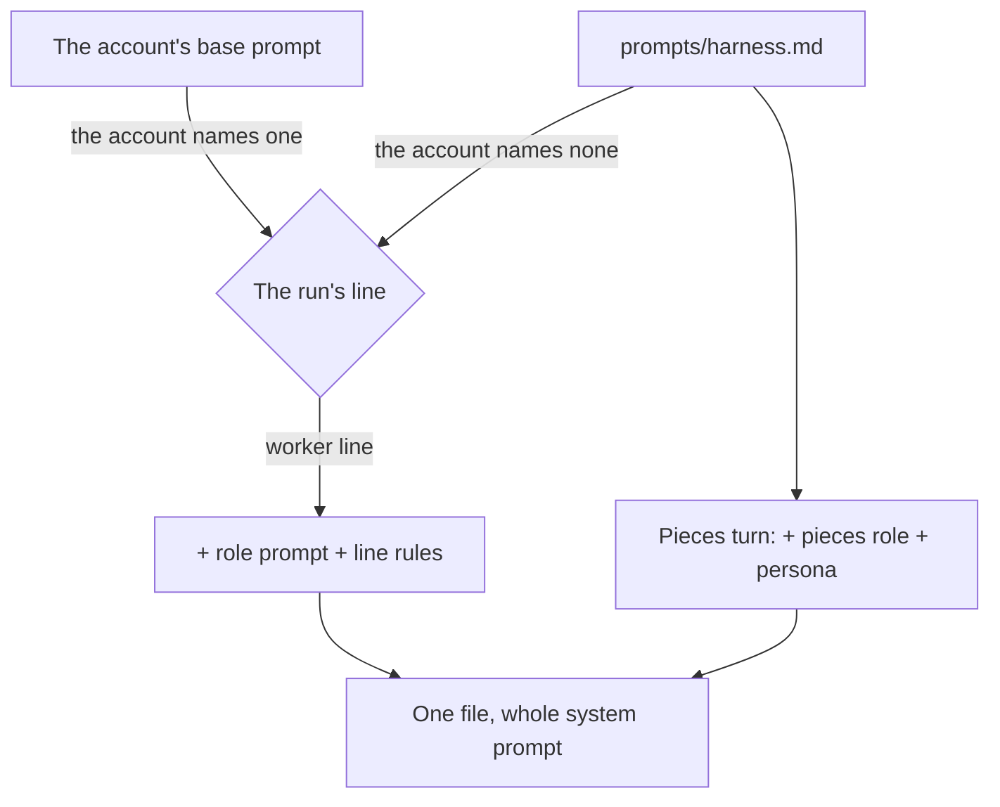

# Base prompts

## The harness layer

- **Every line that runs on Claude Code is handed one whole system prompt,** given with
  `--system-prompt-file` in the place of the program's own, and it opens with a harness layer: what
  the program around the model is, how words reach the agent, where its memory is and how a hosted tool is
  found, true of an agent of any organisation; the platform around it is the platform's rules'
  `environment.md`, which only the lines the platform's rules reach carry (`docs/prompt-layers.md`). Claude
  Code's own prompt reaches no line.
- **The platform's harness opening is agency's own document, `prompts/harness.md`,** read out of the
  deploy tree as each line is composed, like the other agent documents (`docs/agent-documents.md`).
  It is the harness layer of every line on Claude Code whose run goes out on no account naming a base
  prompt.
- **A program that is a harness of its own keeps its own prompt:** on dsh the role and the persona,
  or the worker line's rules, go as the persona suffix after dsh's own prompt, and the platform's
  opening is not sent there (`docs/launch-lines.md`).

## What a base prompt is

- **A whole text a run's system prompt opens with in place of the platform's harness opening.** It is
  for a harness whose own prompt is the opening the model was made to run on and for which the
  platform's opening is the wrong one: dsh's, or an endpoint's own harness.
- **Several are kept, each under a name and a label,** and a Claude account may name one of them. An
  account's base is changed by naming another — a prompt written for another harness, pasted in whole —
  with nothing of the harness or the gateway rewritten.
- **An account's base is the account's answer.** An endpoint account (`docs/cache-fallback.md`, 「The
  Claude Code road is a list of accounts」) runs Claude Code against a model that is not Anthropic's,
  for which the platform's opening is the wrong one, so the account names the prompt its endpoint's own
  harness runs on. Any account may name one.
- **An agent may choose one:** a worker of its own, whose support workers run on its choice, and a
  supervisor whose turns are of the pieces shape. A chosen base stands in the harness opening's place for
  that agent's runs; where neither the agent nor the account a run goes out on names one, the run opens on
  the platform's harness opening.

## What each run is sent

- **A run of the worker line** on an account that names a base prompt is handed one file as its whole
  system prompt: that base, then the role's prompt where the role carries one, then the line's rules —
  the owner's standing rules, the rulebook against destroying the system and the repository's own rules
  where it has them — joined by a blank line (`docs/launch-lines.md`). On an account that names none it
  is handed the platform's harness opening in the base's place, with the same layers after it.
- **A turn of the pieces shape** is sent the base its supervisor chooses, or the platform's harness opening
  where it chooses none, as its harness, then the pieces role whole, then its persona (`docs/supervisors.md`, 「What a turn is given」).
- **The other lines read no base prompt:** the supervisor's harness is the platform's opening, which its
  role and persona follow (`docs/agent-documents.md`, 「A supervisor of the window shape」); the search and browse runners
  and a search's branches open on it before their instructions; the translator and batch runs are
  handed the prompt their caller or their line composes, whole.

## What the harness still adds around it

- **On Claude Code, measured on 2.1.288,** a run handed its whole system prompt as a file still
  sends, around that file:
  - a first system block of its own naming the program, `You are a Claude agent, built on
    Anthropic's Claude Agent SDK.`, in place of the one it opens its own prompt with; no flag takes
    it away;
  - the tools' definitions, each with the instructions for calling it;
  - a system turn at the head of the conversation with the environment — working directory, whether
    it is a git repository, platform, shell, OS version, the model's name — the subagent types and
    skills the run is given, and today's date;
  - the checkout's `CLAUDE.md` as a reminder in the first user turn, where the line reads its
    setting sources.
- **So the prompt holds no value of a run of its own:** the environment reaches the model through
  the program, whether the prompt opens on a base prompt or on the platform's harness opening.

## Values filled in as a run is composed

- **A prompt may name a value a run differs by,** written as `{{name}}`, which is filled in as the
  run is composed:
  - `{{cwd}}` — the folder the run works in;
  - `{{date}}` — today's date on this machine, as `YYYY-MM-DD`;
  - `{{platform}}` — the operating system's platform word, `linux`;
  - `{{os_version}}` — the operating system's name and release;
  - `{{shell}}` — the shell's name;
  - `{{model}}` — the model the run is started on; on an endpoint account whose map names a model for
    that model's family, the endpoint's model it answers on.
- **The names are agency's policy's** (`policy/base-prompts.toml`): the console lists them beside a
  prompt's text as the policy declares them, and the side that composes a run answers each with its
  own reading of the run.
- **Any other `{{word}}` stays as written.**
- **A filled-in value is part of the prompt:** one that changes — the date — changes what the run is
  handed, and with it the prefix the run's session stands on.

## The seeds

- **One prompt is seeded, `dsh`,** from its seed file under `prompts/base/`. No seed reproduces Claude
  Code's own prompt: a run on Claude Code whose account names no base opens on the platform's harness
  opening (「The harness layer」). A prompt a store already keeps under another name is the owner's and
  stands as it is.

### `dsh`

- **`dsh`, labelled DeepSeek Harness based:** the platform's harness opening in dsh's terms — what
  the harness is, how words reach a session, memory and the environment, as `prompts/harness.md` says
  them — then the rules for dsh's own tools from the system prompt dsh sends for a headless coding job
  at the version agency runs it at (`docs/launch-lines.md`), with the values a run differs by written
  as the `{{name}}` values below.
- **What is left out** is the runtime context dsh adds to each request on its own — its sandbox and
  approval policies and the like — since a run on Claude Code is told its environment by the program
  (「What the harness still adds around it」), the model's name, which the harness opening leaves
  unsaid, and the goal tools, which a standing session goes without.
- **Who it is for:** an endpoint account whose model is DeepSeek's names it, so a run of the worker line
  on that account opens on the prompt the model's own harness runs it on.
- **Its text is the seed file `prompts/base/dsh.md`.**

### How a seed reaches the store

- **The deployment declares each seed in agency's policy** (`policy/base-prompts.toml`): its name,
  label and seed file, with no code naming any of them.
- **A seed is given once by its name,** as the store is settled on a start, and recorded as given
  (`base_prompt_seeded`): a store made before a seed was declared gains it on its next start, a prompt
  of that name already kept is left as it stands, and a seed the owner removed stays removed. From then
  on the archive's copy is the owner's, and the file is not read for it again.
- **A seed file that cannot be read** is said as the server starts and not given, so the first start
  that can read it gives it.

## Where it is kept

- **In agency's store** (`base_prompts`, `claude_accounts`):
  - the base prompts: name, label, text, and when and by whom each was last saved;
  - each account's base, a field of the account's own row, empty where it names none.
- **A save overwrites:** a prompt saved replaces its label and text, a prompt removed is gone, and an
  account's base changed replaces the one it named. No earlier value is kept anywhere, so nothing can be
  shown or put back from one.
- **Read afresh for every run,** so a save reaches the next run with no deployment.

## Saving

- **Who may change them:** the owner, through the prompt-document routes (`docs/api.md`,
  「prompt-documents」).
- **What a save is held to,** each refusal a status code with one English sentence and nothing of that save
  written; the name's pattern and the bounds are the policy's:
  - a name of lowercase letters, digits and hyphens beginning with a letter, at most 40 characters,
    unique, and fixed once made;
  - a label of 1 to 60 characters;
  - a text of 1 to 200,000 characters;
  - a prompt an account names is not removed, and the refusal names the accounts;
  - an account's base names a prompt that is kept, or none, set where the account is added or changed
    (`docs/cache-fallback.md`, 「The Claude Code road is a list of accounts」).
- **A save reaches the agents that choose the prompt by a reset, and the accounts by nothing.**
  - The text of a base an agent chooses saved, and an agent's change of choice, ask a reset of every
    session of that agent and of a worker's support workers (`docs/session-resets.md`, 「Where it is
    asked」). Each is carried out as that holder clears a session: a supervisor's through its session's
    handoff, a role's at its next run.
  - Neither an account's base changed nor the text of a base an account names saved writes a reset. A
    run's system-prompt file is named by what it holds, so the next run on that account is handed another
    file, its prefix differs from the one a kept session began on, and the run opens a fresh session
    rather than going on in the old one (`docs/sessions.md`, 「A role's session」).
  - A label alone changes nothing a run is sent.
