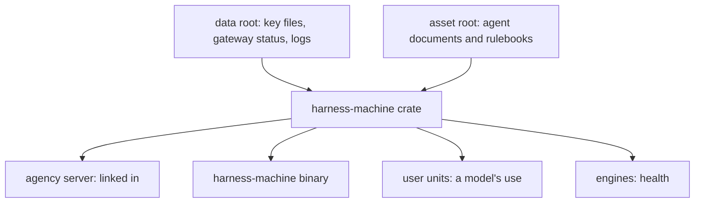

# What the harness reads, writes and starts on this machine

## What it is

- **The machine's part of the registry, the model catalogue and the supervisors,** done in Rust by the
  `harness-machine` crate for every side that needs it:
  - the registered models' key files, written, taken away and checked;
  - the gateway's status, as its launcher last wrote it;
  - the gateway's members, read and validated, with the road each belongs to;
  - an engine's health, asked at a registration's addresses;
  - the arbiter's master, where the deployment names it: a demand for a card asked, read and given back,
    and a service's standing instances and whether a node of its placement is open (「The arbiter's
    master」 below);
  - a model's use on its engine: the unit it runs in, the engine's installer and its log;
  - a pieces-shaped supervisor's system prompt, composed out of the agent documents, and the home each
    supervisor stands in.
- **Agency's server links the crate.** It builds a binary of the same name as well, which answers the
  same questions from a shell.
- **Nothing in it reads the store.** The server reads agency's store and hands the crate what the rows
  hold: an address's key file, a supervisor's settings.

## The keys

- **Where a key agency was given lives:** `env/registered/<registration>-<node>.key` under the data root,
  at `0600`, in a directory made at `0700` where none stands. It is written beside its place and moved
  into it, so a reader finds the old key or the new one and never half of one.
- **What a key may be:** one line with no whitespace, at most 4,096 characters, trimmed of the space
  around it. Anything else is refused with "A key must be one line with no whitespace." and nothing is written.
- **Which key file is usable:** a file of its own, at exactly `0600`, not empty. A file with looser
  permissions counts as none.
- **A key file is taken away only where agency wrote it;** a file an address names that agency did not
  write is left where it is.
- **DeepSeek's key is the road's own file,** `env/deepseek.key` under the data root, at `0600`. Agency
  reads it where the road runs and never writes it.
- **A key reaches the binary on standard input alone,** never as an argument, and nothing the crate
  answers carries one: a write answers the file's name as the address row keeps it.

## The gateway's status

- **What the gateway's launcher last wrote of itself,** under the data root's `llm-gateway/`: the table
  it serves, the one starting, how many old children are still finishing, and when (`docs/own-llm.md`,
  「The gateway」).
- **A file missing or unreadable is no status,** and a field missing reads as none, nothing starting,
  no child finishing and time zero.

## The members

- **Where the file lives:** `<data root>/llm-gateway/members.json`, or the path `BMO_LLM_GATEWAY_MEMBERS`
  names. The deployment seeds it once and owns it afterwards (`docs/own-llm.md`, 「The gateway's
  members」).
- **What a member is held to:** its name and model match the registry's model pattern, its key file the
  registry's key-file pattern, and its road the registry's name pattern; its wait and its window and
  answer ceiling, where it names them, stand within the registry's bounds; its label fits the
  registry's length. A name two members hold is refused.
- **A missing file is no members.** A file that does not read, or a member that fails its rules, is a
  refusal naming the file and the member, and the caller decides whether the last good list stands.
- **By road:** a member names the agent provider it belongs to, and a caller asks for the members of
  one road. A member with no road belongs to no provider and is served by the gateway alone.
- **A member of a road holds its window, its answer ceiling and whether it thinks by default;** a
  caller that runs one refuses a member missing any of them rather than sizing it at a guess.
- **A member may say whether it costs nothing;** one that leaves it out is read by its road's provider
  (`docs/own-llm.md`, 「The gateway's members」).

## An engine's health

- **Asked at each of a registration's addresses in order,** the address's origin with `/health`, under
  the bearer key its key file holds, each ask waiting for its answer. The first that answers with an
  object is the health; an address that refuses or breaks the connection, answers no object, or has no
  readable key is passed over.
- **What it reads of the answer:** the context of the cards it holds now, the model file it serves,
  the requests it has in hand, and why it stands aside and until when. A value of the wrong shape
  reads as none.
- **No address answering is no health,** which every caller reads as nothing known.

## The arbiter's master

- **Where it is:** the address `AGENCY_ARBITER_URL` names, and the token the `CARD_MASTER_TOKEN` entry of
  the settings file `AGENCY_ARBITER_TOKEN_FILE` names, read as `KEY=value` lines by a maintained reader; a
  file that does not read or holds no such entry is no token.
- **What it asks:** `POST /demands` for one card of a service, with the demand it is asked within, the work
  key, a shown reference, a rank and a pool where they are named; `GET /demands/{demandId}` with its answer held
  open up to thirty seconds and asked again by a caller that waits on longer, or with `watch` for a caller
  standing on the card; `DELETE /demands/{demandId}`, a demand the master no longer holds counting as given back;
  `GET /demands`, every demand the master holds, each with its shown reference; and `GET /cluster`, the
  whole picture (the arbiter's `docs/api.md`, 「Demands」 and 「The cluster」).
  Each call waits for the master's answer; its end is that answer, or the connection refused or broken.
- **A demand's card** is the first card it is granted while its state is `granted` and nothing has taken
  it; what it waits on is the master's reason, else the occupant that took its card.
- **A service in the picture** is its standing instances that name an address, each with its node and key
  file, and whether it is open: placed on a node whose link stands and whose every card has no claim and no
  turn or queued ticket of a service of a lower tier than its own.

## A model's use on its engine

- **The unit:** `bmo-model-use-<engine>`, a transient user unit started by `systemd-run`, collected
  once it ends, so a second choice for the same engine is refused while the first stands
  (`docs/model-catalogue.md`, 「Choosing a model for an engine」).
  - It is handed the PATH, the source root and the working directory its caller names, and runs the
    catalogue verb's `run-use` with the choice's number and the archive it was made in, on the bun its
    caller names, and the catalogue verb is agency's (`bmo-agency model`).
  - The user bus is reached as every spawn that asks systemd reaches it: the runtime directory named
    where it is missing, and a disabled session bus address taken off.
  - A start that fails answers what systemd said, which the caller records as the choice's failure.
- **The installer:** the engine's own install script, `<engine>-install.ts --model <entry>`, in the
  gate's training tooling (`training/tooling/scripts/` under the source root), run with
  bun and handed the archive the choice was made in. Its standing output and error are written into
  the choice's log as they come, and the run answers whether it ended well with its last line that
  was not empty. An engine with no installer is a failure naming the installer's path.
- **The log a screen is shown:** the last twenty lines of the choice's log, none where it is missing.

## A supervisor's system prompt

- **Composed exactly as a turn of the pieces shape sends it** (`docs/supervisors.md`, 「What a turn is
  given」; `docs/prompt-layers.md`): its harness at the head — the platform's harness opening where its program
  takes one — then the platform's rulebooks where its layers attach them, its organisation's instructions
  where it has any, the pieces role whole in its fixed order, then its persona unless its layers leave it out,
  joined by a blank line.
- **Read out of the asset root for every call:** the platform's harness opening `prompts/harness.md`, the
  rulebooks under `prompts/rules/` and the platform's under `prompts/platform/`, the frame, turn and tools under `prompts/agents/pieces/`, and the
  `persona.md` of the supervisor's own prompt folder.
- **What the caller hands it:** the supervisor's name; its label and its call names, which the frame tells it
  it is called by (`docs/supervisors.md`, 「What a turn is given」); the prompt folder its supervisor row names
  under `prompts/agents/` or none, the persona its settings hold or none, the model its turn goes out on,
  whether its program takes the platform's harness opening — every program on Claude Code does, and one that
  is a harness of its own does not — and its layers as the caller resolved them: whether the platform's rules
  are attached, the organisation's instructions as composed, and whether the persona is left out. The crate
  composes the organisation's instructions out of the links' texts with the header and end line the prompt
  layers' policy holds, and resolves nothing itself. The crate never derives a prompt folder from the name, and a folder that
  is not one plain name is refused.
- **A prompt's values are filled in here** (`docs/base-prompts.md`, 「Values filled in as a run is
  composed」): the folder it stands in, today's local date, the operating system's name, its
  kernel's name and release, the shell's name and the model. A value the policy names that the
  prompt does not carry changes nothing, and any other `{{word}}` stays as written.
- **The folder:** each supervisor's own under the data root's `supervisor-homes/`. The crate names the
  folder; the runner that starts a turn makes it. The frame names its path only where the layers attach the
  platform's rules, and the prompt layers' words for it otherwise.
- **The persona:** its settings' text, the `persona.md` of its prompt folder, or none where it holds
  neither, as a supervisor added on the console starts with no folder.

## The binary

- **`harness-machine key write <registration> <node>`** reads a key from standard input and prints the
  key file's name; **`key remove <file>`** takes away a key file agency wrote; **`key states`** reads key
  file names from standard input and prints whether each is usable, none or named but not usable.
- **`harness-machine gateway`** prints the gateway's status, or `null`.
- **`harness-machine health`** reads a registration's addresses from standard input and prints the
  health, or `null`.
- **`harness-machine model-use start`** starts a choice's unit, **`model-use install`** runs an engine's
  installer into a log, and **`model-use log`** prints a log's last lines.
- **`harness-machine supervisor-system`** reads a supervisor's settings from standard input, with `label` and
  `callNames` where it holds them, `ownHarness` true where its program is a harness of its own and `layers`
  (`platform`, `organisation`, `personaNone`) where it carries any, and prints the composed system prompt;
  **`supervisor-persona <folder>`** prints the persona the prompt folder's file holds, or nothing where it
  has none.
- **Every answer is one line of JSON on standard output.** A refusal the owner reads ends with status
  2 and its field and sentence as JSON on standard error; any other failure ends with status 1 and
  its reason there.
- **`--data-root` and `--asset-root`** name the roots it reads; the bun side hands its own.

## Stand-ins

- **A test stands the machine in by what it holds, never by replacing a function:**
  - key files written, or not, under the test's scratch data root;
  - a health answered by a stand-in engine on the loopback;
  - a stand-in `systemd-run` on the `PATH`, and a stand-in installer under a scratch source root;
  - agent documents under the test's scratch asset root.
