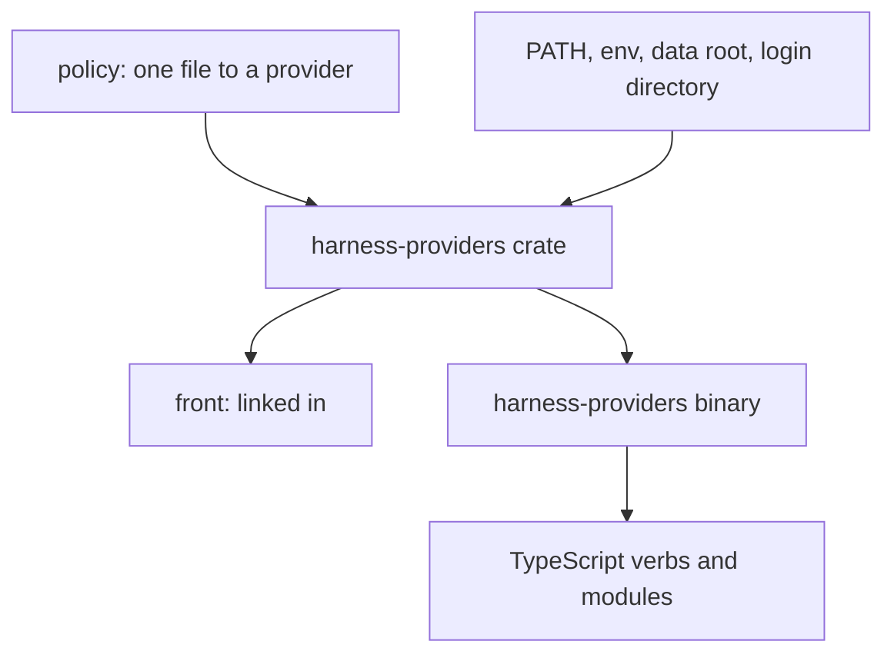

# What a harness provider answers on this machine

## What it is

- **Two questions each provider answers about this machine:** whether it can answer here at all, and
  which models it offers. Both are the machine's facts, read in Rust by the `harness-providers`
  crate for every side that asks.
- **Two more each provider answers about itself in the same crate,** for the front:
  - which of the usage windows its slot reported stand for its session and its week — Claude Code's
    five-hour and seven-day windows, Codex's primary and secondary, none for a provider that
    publishes none;
  - whether it holds logins of its own: Claude Code alone, whose logins are its accounts;
  - the entry its login home holds, by which a folder under the data root's `env/` is told as one and
    passed over when the saved values are read for a record's secrets (`docs/agent-control.md`, 「A record
    holds no secret」): Claude Code's `.claude.json`, none for a provider that holds no login home.
- **What each provider is** — its label, its lines, its effort words, the sentence it says where it is
  missing, where its catalogue is read, whether its engine is the owner's own — is its own file of agency's
  policy (`policy/providers/`); whether its models are the registry's registrations is its own member's
  answer. A consumer reads them, with whether the owner has each on (`docs/api.md`, 「providers, models and
  model files」).
- **Whether its engine is the owner's own** is a declaration every provider's file makes, none left to a
  default: an engine of the registry's registrations, and Claude Code on the owner's own logins, are the
  owner's own; a road that hands what it reads to an outside service, Codex, OpenRouter and DeepSeek among
  them, is not. A new provider declares it in its own file, and nothing else reads it off another of its
  answers (`docs/supervisors.md`, 「What confines a session allowed files」).
- **Agency's server links the crate;** the TypeScript that asks — the verbs and the provider
  modules they import — runs its binary of the same name, out of the deploy tree's `bin/`. Where the
  deploy tree holds none — code running out of a checkout — it runs the checkout's own debug build,
  out of the target directory Cargo builds the checkout into: the one `CARGO_TARGET_DIR` names, else the
  checkout's `target/`. A test builds none: one that asks stands the copy Cargo built before the tests
  in its own home's deploy tree.
- **What a provider answers out of the store** — the registry's registrations — is read by each side
  from agency's store, as every row is.

## Whether a provider can answer here

- **Claude Code** always can: whether one of its logins answers is the account walk's judgement
  (`docs/cache-fallback.md`, 「The Claude Code road is a list of accounts」).
- **Codex, OpenRouter and DeepSeek** can where the gateway's key file and at least one member of their road
  stand, and every member's own key file under the data root's `env` directory is private to its owner and
  not empty. A member road holds no login of its own.
- **The registered models** can where the gateway's key file stands private under the data root's
  `env` directory: a file of its own, mode 0600, not empty.
  - Past that, each side asks agency's store for an offered registration — one with an address, or one
    naming a card service the arbiter's master places, whether or not an instance of it stands at that
    moment — and says the policy file's sentence for the store it lacks or the registration none is.
- **DeepSeek** can where the road's key file stands private under the data root's `env` directory, as
  the registered models' does. Its API is not asked: the key's presence is the machine's fact.
- **A provider that cannot answer** says why twice over, both from its policy file: a kebab-case code a
  screen words in its own language, such as `openrouter-key-unset`, and the English sentence the log and
  the machine's output keep. Every route that answers a provider's reason answers its code beside it.
- **Presence is the first of the questions a run's road judgement asks.** Whether a provider can answer
  now adds the owner's switch on it and what its member declares beside presence — a balance it offers,
  read above zero for a model that costs, and the logins it holds, one of them open — and a run's road is
  judged on those answers and its quota alone (`docs/cache-fallback.md`, 「Availability: whether a provider
  can answer now」, `docs/provider-order.md`, 「Whether a road can answer」). A provider whose balance is
  spent says where its member says it is topped up, from its own policy file.

## Which models a provider offers

- **Codex, OpenRouter and DeepSeek:** the members of their road, each with its window, answer ceiling and
  thinking default. The installed Codex CLI's catalogue and the public OpenRouter listing are still read for
  the chooser that declares a member; neither is what a run is offered.
- **Claude Code:** the catalogue the CLI keeps under the configuration directory of the login the caller
  names (`docs/provider-order.md`, 「The Claude catalogue」).
  - The newest fetch among the files of the surface answers, and an unreadable neighbour is passed over.
  - A directory with no such file, nothing that parses, or a catalogue naming no model is a refusal.
  - Each model carries its id, whether the CLI serves it or has superseded it, and the efforts its entry
    names; the catalogue carries when it was fetched and when the CLI holds it stale.
- **The registered models:** the offered registrations, each with an address or naming a card service,
  out of the archive.

## The binary

- **`harness-providers presence --data-root <dir>`** prints one line of JSON: every provider the build
  carries, with the sentence it says as `missing` and its code as `missingCode`, both none where it
  can answer.
- **`harness-providers models <provider>`** prints the provider's catalogue as JSON;
  `--config-dir <dir>` names the login's directory for Claude Code. A listing that fails ends with a
  non-zero status and its reason on the standard error.
- **Nothing it does writes:** it reads the machine and answers.
- **One reading answers for a second.** A screen asks every provider for every order it shows at once, so
  the bun side keeps a presence reading for a second for the environment and data root it was asked
  in, and asks again after that; a reading that failed is not kept.

## Stand-ins

- **A test stands a provider in by what the machine holds, never by replacing a function,** so a
  TypeScript test and the server read the same stand-in:
  - a stand-in `codex` on the `PATH` that prints a catalogue;
  - the gateway's key file written, or not, under the test's scratch data root;
  - the OpenRouter key in the environment, or not;
  - the listing's stand-in address in `BMO_OPENROUTER_LISTING_URL`;
  - a balance's stand-in address in `BMO_DEEPSEEK_BALANCE_URL` or `BMO_OPENROUTER_BALANCE_URL`, and the
    stand-in address of OpenRouter's request allowance in `BMO_OPENROUTER_REQUESTS_URL`
    (`docs/usage-windows.md`, 「Balances」);
  - a catalogue file under the login's configuration directory.
