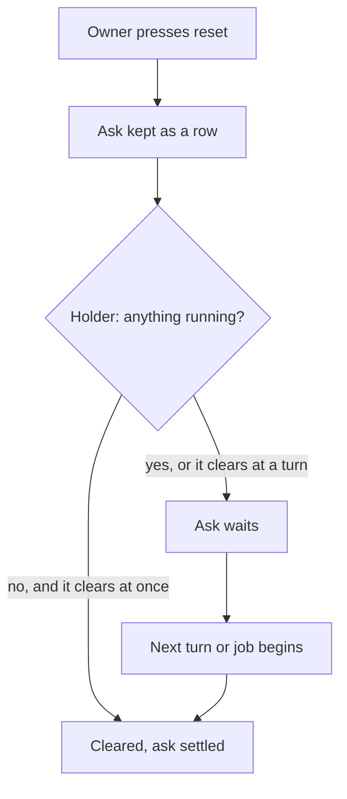

# Clearing an agent's session

## What a reset is

- **An ask to start an agent's session afresh,** made by the owner. It is kept as a row of
  agency's `session_resets` table: the agent, the room where the session is one room's, who asked,
  when and why, whether it starts clean, and when it was carried out.
- **A reset is clean or carries a note.** A supervisor's session sleeps before it goes either way: one
  more turn consolidates its brain. A clean reset — the console's "Reset session" — writes no handoff note, and
  the next session opens on nothing carried over: no note, no transcript and no word that memory was
  lost. A reset that is not clean — the console's handover of a room's session, a save of the
  generation settings, a base prompt — is carried out by the session's handover, whose note the next
  session opens on. Neither touches a room's record: no message, file or minutes is deleted or hidden.
- **`POST /session-reset`** takes `agent`, `chatId` where the session is one room's, `by`, who asked,
  and `clean`, false where it is not named; it answers the session as it stands after, and 400 with
  `field` `session` where the agent holds no such session.
- **It never cuts a turn.** A session is cleared by its own holder at a point where nothing of it
  runs: where a turn or a job of it is running, the reset waits for that one to end and is carried
  out as the next one begins.
- **One ask waits for a session at a time.** An ask for a session that already has one waiting is
  the same ask, and adds no row; a clean ask makes the waiting one clean.
- **The old session is kept, never deleted:** the program's own record of it stays where the
  program wrote it, and whatever the holder keeps of its turns stays under it. Only a supervisor's
  reset of its conversation deletes sessions, and that is a reset of its own (below).

## Who holds a session, and how each clears it

- **Each kind of agent that holds a session answers for it:** which sessions it holds now, with what
  a reset of each would clear, and how it carries a reset out. Nothing outside it knows where a kind
  keeps its sessions.
- **The session routes are agency's** (`docs/api.md`, 「Sessions」): its control routes read the list
  and write the asks, and agency, which holds every program standing in a pane, carries them out.

- **A supervisor of the `agent` scope:** the one session every room's rounds go on in (`unified-bmo.md`).
  - A reset is the chat's forced replacement: the next round asks the receiver's handoff while agency
    still names the session, lets it go, and opens a new one on the note, as every replacement does
    (`docs/sessions.md`, 「A restart hands the session over」). A clean reset asks the handoff `clean`,
    so the session consolidates and writes no note, and the new session opens on none.
  - That round settles the ask.
- **A role:** the sessions kept for it, one for each path, provider and model its runs went out on
  (`docs/sessions.md`, 「A role's session」), or those of one path where the ask names one.
  - Where no run of it holds one of them, a reset removes those records at once and is settled, so its
    next run opens a new session.
  - Where a run holds one, the ask waits for that run to end, and the record it gives back is removed
    rather than kept.
  - Agency carries a role's reset out, since it holds the records and knows which runs go: once an ask
    is written, every waiting ask none of whose sessions a run holds is carried out before the route
    answers, and so is it on a script's `session-resets` word (`docs/api.md`, 「Events」).
- **A supervisor of the `room` scope in a room:** that room's session, cleared by its handover
  (`docs/supervisors.md`, 「Clearing it」).
  - Once an ask is written, every waiting ask of a room session that holds a harness session owes
    that session's handover: the session consolidates and writes its note in one more turn, the new
    generation opens on it and the ask is settled, at once where the room carries no turn and
    otherwise once its turn ends or at the head of its next one. A clean ask's one more turn
    consolidates and writes no note, and the new generation opens holding none.
  - The resident program standing on the cleared session is taken down once the handover is made
    (`docs/supervisors.md`, 「The program on an ended session」).
  - A room whose session holds no harness session has nothing to hand over, and its next turn opens
    the new generation and settles the ask.

## A session boundary is what applies a new chat tool

- **A restart is not a tool-list boundary.** A deployment or a receiver restart leaves the standing
  chat session as it is. The console's reset of that chat session (`POST /session-reset`) closes the
  conversation and opens a new one, but a program already standing in the pane keeps the MCP servers
  it was started with; on dsh the tool list belongs to that program.
- **What really applies a newly named server is the chat program stood again:** its pane process
  ends and the next turn stands a new one from the configuration. A session reset alone does not
  replace the program, and neither does restarting the receiver; the program is what reads the
  server list.

## Where it is asked

- **The console:** the agent settings' session list holds every session there is, one row each, and
  a supervisor's settings hold a reset for each of its room sessions, both read from agency's session
  routes. Before anything is
  asked, a confirmation says in one line what the reset clears and whether it waits for a running
  turn or job.
- **A supervisor's generation settings** ask it of every room session of that supervisor as they are
  saved (`docs/supervisors.md`, 「Its generation settings」).
- **A supervisor's reset with its conversation range** ends that supervisor's room sessions itself,
  and records each as an ask carried out at that moment, settling any ask still waiting for it
  (`docs/supervisors.md`, 「Starting it afresh」).
- **A base prompt** asks it of every session of each agent that chooses it, as its text is saved,
  and an agent's change of choice asks it of that agent's (`docs/base-prompts.md`, 「Saving」).
- **Who may ask:** the owner, signed in to the console; the ask is recorded under the owner's name.

## What the record shows

- **Every ask stays,** waiting or carried out. The session list shows a waiting ask on its session,
  and the last time each session was cleared.
